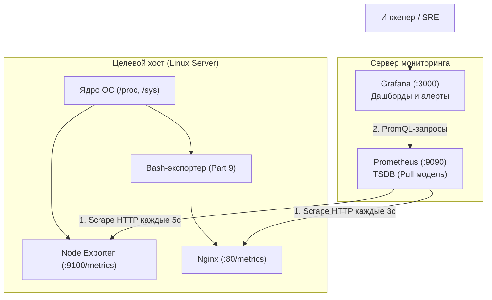

# Linux Monitoring v2.0 (DO4) — Полный технический справочник и мастер-руководство

> [!NOTE]
> Данный справочник представляет собой **структурированную инженерную базу знаний** по проекту DO4.  
> Здесь собраны архитектурные паттерны, физика системных вызовов ядра Linux, регулярные выражения (ERE), детальный разбор утилит (`awk`, `date`, `sort`, `find`, `df`, `iperf3`, `stress`), сетевые протоколы и спецификации мониторинга (**Prometheus + Grafana + Nginx + GoAccess**).
> 
> **Цель руководства:** дать исчерпывающее понимание инструментов и механизмов, чтобы писать код самостоятельно, осознанно и без необходимости искать базовые вещи на стороне.

---

## Содержание

- [Linux Monitoring v2.0 (DO4) — Полный технический справочник и мастер-руководство](#linux-monitoring-v20-do4--полный-технический-справочник-и-мастер-руководство)
  - [Содержание](#содержание)
  - [1. Архитектурный стандарт проекта DO4](#1-архитектурный-стандарт-проекта-do4)
    - [1.1. Модульная декомпозиция и единая точка входа (`main.sh`)](#11-модульная-декомпозиция-и-единая-точка-входа-mainsh)
    - [1.2. Определение пути скрипта через `BASH_SOURCE`](#12-определение-пути-скрипта-через-bash_source)
    - [1.3. Подключение модулей через `source`](#13-подключение-модулей-через-source)
    - [1.4. Паттерн Guard Clauses (Защитные барьеры)](#14-паттерн-guard-clauses-защитные-барьеры)
    - [1.5. Потоки вывода (stdout vs stderr) и коды возврата](#15-потоки-вывода-stdout-vs-stderr-и-коды-возврата)
    - [1.6. Золотые правила ERE-регулярок в переменных Bash](#16-золотые-правила-ere-регулярок-в-переменных-bash)
  - [2. Часть I: Файловая система и генерация данных (Part 1, 2, 3)](#2-часть-i-файловая-система-и-генерация-данных-part-1-2-3)
    - [2.1. Регулярные выражения для валидации параметров](#21-регулярные-выражения-для-валидации-параметров)
    - [2.2. Манипуляции со строками (Bash Parameter Expansion)](#22-манипуляции-со-строками-bash-parameter-expansion)
    - [2.3. Алгоритм генерации имён с сохранением алфавитного порядка](#23-алгоритм-генерации-имён-с-сохранением-алфавитного-порядка)
    - [2.4. Выделение дискового пространства (`fallocate`, `truncate`, `dd`)](#24-выделение-дискового-пространства-fallocate-truncate-dd)
    - [2.5. Контроль свободного места и ловушка сдвига колонок `df`](#25-контроль-свободного-места-и-ловушка-сдвига-колонок-df)
    - [2.6. Продвинутый поиск, фильтрация и удаление (`find`)](#26-продвинутый-поиск-фильтрация-и-удаление-find)
  - [3. Часть II: Веб-логи и потоковый анализ данных (Part 4, 5, 6)](#3-часть-ii-веб-логи-и-потоковый-анализ-данных-part-4-5-6)
    - [3.1. Спецификация Combined Log Format (Nginx / Apache)](#31-спецификация-combined-log-format-nginx--apache)
      - [Анатомия столбцов в `awk` (разделитель — пробел):](#анатомия-столбцов-в-awk-разделитель--пробел)
    - [3.2. Коды состояния HTTP и их смысловые описания](#32-коды-состояния-http-и-их-смысловые-описания)
    - [3.3. Моделирование логов: IP, массивы, случайные числа и время (Part 4)](#33-моделирование-логов-ip-массивы-случайные-числа-и-время-part-4)
      - [1. Арифметика `$RANDOM` и остатка от деления `%`](#1-арифметика-random-и-остатка-от-деления-)
      - [2. Работа с массивами в Bash](#2-работа-с-массивами-в-bash)
      - [3. Раскрытие скобок (Brace Expansion)](#3-раскрытие-скобок-brace-expansion)
      - [4. Строгая хронология времени (Unix Epoch Timestamp)](#4-строгая-хронология-времени-unix-epoch-timestamp)
    - [3.4. Глубокое погружение в `awk` (Part 5)](#34-глубокое-погружение-в-awk-part-5)
      - [1. Модель исполнения `awk`:](#1-модель-исполнения-awk)
      - [2. Структура программы в `awk`:](#2-структура-программы-в-awk)
    - [3.5. Реализация 4 режимов мониторинга через `awk`](#35-реализация-4-режимов-мониторинга-через-awk)
      - [Режим 1: Все записи, отсортированные по коду ответа](#режим-1-все-записи-отсортированные-по-коду-ответа)
      - [Режим 2: Все уникальные IP, встречающиеся в записях](#режим-2-все-уникальные-ip-встречающиеся-в-записях)
      - [Режим 3: Все запросы с ошибками (коды 4xx и 5xx)](#режим-3-все-запросы-с-ошибками-коды-4xx-и-5xx)
      - [Режим 4: Все уникальные IP среди ошибочных запросов](#режим-4-все-уникальные-ip-среди-ошибочных-запросов)
    - [3.6. Архитектура и поиск логов в модуле `05/`](#36-архитектура-и-поиск-логов-в-модуле-05)
      - [1. Модульная декомпозиция `05/`:](#1-модульная-декомпозиция-05)
      - [2. Как скрипт `05/` должен находить логи из `04/`:](#2-как-скрипт-05-должен-находить-логи-из-04)
      - [3. Защитный барьер (Guard Clause) на отсутствие файлов логов:](#3-защитный-барьер-guard-clause-на-отсутствие-файлов-логов)
      - [4. Встроенная команда `compgen` (Zero-Fork интроспекция и проверка масок)](#4-встроенная-команда-compgen-zero-fork-интроспекция-и-проверка-масок)
    - [3.7. Тонкости утилиты `sort` (Сортировка строго по столбцу)](#37-тонкости-утилиты-sort-сортировка-строго-по-столбцу)
    - [3.8. Интерактивный анализ и веб-отчёты с `goaccess` (Part 6)](#38-интерактивный-анализ-и-веб-отчёты-с-goaccess-part-6)
      - [1. Установка:](#1-установка)
      - [2. Сопоставление с 4 вопросами Part 5 и P2P-защита:](#2-сопоставление-с-4-вопросами-part-5-и-p2p-защита)
      - [3. Режимы запуска GoAccess:](#3-режимы-запуска-goaccess)
      - [4. Разбор типичных ошибок запуска:](#4-разбор-типичных-ошибок-запуска)
      - [5. Как открыть `report.html` на локальной машине:](#5-как-открыть-reporthtml-на-локальной-машине)
      - [6. Архитектура скрипта `06/main.sh`:](#6-архитектура-скрипта-06mainsh)
  - [4. Часть III: Системный мониторинг и сетевой стек (Part 7, 8, 9)](#4-часть-iii-системный-мониторинг-и-сетевой-стек-part-7-8-9)
    - [4.1. Архитектура Prometheus + Node Exporter + Grafana](#41-архитектура-prometheus--node-exporter--grafana)
    - [4.2. Настройка сети виртуальных машин (VirtualBox / WSL2 / Linux Host)](#42-настройка-сети-виртуальных-машин-virtualbox--wsl2--linux-host)
      - [1. Доступ к веб-интерфейсам с локального компьютера (хоста):](#1-доступ-к-веб-интерфейсам-с-локального-компьютера-хоста)
      - [2. Связка двух виртуальных машин для теста `iperf3` (Part 8):](#2-связка-двух-виртуальных-машин-для-теста-iperf3-part-8)
    - [4.3. Пошаговая установка и запуск сервисов](#43-пошаговая-установка-и-запуск-сервисов)
      - [1. Установка Node Exporter:](#1-установка-node-exporter)
      - [2. Установка и настройка Prometheus:](#2-установка-и-настройка-prometheus)
      - [3. Установка Grafana:](#3-установка-grafana)
    - [4.4. Настройка Grafana: подключение Prometheus и создание 4 дашбордов](#44-настройка-grafana-подключение-prometheus-и-создание-4-дашбордов)
      - [Шаг 1: Подключение Prometheus в Grafana](#шаг-1-подключение-prometheus-в-grafana)
      - [Шаг 2: Создание собственного дашборда с 4 панелями (Part 7)](#шаг-2-создание-собственного-дашборда-с-4-панелями-part-7)
      - [Шаг 3: Экспорт дашборда в `07/dashboard.json`](#шаг-3-экспорт-дашборда-в-07dashboardjson-сохранение-в-репозиторий)
      - [Шаг 4: Архитектура и реализация скрипта `07/main.sh`](#шаг-4-архитектура-и-реализация-скрипта-07mainsh)
    - [4.5. Язык PromQL: анатомия запросов для метрик](#45-язык-promql-анатомия-запросов-для-метрик)
      - [Разбор ключевых PromQL выражений:](#разбор-ключевых-promql-выражений)
    - [4.6. Нагрузочное тестирование (`stress` и Part 2), чтение графиков и P2P-защита](#46-нагрузочное-тестирование-stress-и-part-2-чтение-графиков-и-p2p-защита)
      - [Тест 1: Запуск скрипта засорения файловой системы (`Part 2`)](#тест-1-запуск-скрипта-засорения-файловой-системы-part-2)
      - [Тест 2: Запуск утилиты `stress`](#тест-2-запуск-утилиты-stress)
      - [3. Шпаргалка для P2P-защиты Part 7 (Вопросы проверяющего)](#3-шпаргалка-для-p2p-защиты-part-7-вопросы-проверяющего)
    - [4.7. Готовые дашборды Grafana (ID 1860) и сетевой тест `iperf3` (Part 8)](#47-готовые-дашборды-grafana-id-1860-и-сетевой-тест-iperf3-part-8)
      - [1. Импорт официального дашборда Node Exporter Full (ID 1860):](#1-импорт-официального-дашборда-node-exporter-full-id-1860)
      - [2. Запуск сетевого тестирования через `iperf3`:](#2-запуск-сетевого-тестирования-через-iperf3)
    - [4.8. Собственный экспортер метрик на Nginx + Bash (Part 9)](#48-собственный-экспортер-метрик-на-nginx--bash-part-9)
      - [1. Текстовый формат спецификации Prometheus (Exposition Format 0.0.4):](#1-текстовый-формат-спецификации-prometheus-exposition-format-004)
      - [2. Получение точных системных метрик средствами ядра Linux:](#2-получение-точных-системных-метрик-средствами-ядра-linux)
      - [3. Настройка Nginx для отдачи метрик (`/etc/nginx/sites-available/default`):](#3-настройка-nginx-для-отдачи-метрик-etcnginxsites-availabledefault)
      - [4. Архитектура скрипта экспортера (Атомарная запись):](#4-архитектура-скрипта-экспортера-атомарная-запись)
      - [5. Оформление скрипта в системный сервис Systemd:](#5-оформление-скрипта-в-системный-сервис-systemd)
      - [6. Переключение Prometheus на свой экспортер:](#6-переключение-prometheus-на-свой-экспортер)
      - [7. Нагрузочное тестирование и верификация собственного экспортера:](#7-нагрузочное-тестирование-и-верификация-собственного-экспортера)
  - [5. Сводная таблица системных граблей и ловушек (Gotchas \& Traps)](#5-сводная-таблица-системных-граблей-и-ловушек-gotchas--traps)

---

## 1. Архитектурный стандарт проекта DO4

В DO4 скрипты перестают быть простыми утилитами вывода текста — они активно модифицируют диск, анализируют логи и эмулируют сервисы мониторинга. Грамотная модульная архитектура защищает от ошибок и упрощает защиту на P2P.

### 1.1. Модульная декомпозиция и единая точка входа (`main.sh`)
Каждое задание декомпозируется минимум на 3 функциональных файла:
* **`main.sh`** — входная точка. Содержит только инициализацию путей, директивы `source` и последовательный вызов функций.
* **`validate.sh`** — изолированная проверка аргументов командной строки (Guard Clauses).
* **`generator.sh`** / **`parser.sh`** / **`clean.sh`** — чистые алгоритмические функции без побочных эффектов или модули выполнения операций.

---

### 1.2. Определение пути скрипта через `BASH_SOURCE`
Чтобы скрипт корректно находил свои модули при запуске из любой рабочей директории системы, в начале `main.sh` всегда используется каноническая конструкция:

```bash
DIR="$(cd "$(dirname "${BASH_SOURCE[0]}")" && pwd)"
```
* `${BASH_SOURCE[0]}` — системный массив Bash. Нулевой индекс указывает точный путь к исполняемому файлу (в отличие от `$0`, который при `source` может указывать на имя родительского шелла).
* `dirname` — отрезает имя самого файла.
* `cd ... && pwd` — переходит в каталог и возвращает его **абсолютный путь**, разрешая любые относительные переходы (`.`, `..`).
* Кавычки `"$DIR/..."` защищают от поломки пути при наличии пробелов в названиях каталогов.

---

### 1.3. Подключение модулей через `source`
```bash
source "$DIR/validate.sh"
source "$DIR/generator.sh"
```
* Команда `source` (синоним точки `.`) читает файл и загружает функции в **текущее адресное пространство процесса шелла**.
* *В чем отличие от запуска `./validate.sh`?* Прямой запуск запускает скрипт в отдельном дочернем процессе (subshell), чьи переменные и функции уничтожаются сразу при выходе. `source` оставляет все функции доступными для `main.sh`.

---

### 1.4. Паттерн Guard Clauses (Защитные барьеры)
Вместо лесенок из глубоко вложенных `if ... else ... if` все проверки строятся по принципу отсечения ошибок на входе:
> *«Если параметр НЕ соответствует правилу $\to$ выводим ошибку и немедленно выходим (`exit 1`). Если соответствует $\to$ идём дальше»*.

Это делает код плоским, читаемым и легко тестируемым.

---

### 1.5. Потоки вывода (stdout vs stderr) и коды возврата
* **Стандартный вывод (stdout, fd 1):** предназначен для полезных данных скрипта (результаты работы, сгенерированные имена, отчёты).
* **Стандартный поток ошибок (stderr, fd 2):** предназначен для сообщений о сбоях. Перенаправление выполняется через **`>&2`**:
  ```bash
  echo "Error: Invalid argument count" >&2
  exit 1
  ```
* **Разница между `exit` и `return`:**
  * `exit 1` — полностью убивает текущий процесс скрипта (применяется при фатальных ошибках валидации).
  * `return 1` — завершает выполнение **только текущей функции** и возвращает статус ошибки вызывающему коду.

---

### 1.6. Золотые правила ERE-регулярок в переменных Bash
При использовании оператора `=~` внутри `[[ ... ]]`:
1. Регулярное выражение выносится в отдельную переменную:
   ```bash
   re='^[0-9]+$'
   if [[ "$val" =~ $re ]]; then ...
   ```
2. **Переменная с регуляркой справа НИКОГДА не оборачивается в кавычки!**
   * Правильно: `[[ "$val" =~ $re ]]` (Bash включает движок ERE).
   * Ошибка: `[[ "$val" =~ "$re" ]]` (Bash выключает движок регулярок и ищет буквальное совпадение символов `^`, `+`, `$`).

---

## 2. Часть I: Файловая система и генерация данных (Part 1, 2, 3)

### 2.1. Регулярные выражения для валидации параметров
* **Абсолютный путь:** `^/` (начинается со слеша).
* **Положительное целое число:** `^[1-9][0-9]*$`
* **Набор букв английского алфавита:** `^[a-zA-Z]{1,7}$`
* **Шаблон файла с расширением:** `^[a-zA-Z]{1,7}\.[a-zA-Z]{1,3}$`
* **Размер файла с суффиксом:** `^[1-9][0-9]*(kb|Mb)$`

---

### 2.2. Манипуляции со строками (Bash Parameter Expansion)

* **Длина строки:** `${#string}`
* **Извлечение подстроки по смещению:** `${string:offset:length}`
  * `${string:0:1}` — первый символ.
  * `${string: -1}` — последний символ (**пробел перед минусом обязателен**, иначе сработает оператор дефолтного значения `${var:-def}`).
* **Удаление подстрок по маске:**
  * `${filename%.*}` — отрезает кратчайшее совпадение с конца (имя без расширения).
  * `${filename##*.}` — отрезает длиннейшее совпадение с начала (только расширение).

---

### 2.3. Алгоритм генерации имён с сохранением алфавитного порядка
Требование Школы 21: длина имени должна быть не менее 4 символов (Part 1) или 5 символов (Part 2). Если задано меньше букв (например, `a`), мы обязаны дополнять имя повторением знаков так, чтобы сохранялся алфавитный порядок сортировки.

**Физика алгоритма:**
1. Если базовый набор символов короче целевой длины `MIN_LEN`:
   Берется последний символ переданного набора `${chars: -1}` и дублируется до достижения нужной длины.
2. Для каждого последующего элемента к текущему суффиксу добавляется ещё один дубликат последнего символа:
   * Исходные буквы: `az` $\to$ база: `azzz` $\to$ шаг 1: `azzz` $\to$ шаг 2: `azzzz` $\to$ шаг 3: `azzzzz`.
   * При сортировке `ls` файлы встанут строго по алфавиту: `azzz`, `azzzz`, `azzzzz`.

---

### 2.4. Выделение дискового пространства (`fallocate`, `truncate`, `dd`)

| Утилита | Системный вызов ядра | Реальное выделение блоков на диске | Скорость | Поведение в WSL2 / VirtualBox |
|---|---|---|---|---|
| **`fallocate -l 10M file`** | `fallocate(2)` | **Да** (preallocation) | Мгновенно ($O(1)$) | Может выдавать `Operation not supported` на файловых системах-мостах (`9p`, `vboxsf`). |
| **`truncate -s 10M file`** | `ftruncate(2)` | **Нет** (Sparse file, разреженный) | Мгновенно ($O(1)$) | Работает везде. Реальное место на диске **не расходуется**. |
| **`dd if=/dev/zero of=file bs=1M count=10`** | `write(2)` | **Да** (физическая запись нулей) | Медленно ($O(N)$, упирается в диск) | Работает везде, но тратит ресурс SSD/диска. |

> [!TIP]
> **Паттерн надежности для DO4:**
> ```bash
> fallocate -l "${size}M" "$filepath" 2>/dev/null || truncate -s "${size}M" "$filepath"
> ```

---

### 2.5. Контроль свободного места и ловушка сдвига колонок `df`

* **Ловушка:** В зависимости от длины имени устройства в первой колонке (`/dev/mapper/...`), `df -h /` может переносить вывод на 2 строки или сдвигать номера колонок в `awk`. Из-за этого `$4` внезапно возвращает `12%` вместо мегабайт, и скрипт падает: `[: 1%: integer expression expected`.
* **Надежное инженерное решение:** Использовать флаг `--output=avail`:
  ```bash
  avail_mb=$(df --output=avail -m / | tail -n 1 | tr -d ' ')
  if [ "$avail_mb" -le 1024 ]; then
      echo "Threshold reached: <= 1GB left"
      break
  fi
  ```

---

### 2.6. Продвинутый поиск, фильтрация и удаление (`find`)

* **Защита от зацикливания ядра (`-prune`):**
  Псевдофайловые системы ядра (`/proc`, `/sys`, `/dev`, `/run`) не содержат физических файлов на диске — это виртуальные структуры структур ядра. Сканировать их скриптом бессмысленно и опасно (зависание или переполнение буферов):
  ```bash
  find / \( -path '/proc' -o -path '/sys' -o -path '/dev' -o -path '/run' -o -path '/mnt' \) -prune -o -type d -writable -print
  ```
* **Поиск по диапазону дат (`-newermt`):**
  ```bash
  find / -newermt "2026-09-28 10:00" ! -newermt "2026-09-28 11:30"
  ```
* **Каскадное удаление родительских папок:**
  Флаг `-depth` заставляет `find` обрабатывать содержимое папки **до** самой папки (Post-order traversal). Это исключает ошибку `Directory not empty`.

---

## 3. Часть II: Веб-логи и потоковый анализ данных (Part 4, 5, 6)

### 3.1. Спецификация Combined Log Format (Nginx / Apache)

Стандарт Combined Log Format — это классический текстовый протокол журналирования веб-серверов. Каждая строка представляет собой одно HTTP-событие:

```text
$remote_addr - $remote_user [$time_local] "$request" $status $body_bytes_sent "$http_referer" "$http_user_agent"
```

Пример реальной строки:
```text
36.105.158.92 - - [23/Sep/2026:00:00:45 +0300] "GET /static/style.css HTTP/1.1" 501 3860 "https://yandex.ru" "Mozilla"
```

#### Анатомия столбцов в `awk` (разделитель — пробел):
| Переменная | Поле | Пример | Описание |
|---|---|---|---|
| `$1` | IP-адрес клиента | `36.105.158.92` | IPv4 адрес хоста |
| `$2` | RFC 1413 identity | `-` | Устаревший протокол идентификации (всегда `-`) |
| `$3` | `$remote_user` | `-` | Имя пользователя при HTTP Basic Auth (если нет — `-`) |
| `$4` | Дата и время | `[23/Sep/2026:00:00:45` | Включает открывающую скобку `[` |
| `$5` | Таймзона | `+0300]` | Смещение часового пояса и закрывающая скобка `]` |
| `$6` | Метод HTTP | `"GET` | Включает открывающую кавычку `"` |
| `$7` | URI запроса | `/static/style.css` | Запрошенный ресурс |
| `$8` | Версия протокола | `HTTP/1.1"` | Включает закрывающую кавычку `"` |
| `$9` | **HTTP Status Code** | **`501`** | **Код ответа сервера (число от 100 до 599)** |
| `$10` | Размер тела ответа | `3860` | Количество переданных байт данных |
| `$11` | HTTP Referer | `"https://yandex.ru"` | URL страницы-источника перехода |
| `$12..$NF` | User-Agent | `"Mozilla"` | Идентификатор браузера / клиента |

---

### 3.2. Коды состояния HTTP и их смысловые описания

> [!IMPORTANT]
> **Обязательное требование Part 4:** в комментариях к коду указать точное назначение каждого из 10 кодов:

* **200 (OK):** Запрос успешно обработан, сервер возвращает запрошенные данные.
* **201 (Created):** Запрос выполнен успешно, и в результате создан новый ресурс (`POST`/`PUT`).
* **400 (Bad Request):** Синтаксическая ошибка в запросе клиента, сервер не может его разобрать.
* **401 (Unauthorized):** Требуется аутентификация пользователя (неверные или отсутствующие учетные данные).
* **403 (Forbidden):** Запрос понятен, но сервер отказывается его выполнять из-за ограничений прав доступа.
* **404 (Not Found):** Запрашиваемый ресурс не найден по указанному URL.
* **500 (Internal Server Error):** Внутренняя непредвиденная ошибка на стороне логики веб-сервера.
* **501 (Not Implemented):** Метод запроса не поддерживается сервером и не может быть обслужен.
* **502 (Bad Gateway):** Сервер, действуя как шлюз или прокси, получил некорректный ответ от бэкенда.
* **503 (Service Unavailable):** Сервер временно перегружен или находится на техническом обслуживании.

---

### 3.3. Моделирование логов: IP, массивы, случайные числа и время (Part 4)

#### 1. Арифметика `$RANDOM` и остатка от деления `%`
Переменная `$RANDOM` генерирует случайное псевдочисло в диапазоне от `0` до `32767`.
Чтобы получить число в диапазоне `[MIN .. MAX]`:
$$\text{val} = \text{RANDOM} \pmod{(\text{MAX} - \text{MIN} + 1)} + \text{MIN}$$

* **Случайный октет IP (1..254):**
  Размер диапазона: $254 - 1 + 1 = 254$. Остаток `$RANDOM % 254` даёт `0..253`.
  Прибавляем 1: `$(( RANDOM % 254 + 1 ))` $\to$ получаем строго `1..254`.
* **Случайное число строк от 100 до 1000:**
  Размер диапазона: $1000 - 100 + 1 = 901$. Остаток `$RANDOM % 901` даёт `0..900`.
  Прибавляем 100: `$(( RANDOM % 901 + 100 ))` $\to$ получаем строго `100..1000`.

#### 2. Работа с массивами в Bash
```bash
items=("Apple" "Banana" "Cherry" "Date")

# Количество элементов в массиве:
total=${#items[@]}               # 4

# Случайный индекс от 0 до total-1:
rand_idx=$(( RANDOM % total ))   # 0..3

# Получение случайного элемента:
picked=${items[rand_idx]}        # Например, "Banana"

# В одну компактную строку:
picked=${items[RANDOM % ${#items[@]}]}
```
> [!CAUTION]
> **Ловушка bad substitution:** пробел между именем массива и скобкой недопустим!
> * `${items[0]}` — ПРАВИЛЬНО.
> * `${items [0]}` — ФАТАЛЬНАЯ ОШИБКА: `bad substitution`.
> * `${items[@]}` — вернет ВСЕ элементы массива через пробел, а не один случайный!

#### 3. Раскрытие скобок (Brace Expansion)
Вместо громоздких циклов с переменными-счетчиками в Bash используется раскрытие диапазонов через две точки:
```bash
for day in {1..5}; do
    echo "Processing day $day"
done
```
* `{1..5}` $\to$ `1 2 3 4 5`
* `{5..1}` $\to$ `5 4 3 2 1` (обратный порядок)
* `{0..10..2}` $\to$ `0 2 4 6 8 10` (шаг 2)
* `{a..e}` $\to$ `a b c d e` (буквенный диапазон)

#### 4. Строгая хронология времени (Unix Epoch Timestamp)
Пытаться прибавлять секунды к строке `"14:20:15"` сложно (нужно отслеживать переполнение минут и часов).
Поэтому в Linux все расчеты времени ведутся в **секундах Unix Epoch** (количество секунд с 1 января 1970 г.):

```bash
# 1. Задаем базовое время суток (полночь N дней назад):
start_ts=$(date -d "today - 3 days 00:00:00" +%s)

# 2. На каждом шаге генерации прибавляем случайный интервал (например, от 5 до 60 сек):
current_ts=$(( current_ts + (RANDOM % 55 + 5) ))

# 3. Превращаем секунды в стандартную строку Nginx:
log_date=$(LC_ALL=C date -d "@$current_ts" +"%d/%b/%Y:%H:%M:%S %z")
```
* Символ `@` сообщает утилите `date`, что на вход передаются секунды эпохи Unix.
* `LC_ALL=C` гарантирует вывод английских названий месяцев (`Sep`, `Oct`, `Nov`), предотвращая сбои парсеров на машинах с русскоязычной локалью.

---

### 3.4. Глубокое погружение в `awk` (Part 5)

Утилита **`awk`** — это полноценный Тьюринг-полный язык программирования, специально спроектированный для потоковой построчной обработки структурированных текстовых данных.

#### 1. Модель исполнения `awk`:
`awk` работает по принципу неявного конвейера:
1. Автоматически открывает входные файлы (или читает поток из `stdin`).
2. Читает входные данные **строка за строкой** (явный цикл `while read` не нужен!).
3. Каждую прочитанную строку разбивает по пробельным символам на поля:
   * `$0` — вся строка целиком.
   * `$1` — первое поле (IP-адрес).
   * `$2` — второе поле и т.д.
   * `NF` — системная переменная: общее количество полей в текущей строке (Number of Fields).
   * `$NF` — последнее поле строки.
   * `NR` — порядковый номер текущей строки (Number of Records).

#### 2. Структура программы в `awk`:
Программа состоит из блоков вида:
$$\text{PATTERN} \quad \{ \text{ACTION} \}$$

* **Если указан только `ACTION` (без шаблона):** действие выполняется для **каждой** строки:
  ```bash
  awk '{ print $1 }' file.log     # Вывести первый столбец каждой строки
  ```
* **Если указан только `PATTERN` (без действия):** при истинности условия срабатывает действие по умолчанию — **`{ print $0 }`** (вывод всей строки):
  ```bash
  awk '$9 >= 400' file.log        # Распечатать все строки, где 9-й столбец >= 400
  ```
* **Специальные блоки `BEGIN` и `END`:**
  * `BEGIN { ... }` — выполняется один раз **до** начала чтения файлов.
  * `END { ... }` — выполняется один раз **после** прочтения всех файлов.

---

### 3.5. Реализация 4 режимов мониторинга через `awk`

В Part 5 скрипт принимает один параметр (режим от `1` до `4`) и обрабатывает все логи Part 4:

#### Режим 1: Все записи, отсортированные по коду ответа
Задача: прочитать все строки и упорядочить их по возрастанию кода ответа (поле `$9`).
* `awk` передает строки в поток: `awk '{print $0}' *.log`
* Утилита `sort` выполняет числовую сортировку строго по 9-й колонке:
  ```bash
  awk '{print $0}' *.log | sort -k9,9n
  ```

#### Режим 2: Все уникальные IP, встречающиеся в записях
Классический подход через конвейер `awk '{print $1}' *.log | sort -u` работает медленно, так как требует сортировки всего объема данных.

**Инженерный подход через ассоциативный массив `awk` (в памяти за один проход):**
```bash
awk '!seen[$1]++ { print $1 }' *.log
```

**Как работает магия `!seen[$1]++`:**
1. `seen` — это встроенная в `awk` хэш-таблица (ассоциативный массив). Ключом является IP-адрес (`$1`).
2. Постфиксный инкремент `seen[$1]++`:
   * При первой встрече IP `1.2.3.4`: ячейка `seen["1.2.3.4"]` инициализируется нулём (`0`). Выражение возвращает `0`, а затем значение в ячейке становится равным `1`.
   * Логическое отрицание `!` превращает `0` (ложь) в `1` (истина). Условие срабатывает $\to$ IP печатается!
   * При повторной встрече IP `1.2.3.4`: ячейка уже содержит `1`. Выражение возвращает `1` (инкрементируя до 2).
   * Отрицание `!` превращает `1` в `0` (ложь). Условие не срабатывает $\to$ строка пропускается.
3. Результат: идеальная дедупликация со сложностью $O(N)$ без вызова внешней утилиты `sort`.

#### Режим 3: Все запросы с ошибками (коды 4xx и 5xx)
Ошибочные запросы — это HTTP-статусы в диапазоне от `400` до `599`.

* **Вариант А (Числовой фильтр):**
  ```bash
  awk '$9 >= 400 && $9 <= 599 { print $0 }' *.log
  ```
* **Вариант Б (Фильтр регулярным выражением):**
  Оператор `~` в `awk` проверяет соответствие поля регулярному выражению:
  ```bash
  awk '$9 ~ /^[45][0-9]{2}$/ { print $0 }' *.log
  ```
  * `^[45]` — начинается с 4 или 5.
  * `[0-9]{2}$` — заканчивается ровно двумя цифрами (всего 3 цифры).

#### Режим 4: Все уникальные IP среди ошибочных запросов
Здесь объединяются логические условия: статус ответа должен быть ошибочным **И** данный IP ещё не встречался ранее:

```bash
awk '($9 ~ /^[45][0-9]{2}$/) && !seen[$1]++ { print $1 }' *.log
```
* За счет правила короткого замыкания (Short-Circuit Evaluation): если код ответа `200`, левая часть возвращает ложь, и правая часть `!seen[$1]++` даже не вычисляется. Таким образом, успешные запросы вообще не засоряют хэш-таблицу.

---

### 3.6. Архитектура и поиск логов в модуле `05/`

#### 1. Модульная декомпозиция `05/`:
```text
05/
├── main.sh      # Точка входа: прием параметра (1..4), импорт модулей, вызов логики
├── validate.sh  # Проверка аргументов ($# == 1 и значение от 1 до 4) + проверка наличия логов
└── filter.sh    # Реализация 4 функций парсинга awk
```

#### 2. Как скрипт `05/` должен находить логи из `04/`:
Скрипт должен работать надежно независимо от текущего рабочего каталога. Путь к логам резолвится через переменную `$DIR`:
```bash
LOG_FILES=("$DIR/../04/"*.log)
```

#### 3. Защитный барьер (Guard Clause) на отсутствие файлов логов:
Если пользователь запустил `./main.sh` в Part 5, но в папке `../04/` ещё нет сгенерированных файлов `*.log`, утилита `awk` упадет с непонятной ошибкой или воспримет маску как буквальное имя файла.

**Классический вариант через `find`:**
```bash
check_logs_exist() {
  local log_dir="$1"
  local count=$(find "$log_dir" -maxdepth 1 -name "*.log" 2>/dev/null | wc -l)
  if [ "$count" -eq 0 ]; then
    echo "Error: No log files found in $log_dir. Run Part 4 first!" >&2
    exit 1
  fi
}
```

**Продвинутый Zero-Fork вариант через `compgen`:**
```bash
check_logs_exist() {
  local log_dir="$1"
  if ! compgen -G "$log_dir/*.log" >/dev/null; then
    echo "Error: No log files found in $log_dir. Run Part 4 first!" >&2
    exit 1
  fi
}
```

#### 4. Встроенная команда `compgen` (Zero-Fork интроспекция и проверка масок)

Команда **`compgen`** (Completion Generator) — это встроенная утилита Bash (**builtin**), изначально созданная как движок автодополнения по нажатию клавиши `Tab`. Поскольку она исполняется непосредственно процессом шелла без системных вызовов `fork()` и `execve()`, она работает в десятки раз быстрее внешних утилит.

**Практические флаги `compgen` в DevOps:**

| Флаг | Что генерирует / проверяет | Пример вызова | Зачем нужно |
|---|---|---|---|
| **`-G`** | Файлы по Glob-шаблону | `compgen -G "$dir/*.log"` | Мгновенная проверка существования файлов по маске |
| **`-c`** | Доступные команды в `$PATH` | `compgen -c \| grep nginx` | Проверка установленного ПО |
| **`-b`** | Встроенные команды Bash | `compgen -b` | Проверка, является ли команда builtin |
| **`-v`** | Переменные окружения и шелла | `compgen -v \| grep USER` | Поиск активных переменных |
| **`-u`** | Пользователи системы | `compgen -u` | Список юзеров без чтения `/etc/passwd` |
| **`-a`** | Алиасы шелла | `compgen -a` | Просмотр алиасов |

**Физика работы `compgen -G`:**
* При совпадении хотя бы одного файла возвращает код завершения `0` (Success).
* Если совпадений нет — возвращает `1` (Failure).
* Шаблон маски обязательно передается в кавычках (`"$dir/*.log"`), чтобы шелл не раскрыл маску раньше времени.
* В отличие от наивной конструкции `[ -e $dir/*.log ]`, которая падает с ошибкой `too many arguments` при наличии более одного файла, `compgen -G` абсолютно устойчив к любому числу файлов.

---

### 3.7. Тонкости утилиты `sort` (Сортировка строго по столбцу)

Синтаксис флага `-k` (Key definition):
$$\text{sort} \quad -k \ \text{POS1}[,\text{POS2}]$$

* **Опасная ловушка `-k9n`:**
  Если указана только одна позиция `-k9n`, утилита `sort` начинает сравнение с 9-го поля и **продолжает сравнивать все последующие символы до самого конца строки**! Если в строках после кода ответа идут разные рефереры или агенты, порядок сортировки может быть искажен.
* **Строгое решение `-k9,9n`:**
  Запись `-k9,9n` прямо задает: начать со столбца 9 (`POS1 = 9`) и **закончить на столбце 9** (`POS2 = 9`), сравнивая значение как число (`n` — numeric sort).

---

### 3.8. Интерактивный анализ и веб-отчёты с `goaccess` (Part 6)

**GoAccess** — это сверхбыстрый анализатор логов веб-серверов в реальном времени с открытым исходным кодом, написанный на C.

#### 1. Установка:
```bash
sudo apt update && sudo apt install -y goaccess
```

#### 2. Сопоставление с 4 вопросами Part 5 и P2P-защита:
В задании Part 6 требуется: *«С помощью утилиты GoAccess получи ту же информацию, что и в Части 5»*.

В веб-интерфейсе и консольном TUI утилиты GoAccess информация сгруппирована по отдельным панелям:
1. **Все записи, отсортированные по коду ответа:**
   * **Панель «HTTP Status Codes»:** Отображает сводную таблицу всех кодов ответа (200, 400, 401, 403, 404, 500, 501, 502, 503...), количество обращений (hits) и процент от общего трафика.
2. **Все уникальные IP:**
   * **Панель «Visitor Hostnames and IPs» (Unique Visitors):** Полный список всех уникальных IP-адресов клиентов с числом запросов, процентами и объёмом переданных байт.
3. **Все запросы с ошибками (коды 4xx и 5xx):**
   * **Панель «HTTP Status Codes»:** категории *4xx Client Errors* и *5xx Server Errors* с детальной разбивкой по каждому коду ошибки.
   * **Панель «Not Found URLs (404s)»:** список конкретных несуществующих URL-адресов, запрошенных клиентами.
4. **Все уникальные IP среди ошибочных запросов:**
   * **Ограничение GoAccess:** В стандартном отчёте GoAccess агрегирует каждую панель изолированно в независимые плоские хэш-таблицы в оперативной памяти: панель *HTTP Status Codes* раскрывает конкретные коды ошибок (`400`, `401`, `404`...), но **не делает кросс-табличный drill-down до IP-адресов**.
   * **Как получить эти данные через GoAccess:** отфильтровать входящий поток логов перед подачей в GoAccess:
     ```bash
     awk '$9 ~ /^[45]/' ../04/*.log | goaccess - --log-format=COMBINED
     ```
     Тогда в панели **«Visitor Hostnames and IPs»** будут отображаться **исключительно те уникальные IP, которые совершили ошибочные запросы**!

#### 3. Режимы запуска GoAccess:

* **Режим 1: Интерактивный консольный TUI:**
  ```bash
  goaccess ../04/*.log --log-format=COMBINED
  ```
  *(Навигация: `TAB` / `Shift+TAB` — переход между панелями, `ENTER` — раскрыть выбранную панель, `0`..`9` — быстрый переход, `q` — выход).*

* **Режим 2: Генерация статического HTML-отчёта (Стандарт Part 6):**
  ```bash
  goaccess ../04/*.log --log-format=COMBINED -o report.html
  ```
  Создает автономный легковесный файл `report.html` (включающий графики на Chart.js, HTML и CSS прямо внутри файла без внешних сетевых зависимостей).

* **Режим 3: Живой веб-дашборд в реальном времени (Real-Time HTML):**
  ```bash
  goaccess ../04/*.log --log-format=COMBINED -o /var/www/html/report.html --real-time-html --ws-url=localhost:7890
  ```
  GoAccess поднимает WebSocket-сервер на порту 7890 и обновляет браузер на лету при дописывании новых строк в лог.

#### 4. Разбор типичных ошибок запуска:

> [!CAUTION]
> **Ошибка 1: `Fatal error: No input data was provided nor there's data to restore.`**
> * **Причина:** Команда `goaccess` запущена без указания входных лог-файлов и без пайпа.
> * **Решение:** GoAccess требует явного указания файлов: `goaccess ../04/*.log ...` либо чтения из стандартного ввода: `cat ../04/*.log | goaccess - ...`.
>
> **Ошибка 2: `Fatal error: No log format was found.` (или появление синего диалогового окна в терминале)**
> * **Причина:** Пропущен флаг `--log-format=COMBINED`. Если формат не задан ни ключом командной строки, ни файлом `~/.goaccessrc`, GoAccess останавливается в ожидании ручного выбора формата.
> * **Решение:** Всегда явно указывать флаг `--log-format=COMBINED` в автоматических скриптах.

#### 5. Как открыть `report.html` на локальной машине:

* **На хосте с Linux Desktop (Ubuntu / Debian / Mint):**
  Поскольку отчёт представляет собой автономный HTML-файл, никакой веб-сервер, порт или сетевой интерфейс (`lo` / `127.0.0.1` / `localhost`) **не требуются**! Браузер открывает локальный файл напрямую с файловой системы по протоколу `file://`:
  ```bash
  # Открытие в браузере по умолчанию через системный диспетчер:
  xdg-open report.html
  # Или прямой вызов установленного браузера:
  google-chrome report.html
  firefox report.html
  ```
  Также можно просто нажать `Ctrl+O` в любом браузере и выбрать файл `report.html` на диске.

* **В WSL2 под Windows:**
  ```bash
  wslview report.html 2>/dev/null || explorer.exe report.html
  ```

* **На удаленном сервере или виртуальной машине без GUI (VirtualBox):**
  Если на машине нет графической оболочки, отдай файл по локальной сети через временный HTTP-сервер Python:
  ```bash
  python3 -m http.server 8000
  ```
  И перейди в браузере хоста по адресу: `http://<IP_виртуалки>:8000/report.html`.

#### 6. Модульная архитектура решения (`06/main.sh` и `06/validate.sh`):
В соответствии с общим инженерным стандартом проекта, решение разделено на два подключаемых модуля:
* **`06/validate.sh` — защитные барьеры (Guard Clauses):**
  1. **Валидация аргументов:** скрипт строго не принимает параметров (`[ "$#" -ne 0 ]` $\to$ ошибка в `stderr` и `exit 1`).
  2. **Проверка утилиты:** проверка наличия установленной утилиты через встроенную команду `command -v goaccess >/dev/null 2>&1`. Если утилита не установлена — выдать внятную инструкцию по установке в `stderr` и завершиться с кодом `1`.
  3. **Zero-Fork проверка логов:** проверка наличия логов через встроенный `compgen -G "$DIR/../04/*.log" >/dev/null`. Если файлов логов нет — сообщить об ошибке в `stderr` и завершиться с кодом `1`.
* **`06/main.sh` — оркестратор:**
  1. Вычисляет канонический `DIR` через `${BASH_SOURCE[0]}`.
  2. Подключает `source "$DIR/validate.sh"` и вызывает функцию `validate_all "$@"`.
  3. Вызывает `goaccess "$DIR/../04/"*.log --log-format=COMBINED -o "$DIR/report.html"`.
  4. Выводит информационное сообщение с абсолютным путём к созданному HTML-отчёту.

---

## 4. Часть III: Системный мониторинг и сетевой стек (Part 7, 8, 9)

### 4.1. Архитектура Prometheus + Node Exporter + Grafana



* **Node Exporter:** легковесный демон на Go, транслирующий внутреннюю статистику ядра Linux (`/proc/stat`, `/proc/meminfo`, `/proc/diskstats`) в стандартный текстовый формат Prometheus.
* **Prometheus:** СУБД временных рядов (TSDB). Реализует **Pull-модель**: сервер сам регулярно опрашивает (scrape) целевые агенты по HTTP.
* **Grafana:** веб-интерфейс для построения графиков и дашбордов. Сама метрики не хранит — выполняет запросы на языке PromQL к базе Prometheus.

---

### 4.2. Настройка сети виртуальных машин (VirtualBox / WSL2 / Linux Host)

В заданиях Part 7 и Part 8 ключевое требование — **получить доступ к дашбордам с локальной машины (хоста)** и **запустить сетевой тест `iperf3` между двумя виртуальными машинами**. 

По умолчанию VirtualBox запускает виртуальные машины за изолированным шлюзом **NAT**. Без настройки портов хост не сможет достучаться до портов 3000 и 9090, а две виртуалки не смогут пинговать друг друга.

#### 1. Доступ к веб-интерфейсам с локального компьютера (хоста):

* **Способ А (Самый простой — Проброс портов в NAT):**
  1. Выключи ВМ или открой её свойства на лету в VirtualBox:
     `Настройки ВМ` $\to$ `Сеть` $\to$ `Адаптер 1 (Тип подключения: NAT)` $\to$ `Дополнительно` $\to$ кнопка `Проброс портов`.
  2. Добавь правила проброса:
     * **Grafana:** Имя: `grafana`, Протокол: `TCP`, Порт хоста: `3000`, Порт гостя: `3000`.
     * **Prometheus:** Имя: `prometheus`, Протокол: `TCP`, Порт хоста: `9090`, Порт гостя: `9090`.
     * **Nginx (Part 9):** Имя: `nginx`, Протокол: `TCP`, Порт хоста: `8080`, Порт гостя: `80`.
  3. Теперь прямо в браузере хостовой машины открывай:
     * Grafana: `http://localhost:3000`
     * Prometheus: `http://localhost:9090`
     * Метрики Part 9: `http://localhost:8080/metrics`

* **Способ Б (Для WSL2 под Windows):**
  WSL2 автоматически пробрасывает `localhost`, поэтому `http://localhost:3000` и `http://localhost:9090` открываются в браузере Windows «из коробки» без дополнительных настроек.

* **Способ В (Для хоста на Linux Desktop / Ubuntu):**
  Если сервисы мониторинга (Grafana, Prometheus, Nginx) разворачиваются прямо на твоей рабочей системе Ubuntu (без VirtualBox), они работают нативно на ядре хоста. Веб-интерфейсы открываются в любом установленном браузере мгновенно по адресам `http://localhost:3000` и `http://localhost:9090` без проброса портов. Для сетевого теста `iperf3` (Part 8) можно поднять вторую виртуальную машину в VirtualBox с адаптером «Сетевой мост», либо использовать тестовую среду со второй машиной в локальной сети.

---

#### 2. Связка двух виртуальных машин для теста `iperf3` (Part 8):
На дефолтном NAT обе виртуальные машины получают одинаковый серый адрес `10.0.2.15` и изолированы друг от друга — команда `iperf3 -c` между ними работать не будет.

**Решение — Второй сетевой адаптер (Host-Only или Внутренняя сеть):**
1. В VirtualBox для **обеих ВМ** включи **Адаптер 2**:
   * Тип подключения: **Виртуальный адаптер хоста (Host-Only Adapter)** (имя: `vboxnet0` на Linux/Mac или `VirtualBox Host-Only Ethernet Adapter` на Windows).
2. Запусти обе ВМ. Внутри Ubuntu появится второй интерфейс (например, `enp0s8`).
3. Назначь им статические IP в одной подсети (если DHCP не выдал автоматически):
   * На ВМ-1: `sudo ip addr add 192.168.56.10/24 dev enp0s8 && sudo ip link set enp0s8 up`
   * На ВМ-2: `sudo ip addr add 192.168.56.20/24 dev enp0s8 && sudo ip link set enp0s8 up`
4. Проверь связь: на ВМ-2 выполни `ping 192.168.56.10`.
5. Теперь тест `iperf3` работает мгновенно:
   * На ВМ-1: `iperf3 -s`
   * На ВМ-2: `iperf3 -c 192.168.56.10 -t 15 -P 2`

---

#### 3. Способы синхронизации кода и файлов между хостом (WSL2) и ВМ

В процессе разработки код пишется в удобном редакторе (VS Code под WSL2), а исполняется и тестируется на целевой виртуальной машине VirtualBox.

| Инструмент | Команда (из терминала WSL) | Особенности и применение |
|---|---|---|
| **`scp` (Secure Copy)** | `scp -r /home/dev/school21/monitoringv2/07 beerlover47@192.168.56.X:~/monitoringv2/` | Встроен в любой Linux. Копирует указанный файл или папку целиком по протоколу SSH. |
| **`rsync` (DevOps стандарт)** | `rsync -avz /home/dev/school21/monitoringv2/07/ beerlover47@192.168.56.X:~/monitoringv2/07/` | **Самый быстрый способ.** Передаёт только изменённые файлы (дельту), сохраняет права (`chmod +x`), сжимает трафик. |
| **Один конкретный файл** | `scp /home/dev/school21/monitoringv2/07/check_service.sh beerlover47@192.168.56.X:~/monitoringv2/07/` | Быстрый переброс одного скрипта после точечных правок. |

> [!TIP]
> **Как перестать вводить пароль при каждом копировании (SSH-ключи):**
> 1. В терминале WSL сгенерируй пару ключей (если ещё нет): `ssh-keygen -t ed25519` (нажимай `Enter` на все вопросы).
> 2. Скопируй публичный ключ на ВМ: `ssh-copy-id beerlover47@192.168.56.X` (введи пароль один раз).
> 3. Теперь `scp`, `rsync` и `ssh` работают мгновенно без ввода пароля!

---

### 4.3. Пошаговая установка и запуск сервисов

#### 1. Установка Node Exporter:
```bash
sudo apt update && sudo apt install -y prometheus-node-exporter
sudo systemctl enable --now prometheus-node-exporter

# Проверка статуса сервиса:
sudo systemctl status prometheus-node-exporter --no-pager

# Проверка отдачи сырых метрик ядра:
curl -s http://localhost:9100/metrics | head -n 20
```

#### 2. Установка и настройка Prometheus:
```bash
sudo apt install -y prometheus
```
Конфигурационный файл `/etc/prometheus/prometheus.yml`:
```yaml
global:
  scrape_interval: 5s

scrape_configs:
  - job_name: 'node_exporter'
    static_configs:
      - targets: ['localhost:9100']
```
Перезапуск сервиса и проверка работоспособности:
```bash
sudo systemctl restart prometheus
sudo systemctl enable prometheus

# Проверка статуса:
sudo systemctl status prometheus --no-pager

# Проверка доступности веб-интерфейса и таргетов:
curl -s http://localhost:9090/-/healthy
# Просмотр статуса таргетов в браузере: http://<IP_хоста_или_localhost>:9090/targets
```
> [!NOTE]
> В веб-интерфейсе Prometheus перейди во вкладку **Status $\to$ Targets**.  
> Эндпоинт `node_exporter (http://localhost:9100/metrics)` должен быть в состоянии **UP** (зелёная плашка).

#### 3. Установка Grafana:
```bash
sudo apt install -y apt-transport-https software-properties-common wget
sudo mkdir -p /etc/apt/keyrings/
wget -q -O - https://apt.grafana.com/gpg.key | gpg --dearmor | sudo tee /etc/apt/keyrings/grafana.gpg > /dev/null
echo "deb [signed-by=/etc/apt/keyrings/grafana.gpg] https://apt.grafana.com stable main" | sudo tee /etc/apt/sources.list.d/grafana.list
sudo apt update && sudo apt install -y grafana
sudo systemctl enable --now grafana-server

# Проверка статуса:
sudo systemctl status grafana-server --no-pager
```

---

### 4.4. Настройка Grafana (интерфейс v11): подключение Prometheus и создание 4 дашбордов

#### 4.4.1. Полезные обучающие материалы и документация
Перед настройкой рекомендуется ознакомиться с базовыми концепциями визуализации:
* 📘 **Официальный старт Grafana:** [Grafana Dashboards: Get started](https://grafana.com/docs/grafana/latest/dashboards/build-dashboards/create-dashboard/) — пошаговый обзор создания дашбордов и концепции панелей.
* 🛠 **Анатомия редактора панелей (Panel Editor):** [Panel Editor Overview](https://grafana.com/docs/grafana/latest/panels-visualizations/panel-editor-overview/) — детальное описание всех блоков настроек (Query, Transformations, Panel options, Standard options).
* ⚡ **Редактор запросов Prometheus (Builder vs Code):** [Prometheus Query Editor in Grafana](https://grafana.com/docs/grafana/latest/datasources/prometheus/query-editor/) — почему режим `Code` предпочтительнее для ввода сырых PromQL-выражений.
* 🎮 **Интерактивная песочница:** [Grafana Play (Online Sandbox)](https://play.grafana.com/) — живая онлайн-лаборатория от создателей Grafana. Можно открыть любой дашборд, нажать `Edit` и посмотреть, как устроены боевые панели, без риска что-то сломать.
* 📈 **Шпаргалка по языку PromQL:** [PromLabs PromQL Cheat Sheet](https://promlabs.com/promql-cheat-sheet/) — интерактивный справочник по фильтрам, функциям `rate()`, агрегаторам и математическим операторам.
* 🐧 **Метрики ядра Linux:** [Prometheus Node Exporter Metrics](https://github.com/prometheus/node_exporter) — полный реестр метрик `/proc` и `/sys`, которые экспортирует Node Exporter.

---

#### Шаг 1: Подключение Prometheus в Grafana
1. Открой в браузере хоста (Windows): `http://<IP_ВМ>:3000` (где `<IP_ВМ>` — адрес адаптера Host-Only, например `192.168.56.X`).
2. Авторизация:
   * **Username:** `admin`
   * **Password:** `admin`
   * При первом входе появится запрос на смену пароля — нажми **Skip** (Пропустить) или введи простой пароль.
3. В левом вертикальном меню перейди: **Connections** $\to$ **Data sources** $\to$ нажми синюю кнопку **Add data source** (в правом верхнем углу).
4. В списке выбери карточку **Prometheus**.
5. В блоке **Connection** в поле **Prometheus server URL** укажи: `http://localhost:9090` (так как Prometheus и Grafana запущены на одной ВМ).
6. Прокрути страницу в самый низ и нажми зеленую кнопку **Save & test**.  
   *Должно появиться зеленое подтверждение:* `Successfully queried the Prometheus API`.

---

#### Шаг 2: Создание собственного дашборда с 4 панелями (Part 7)

##### 1. Создание пустого дашборда:
1. В левом вертикальном меню нажми **Dashboards**.
2. Вверху справа нажми синюю кнопку **New** $\to$ выбери **New Dashboard**.
3. В центре экрана нажми кнопку **+ Add visualization**.
4. В появившемся окне выбора источника данных нажми на **Prometheus**.  
   Ты попадёшь в полноэкранный редактор панели (**Edit panel**).

##### 2. Анатомия окна редактирования панели (Grafana 11):
По скриншоту редактора видно три ключевые зоны:
1. **Верхняя панель управления (Top Bar):**
   * **Период времени:** выпадающий список (по умолчанию `Last 6 hours`) переключи в **`Last 5 minutes`** — для наблюдения за нагрузочными тестами в реальном времени.
   * **Автообновление:** кнопка с часами `Refresh` ➔ выстави **`5s`** (графики будут обновляться каждые 5 секунд).
   * **Кнопка сохранения:** синяя кнопка **Save** (сохранить дашборд) и кнопка **+ Back** (вернуться к сетке дашборда).
2. **Нижняя половина (Query Editor — редактор запроса):**
   * **Data source:** `prometheus` (уже выбран).
   * **Переключатель режима запроса (КРИТИЧНО!):**  
     Справа над строкой ввода запроса `A` расположены переключатели: `Run queries | Builder | Code`.  
     По умолчанию включен режим **Builder** (с подсказкой `Metrics browser > Enter a PromQL query...`).  
     👉 **Всегда нажимай кнопку `Code`!** Поле ввода превратится в моноширинный редактор кода с подсветкой PromQL, куда можно вставлять формулы целиком без блокировок.
   * **Кнопка выполнения:** после ввода формулы нажми **`Run queries`** (или нажми `Shift + Enter`).
   * **Блок `> Options` (под строкой запроса):**  
     Кликни на `> Options`, чтобы развернуть дополнительные параметры. Здесь находится поле **`Legend`** (подпись кривой на графике). Если оставить пустым, Grafana выведет длинную строку со всеми метками (`{instance="...", job="..."}`).
   * **Кнопка `+ Add query`:**  
     Находится внизу слева под запросом `A`. Используется, когда на одном графике нужно нарисовать две разные кривые (например, чтение и запись диска).
3. **Правая колонка (Visualizations & Panel settings):**
   * Вверху правой колонки есть вкладки **`Suggestions`** и **`All visualizations`**.
   * Нажми на **`All visualizations`** и выбери плитку **Time series** (классический график по времени).
   * После выбора визуализации правая колонка переключается в инспектор параметров:
     * **Блок Panel options:** в поле **Title** вводится имя панели (например, `CPU Utilization`).
     * **Блок Standard options (прокрути чуть ниже):**
       * **Unit:** единица измерения (при клике открывается поиск).
       * **Min / Max:** жесткие границы шкалы по вертикали Y (для процентов задаются `0` и `100`).

---

##### 3. Пошаговая настройка 4 панелей:

###### Панель 1: «CPU Utilization» (Загрузка процессора):
1. **Режим запроса:** переключись на кнопку **`Code`** в строке запроса `A`.
2. **PromQL запрос:**
   ```promql
   100 - (avg by (instance) (rate(node_cpu_seconds_total{mode="idle"}[1m])) * 100)
   ```
3. Нажми кнопку **Run queries** (в превью пойдет линия графика).
4. Разверни блок **`> Options`** под запросом $\to$ в поле **Legend** введи: `CPU Usage (%)`.
5. В правой колонке:
   * **Panel options $\to$ Title:** `CPU Utilization`
   * **Standard options $\to$ Unit:** начни вводить `percent` $\to$ выбери **Misc $\to$ Percent (0-100)**.
   * **Standard options $\to$ Min:** `0`
   * **Standard options $\to$ Max:** `100`
6. В правом верхнем углу нажми кнопку **Save** (введи имя дашборда `Part 7 System Monitoring`), а затем нажми **+ Back** (или стрелку назад), чтобы вернуться к дашборду.

---

###### Панель 2: «Available RAM» (Доступная оперативная память):
1. На дашборде нажми вверху кнопку **+ Add** $\to$ **Visualization** $\to$ выбери **Prometheus**.
2. В редакторе запроса нажми кнопку **`Code`**.
3. **PromQL запрос:**
   ```promql
   node_memory_MemAvailable_bytes
   ```
4. Нажми **Run queries**.
5. Разверни **`> Options`** $\to$ в поле **Legend** введи: `Available RAM`.
6. В правой колонке:
   * **Panel options $\to$ Title:** `Available RAM`
   * **Standard options $\to$ Unit:** введи в поиск `bytes` $\to$ выбери **Data $\to$ bytes (IEC)** *(Grafana автоматически переведет байты в человекочитаемые MiB/GiB)*.
7. Нажми **Save** вверху справа $\to$ нажми **+ Back**.

---

###### Панель 3: «Free Disk Space (Root)» (Свободное место на корневом разделе):
1. На дашборде нажми **+ Add** $\to$ **Visualization** $\to$ выбери **Prometheus**.
2. Нажми кнопку **`Code`**.
3. **PromQL запрос:**
   ```promql
   node_filesystem_avail_bytes{mountpoint="/"}
   ```
4. Нажми **Run queries**.
5. Разверни **`> Options`** $\to$ в поле **Legend** введи: `Free Space (/)`.
6. В правой колонке:
   * **Panel options $\to$ Title:** `Free Disk Space (Root)`
   * **Standard options $\to$ Unit:** введи в поиск `bytes` $\to$ выбери **Data $\to$ bytes (IEC)**.
7. Нажми **Save** вверху справа $\to$ нажми **+ Back**.

---

###### Панель 4: «Disk I/O Operations» (Операции чтения/записи):
1. На дашборде нажми **+ Add** $\to$ **Visualization** $\to$ выбери **Prometheus**.
2. **Первый запрос (Чтение):**
   * Нажми **`Code`** в строке запроса `A`.
   * PromQL:
     ```promql
     rate(node_disk_reads_completed_total[1m])
     ```
   * Разверни **`> Options`** $\to$ в поле **Legend** введи: `Reads / sec`.
3. **Второй запрос (Запись):**
   * Под запросом `A` нажми кнопку **`+ Add query`** (появится синяя плашка `B`).
   * Нажми **`Code`** в строке запроса `B`.
   * PromQL:
     ```promql
     rate(node_disk_writes_completed_total[1m])
     ```
   * Разверни **`> Options`** запроса `B` $\to$ в поле **Legend** введи: `Writes / sec`.
4. Нажми **Run queries**.
5. В правой колонке:
   * **Panel options $\to$ Title:** `Disk I/O Operations`
   * **Standard options $\to$ Unit:** введи в поиск `ops` $\to$ выбери **Throughput $\to$ ops/sec (ops/s)**.
6. Нажми **Save** вверху справа $\to$ нажми **+ Back**.

---

#### Шаг 3: Экспорт дашборда в `07/dashboard.json` (Сохранение в репозиторий)
> [!TIP]
> Экспорт дашборда в JSON защитит твою работу. На проверке P2P или при пересоздании ВМ ты сможешь мгновенно импортировать готовый дашборд за 5 секунд через кнопку **Import**!

1. В правом верхнем углу дашборда нажми иконку шестерёнки (**Dashboard settings**).
2. В левом меню перейди в раздел **JSON Model**.
3. Нажми кнопку **Copy to clipboard** (или выдели весь JSON текст `Ctrl+A` $\to$ `Ctrl+C`).
4. В репозитории проекта создай файл `07/dashboard.json` и вставь туда скопированный JSON.

---

#### Шаг 4: Архитектура и реализация скрипта `07/main.sh`
По стандарту Школы 21 (Chapter III), в папке `07/` должен быть рабочий исполняемый файл `main.sh`.

**Задачи скрипта `07/main.sh`:**
1. **Валидация:** скрипт не принимает аргументов (`[ "$#" -ne 0 ]` $\to$ ошибка в `stderr` и `exit 1`).
2. **Проверка окружения:** проверяет активность сервисов через `systemctl is-active`:
   - `prometheus`
   - `prometheus-node-exporter`
   - `grafana-server`
3. **Вывод сводки:** печатает статус сервисов, локальные URL-адреса и порты (Grafana `:3000`, Prometheus `:9090`).
4. **Интерактивный лаунчер стресс-тестов:** предоставляет понятное текстовое меню для запуска теста Part 2, утилиты `stress` и последующей очистки через Part 3.

---

### 4.5. Язык PromQL: анатомия запросов для метрик

Временные ряды (Time Series) в Prometheus делятся на два фундаментальных типа:

| Характеристика | **Gauge (Датчик)** | **Counter (Счётчик)** |
|---|---|---|
| **Поведение значения** | Произвольно колеблется: может как расти, так и падать | **Монотонно растёт** с момента старта ядра ОС (или сбрасывается в 0 при перезагрузке) |
| **Что отражает** | **Мгновенное состояние** ресурса «здесь и сейчас» | **Накопленный суммарный объем событий** с момента старта системы |
| **Примеры в Linux** | Свободная память (`node_memory_MemAvailable_bytes`), свободный диск (`node_filesystem_avail_bytes`), температура CPU | Суммарное время работы ядер CPU (`node_cpu_seconds_total`), прочитано байт с диска (`node_disk_read_bytes_total`) |
| **Отображение на графике** | Используется **напрямую**, как есть | Сырое значение **бесполезно** (это просто бесконечно растущая наклонная линия). Требует функции вычисления скорости — **`rate()`** или **`irate()`** |

#### Почему Counter нельзя выводить на график без `rate()`?
Если вывести сырой счётчик `node_cpu_seconds_total` на график, мы увидим число вроде `1,452,300` секунд, которое каждую секунду увеличивается на 1. На графике это будет прямая диагональная линия под углом 45°, из которой **невозможно понять**, простаивает сервер или загружен на 100%.

Функция `rate(metric[1m])`:
1. Берёт значения счётчика на интервале в 1 минуту (`[1m]`).
2. Вычисляет приращение: $\Delta = \text{значение}_{\text{конец}} - \text{значение}_{\text{начало}}$.
3. Делит $\Delta$ на количество секунд в интервале, получая **скорость изменения в секунду** (производную).
4. **Защита от ребута (Counter Reset):** Если система перезагрузилась и счётчик сбросился в 0, функция `rate()` автоматически определяет скачок вниз и корректно рассчитывает приращение без отрицательных выбросов.

#### Разбор ключевых PromQL выражений дашборда Part 7:
* `100 - (avg by (instance) (rate(node_cpu_seconds_total{mode="idle"}[1m])) * 100)`:
  - `node_cpu_seconds_total` — счётчик (Counter) секунд, проведённых ядром в разных режимах.
  - `{mode="idle"}` — фильтр по метке (label), отбирающий время бездействия процессора.
  - `[1m]` — скользящее окно расчёта скорости (за последнюю 1 минуту).
  - `rate(...)` — доля секунд простоя за 1 секунду физического времени (число от 0.0 до 1.0).
  - `avg by (instance) (...) * 100` — усредняет показатель по всем ядрам машины и переводит в проценты простоя (Idle %).
  - `100 - (...)` — вычитание простоя из 100% даёт чистую **полезную утилизацию CPU**.
* `node_memory_MemAvailable_bytes`:
  - Метрика типа **Gauge**. Выводится напрямую, показывает мгновенный остаток доступной оперативной памяти.
* `node_filesystem_avail_bytes{mountpoint="/"}`:
  - Метрика типа **Gauge**. Фильтр `{mountpoint="/"}` отсекает псевдо-ФС (`/dev`, `/run`, `/sys`) и оставляет чистый остаток на основном корневом диске.
* `rate(node_disk_read_bytes_total[1m])` и `rate(node_disk_written_bytes_total[1m])`:
  - Метрики типа **Counter**. `rate()` превращает суммарные байты в скорость дискового ввода-вывода (байт в секунду).

---

### 4.6. Нагрузочное тестирование (`stress` и Part 2), чтение графиков и P2P-защита

В Part 7 требуется запустить два нагрузочных теста и зафиксировать поведение дашборда:

#### Тест 1: Запуск скрипта засорения файловой системы (`Part 2`)
1. **Запуск скрипта:**
   ```bash
   # Запуск из корня репозитория (на виртуальной машине!):
   ./02/main.sh az az.az 50Mb
   ```
2. **Что искать глазами на дашборде Grafana:**
   * **Панель 3 (Free Disk Space):** наклонная линия вниз — свободное место на диске уменьшается с каждым созданным файлом вплоть до достижения лимита в 1 Гб.
   * **Панель 4 (Disk I/O):** резкий вертикальный всплеск графика `Writes / sec` (активная запись блоков на диск) на протяжении всего времени работы скрипта.
3. **Обязательная очистка после теста (Part 3):**
   Не оставляй виртуалку с забитым диском! Очисти созданные файлы через Part 3:
   ```bash
   # Способ по свежему лог-файлу:
   ./03/main.sh 1 02/02_*.log
   # Либо по маске времени запуска:
   ./03/main.sh 2
   ```

#### Тест 2: Запуск утилиты `stress`
1. **Установка и запуск команды по ТЗ:**
   ```bash
   sudo apt install -y stress
   stress -c 2 -i 1 -m 1 --vm-bytes 32M -t 10s
   ```
   **Анатомия флагов:**
   * `-c 2` — 2 вычислительных воркера CPU, циклически вычисляющих `sqrt()`.
   * `-i 1` — 1 воркер ввода-вывода, непрерывно вызывающий `sync()` ядра.
   * `-m 1 --vm-bytes 32M` — 1 воркер памяти, непрерывно выделяющий (`malloc`) и освобождающий (`free`) 32 Мб RAM.
   * `-t 10s` — длительность теста ровно 10 секунд.

2. **Что искать глазами на дашборде Grafana:**
   * **Панель 1 (CPU Utilization):** взлёт графика нагрузки процессора до 100% ровно на 10 секунд, затем возврат к фоновым 1–3%.
   * **Панель 2 (Available RAM):** кратковременная просадка (ступенька вниз) ровно на 32 Мб.
   * **Панель 4 (Disk I/O):** всплеск активности за счет вызовов `sync()`.

---

#### 3. Шпаргалка для P2P-защиты Part 7 (Вопросы проверяющего):
* **Вопрос 1:** *«Откуда Prometheus берет эти системные метрики?»*  
  **Ответ:** *«Prometheus опрашивает агент Node Exporter по HTTP на порту 9100 раз в 5 секунд. Сам Node Exporter парсит структуры ядра Linux в `/proc` (`/proc/stat`, `/proc/meminfo`, `/proc/diskstats`) и транслирует их в стандартный текстовый формат экспозиции Prometheus»*.
* **Вопрос 2:** *«Почему в CPU и Disk I/O используется функция `rate()`, а в RAM и Disk Space — нет?»*  
  **Ответ:** *«Потому что метрики CPU и Disk I/O являются счетчиками (Counter) — они монотонно растут с момента старта ядра. Их абсолютное значение бесполезно без вычисления скорости изменения во времени (`rate`). А свободная память и свободный диск — это датчики (Gauge), их мгновенное значение уже само по себе отражает состояние системы»*.
* **Вопрос 3:** *«Как восстановить твой дашборд, если Grafana переустановлена?»*  
  **Ответ:** *«В репозитории лежит `07/dashboard.json`. В Grafana нажимаем Dashboards $\to$ New $\to$ Import $\to$ Upload JSON file, и все 4 панели со всеми формулами и единицами измерения импортируются мгновенно»*.

---

### 4.7. Готовые дашборды Grafana (ID 1860) и сетевой тест `iperf3` (Part 8)

#### 1. Импорт официального дашборда Node Exporter Full (ID 1860):
В сообществе Grafana существуют тысячи готовых профессиональных дашбордов. Самый популярный для Linux — **Node Exporter Full** (ID: `1860`).

**Пошаговая инструкция импорта:**
1. В Grafana нажми **Dashboards** $\to$ выпадающий список **New** $\to$ выбери **Import**.
2. В поле **Import via grafana.com** введи цифры: `1860` и нажми **Load**.
3. Внизу в поле **Prometheus** выбери подключенный источник данных (*Prometheus*).
4. Нажми **Import**. Перед тобой откроется полный мониторинг сервера из сотен готовых графиков.

#### 2. Запуск сетевого тестирования через `iperf3`:
Тест проводится между двумя виртуальными машинами (или между хостом и ВМ):

* **На сервере (Машина 1):**
  ```bash
  sudo apt install -y iperf3
  iperf3 -s -p 5201
  ```
* **На клиенте (Машина 2):**
  ```bash
  sudo apt install -y iperf3
  iperf3 -c <IP_МАШИНЫ_1> -p 5201 -t 15 -P 2
  ```
  * `-t 15` — длительность теста 15 секунд.
  * `-P 2` — 2 параллельных TCP-потока.

**На дашборде Grafana (ID 1860):**
Найди секцию **Network Traffic** (запрос `rate(node_network_receive_bytes_total[1m])`). Во время работы `iperf3` график сетевого трафика резко подскочит до максимума пропускной способности виртуальной сети.

---

### 4.8. Собственный экспортер метрик на Nginx + Bash (Part 9)

В Part 9 требуется отказаться от стороннего `node_exporter` и написать свой скрипт на Bash, генерирующий метрики для веб-сервера Nginx каждые 3 секунды.

#### 1. Текстовый формат спецификации Prometheus (Exposition Format 0.0.4):
Каждая метрика оформляется строго по стандарту:
```text
# HELP cpu_usage_percent CPU utilization in percent
# TYPE cpu_usage_percent gauge
cpu_usage_percent 18.5

# HELP mem_available_bytes Available RAM in bytes
# TYPE mem_available_bytes gauge
mem_available_bytes 1048576000

# HELP disk_avail_bytes Free disk space on root filesystem in bytes
# TYPE disk_avail_bytes gauge
disk_avail_bytes 15728640000
```

#### 2. Получение точных системных метрик средствами ядра Linux:
* **Доступная оперативная память:**
  Из псевдофайла `/proc/meminfo` (значение в килобайтах умножается на 1024 для перевода в байты):
  ```bash
  mem_avail=$(awk '/MemAvailable/ {print $2 * 1024}' /proc/meminfo)
  ```
* **Свободное место на диске `/`:**
  Через команду `df` в байтах (флаг `-B1`):
  ```bash
  disk_avail=$(df --output=avail -B1 / | tail -n 1 | tr -d ' ')
  ```
* **Загрузка CPU (%):**
  Самый легкий способ без утяжеления системы — однократный замер через `top` или чтение первой строки `/proc/stat`:
  ```bash
  cpu_usage=$(top -bn1 | grep "Cpu(s)" | awk '{print 100 - $8}')
  ```

#### 3. Настройка Nginx для отдачи метрик (`/etc/nginx/sites-available/default`):
> [!CAUTION]
> **Ловушка MIME-типа:** по умолчанию Nginx отдает файлы `.html` с заголовком `Content-Type: text/html`. Prometheus выдаст ошибку парсинга! Обязательна директива `default_type text/plain;`:

```nginx
server {
    listen 80 default_server;
    server_name _;

    location /metrics {
        alias /var/www/html/metrics.html;
        default_type text/plain;
    }
}
```
Проверка конфигурации и перезапуск:
```bash
sudo nginx -t && sudo systemctl restart nginx
```

#### 4. Архитектура скрипта экспортера (Атомарная запись):
Чтобы Prometheus не прочитал наполовину записанный файл, метрики пишутся во временный файл и подменяются атомарной операцией `mv`:

```bash
#!/bin/bash

while true; do
  cpu=$(top -bn1 | grep "Cpu(s)" | awk '{print 100 - $8}')
  mem=$(awk '/MemAvailable/ {print $2 * 1024}' /proc/meminfo)
  disk=$(df --output=avail -B1 / | tail -n 1 | tr -d ' ')

  cat <<EOF > /var/www/html/metrics.tmp
# HELP cpu_usage_percent CPU utilization in percent
# TYPE cpu_usage_percent gauge
cpu_usage_percent $cpu

# HELP mem_available_bytes Available RAM in bytes
# TYPE mem_available_bytes gauge
mem_available_bytes $mem

# HELP disk_avail_bytes Free disk space on root in bytes
# TYPE disk_avail_bytes gauge
disk_avail_bytes $disk
EOF

  mv /var/www/html/metrics.tmp /var/www/html/metrics.html
  sleep 3
done
```

#### 5. Оформление скрипта в системный сервис Systemd:
Создаем файл `/etc/systemd/system/custom-exporter.service`:
```ini
[Unit]
Description=Custom Bash Prometheus Exporter
After=network.target nginx.service

[Service]
Type=simple
ExecStart=/bin/bash /absolute/path/to/09/exporter.sh
Restart=always
RestartSec=3

[Install]
WantedBy=multi-user.target
```
Активация сервиса:
```bash
sudo systemctl daemon-reload
sudo systemctl enable --now custom-exporter.service
```

#### 6. Переключение Prometheus на свой экспортер:
В `/etc/prometheus/prometheus.yml`:
```yaml
scrape_configs:
  - job_name: 'custom_bash_exporter'
    scrape_interval: 3s
    metrics_path: '/metrics'
    static_configs:
      - targets: ['localhost:80']
```
После перезапуска Prometheus (`sudo systemctl restart prometheus`) в Grafana на тех же самых дашбордах появятся графики, собираемые твоим собственным Bash-скриптом!

#### 7. Нагрузочное тестирование и верификация собственного экспортера:
В задании Part 9 ключевое обязательное требование: **повторить те же тесты, что и в Части 7, и зафиксировать реакцию дашборда на метриках собственного экспортера**:

1. **Тест дисковой подсистемы (Part 2):**
   ```bash
   ./02/main.sh az az.az 50Mb
   ```
   * **На дашборде Grafana:** отслеживай метрику `disk_avail_bytes`. График свободного места должен плавно идти вниз с шагом в 50 Мб вплоть до границы в 1 Гб.
2. **Тест вычислительной подсистемы и памяти (`stress`):**
   ```bash
   stress -c 2 -i 1 -m 1 --vm-bytes 32M -t 10s
   ```
   * **На дашборде Grafana:** график `cpu_usage_percent` должен взлететь до 100%, а график `mem_available_bytes` кратковременно просесть на 32 Мб.

---

## 5. Сводная таблица системных граблей и ловушек (Gotchas & Traps)

| № | Симптом / Ошибка | Первопричина | Надежное инженерное решение |
|---|---|---|---|
| **1** | `df -m /` сбоит: `[: 1%: integer expression expected` | В средах со сложными именами дисков заголовок `Filesystem` переносится, смещая колонки в `awk`. | Использовать жесткий фильтр вывода: `df --output=avail -m / \| tail -n 1`. |
| **2** | `[[ "$var" =~ "$regex" ]]` не работает | Переменная с регулярным выражением взята в кавычки справа. | Снять кавычки с переменной шаблона: `[[ "$var" =~ $regex ]]`. |
| **3** | `date +%b` выдает русские месяцы (`сен`) | В системе активирована локаль `ru_RU.UTF-8`, что ломает парсеры Combined Log Format. | Всегда задавать ASCII-локаль: `LC_ALL=C date +"..."`. |
| **4** | `bash: ${methods [0]}: bad substitution` | Лишний пробел между именем массива и открывающей скобкой. | Устранить пробел: скобка должна примыкать: `${methods[0]}`. |
| **5** | Строки логов выводятся в терминал, файл пустой | Знак перенаправления `>> "$file"` перенесен на новую строку после `echo`. | `>> "$file"` должно находиться на той же строке, что и команда `echo`. |
| **6** | Срез `${str: -1}` возвращает `1` | Пропущен пробел перед знаком минус. | Обязательно ставить пробел: `${str: -1}`. |
| **7** | `find /` зависает намертво | Поиск зашел в системные псевдофайловые системы ядра (`/proc`, `/sys`). | Использовать флаг исключения веток: `\( -path '/proc' -o -path '/sys' \) -prune`. |
| **8** | `sort -k9` сортирует некорректно | Без указания конечной позиции `sort` сравнивает от 9-го поля до конца строки. | Жестко ограничивать границы сортировки: `sort -k9,9n`. |
| **9** | Prometheus выдает ошибку скрейпинга в Part 9 | Nginx отдает файл метрик с заголовком `Content-Type: text/html`. | В блоке `location /metrics` Nginx явно прописать `default_type text/plain;`. |
| **10** | `fallocate: Operation not supported` | В средах WSL2 или VirtualBox системный вызов `fallocate(2)` не поддерживается мостовыми ФС (`9p`, `vboxsf`). | Использовать fallback на усечение: `fallocate ... \|\| truncate -s ...`. |
| **11** | `05/main.sh` падает с ошибкой чтения логов | В каталоге `04/` отсутствуют сгенерированные файлы `*.log`. | Внедрять Guard Clause на наличие файлов через `find ... -name "*.log"`. |
| **12** | Prometheus читает полупустые метрики в Part 9 | Скрипт пишет напрямую в `metrics.html` во время скрейпинга. | Использовать атомарную подмену: запись в `metrics.tmp` $\to$ `mv metrics.tmp metrics.html`. |
| **13** | `goaccess: Fatal error: No input data was provided` | Утилита запущена без параметров путей к файлам логов и без передачи потока в stdin. | Передавать пути: `goaccess ../04/*.log --log-format=COMBINED` или поток `cat ... \| goaccess -`. |
| **14** | `goaccess: Fatal error: No log format was found` | Не указан формат лога и отсутствует конфигурационный файл `~/.goaccessrc`. | Обязательно передавать флаг `--log-format=COMBINED`. |
| **15** | Поиск адреса `localhost`/`lo` для просмотра `report.html` на Ubuntu Desktop | Локальный статичный HTML-файл открывается ядром напрямую с диска и не требует сети. | Открывать через браузер по умолчанию: `xdg-open report.html` или по протоколу `file:///...`. |
