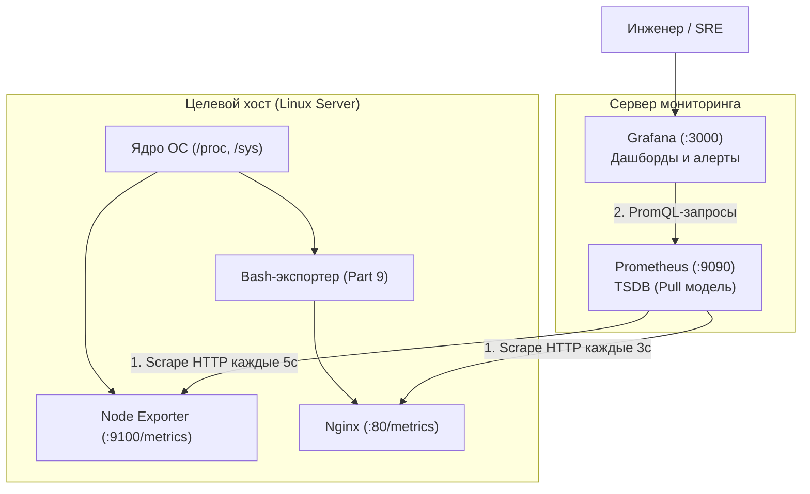

# Linux Monitoring v2.0 (DO4) — Полный технический справочник и мастер-руководство

> [!NOTE]
> Данный справочник представляет собой **структурированную инженерную базу знаний** по проекту DO4.  
> Здесь собраны архитектурные паттерны, физика системных вызовов ядра Linux, регулярные выражения (ERE), детальный разбор утилит (`awk`, `date`, `sort`, `find`, `df`), сетевые протоколы и спецификации мониторинга (**Prometheus + Grafana + Nginx + GoAccess**).
> 
> **Цель руководства:** дать исчерпывающее понимание инструментов и механизмов, чтобы писать код самостоятельно, осознанно и без необходимости искать базовые вещи на стороне.

---

## Содержание

1. [Архитектурный стандарт проекта DO4](#1-архитектурный-стандарт-проекта-do4)
   - [1.1. Модульная декомпозиция и единая точка входа (`main.sh`)](#11-модульная-декомпозиция-и-единая-точка-входа-mainsh)
   - [1.2. Определение пути скрипта через `BASH_SOURCE`](#12-определение-пути-скрипта-через-bash_source)
   - [1.3. Подключение модулей через `source`](#13-подключение-модулей-через-source)
   - [1.4. Паттерн Guard Clauses (Защитные барьеры)](#14-паттерн-guard-clauses-защитные-барьеры)
   - [1.5. Потоки вывода (stdout vs stderr) и коды возврата](#15-потоки-вывода-stdout-vs-stderr-и-коды-возврата)
   - [1.6. Золотые правила ERE-регулярок в переменных Bash](#16-золотые-правила-ere-регулярок-в-переменных-bash)
2. [Часть I: Файловая система и генерация данных (Part 1, 2, 3)](#2-часть-i-файловая-система-и-генерация-данных-part-1-2-3)
   - [2.1. Регулярные выражения для валидации параметров](#21-регулярные-выражения-для-валидации-параметров)
   - [2.2. Манипуляции со строками (Bash Parameter Expansion)](#22-манипуляции-со-строками-bash-parameter-expansion)
   - [2.3. Алгоритм генерации имён с сохранением алфавитного порядка](#23-алгоритм-генерации-имён-с-сохранением-алфавитного-порядка)
   - [2.4. Выделение дискового пространства (`fallocate`, `truncate`, `dd`)](#24-выделение-дискового-пространства-fallocate-truncate-dd)
   - [2.5. Контроль свободного места и ловушка сдвига колонок `df`](#25-контроль-свободного-места-и-ловушка-сдвига-колонок-df)
   - [2.6. Продвинутый поиск, фильтрация и удаление (`find`)](#26-продвинутый-поиск-фильтрация-и-удаление-find)
   - [2.7. Случайная выборка папок и генерация чисел (`shuf`, `$RANDOM`)](#27-случайная-выборка-папок-и-генерация-чисел-shuf-random)
   - [2.8. Замер времени выполнения и форматирование дат (`date`)](#28-замер-времени-выполнения-и-форматирование-дат-date)
3. [Часть II: Веб-логи и потоковый анализ данных (Part 4, 5, 6)](#3-часть-ii-веб-логи-и-потоковый-анализ-данных-part-4-5-6)
   - [3.1. Спецификация Combined Log Format (Nginx / Apache)](#31-спецификация-combined-log-format-nginx--apache)
   - [3.2. Коды состояния HTTP и их смысловые описания](#32-коды-состояния-http-и-их-смысловые-описания)
   - [3.3. Моделирование логов: IP, массивы, случайные числа и время (Part 4)](#33-моделирование-логов-ip-массивы-случайные-числа-и-время-part-4)
   - [3.4. Глубокое погружение в `awk` (Part 5)](#34-глубокое-погружение-в-awk-part-5)
   - [3.5. Реализация 4 режимов мониторинга через `awk`](#35-реализация-4-режимов-мониторинга-через-awk)
   - [3.6. Тонкости утилиты `sort` (Сортировка строго по столбцу)](#36-тонкости-утилиты-sort-сортировка-строго-по-столбцу)
   - [3.7. Интерактивный анализ и веб-отчёты с `goaccess` (Part 6)](#37-интерактивный-анализ-и-веб-отчёты-с-goaccess-part-6)
4. [Часть III: Системный мониторинг и сетевой стек (Part 7, 8, 9)](#4-часть-iii-системный-мониторинг-и-сетевой-стек-part-7-8-9)
   - [4.1. Архитектура Prometheus + Node Exporter + Grafana](#41-архитектура-prometheus--node-exporter--grafana)
   - [4.2. Пошаговая установка и запуск стека](#42-пошаговая-установка-и-запуск-стека)
   - [4.3. Язык PromQL: анатомия запросов для дашбордов Grafana](#43-язык-promql-анатомия-запросов-для-дашбордов-grafana)
   - [4.4. Стресс-тестирование подсистем ОС (`stress`) (Part 7, 8)](#44-стресс-тестирование-подсистем-ос-stress-part-7-8)
   - [4.5. Межмашинное сетевое тестирование (`iperf3`)](#45-межмашинное-сетевое-тестирование-iperf3)
   - [4.6. Собственный экспортер метрик на Nginx + Bash (Part 9)](#46-собственный-экспортер-метрик-на-nginx--bash-part-9)
5. [Сводная таблица системных граблей и ловушек (Gotchas & Traps)](#5-сводная-таблица-системных-граблей-и-ловушек-gotchas--traps)

---

## 1. Архитектурный стандарт проекта DO4

В DO4 скрипты перестают быть простыми утилитами вывода текста — они активно модифицируют диск, анализируют логи и эмулируют сервисы мониторинга. Грамотная модульная архитектура защищает от ошибок и упрощает защиту на P2P.

### 1.1. Модульная декомпозиция и единая точка входа (`main.sh`)
Каждое задание декомпозируется минимум на 3 функциональных файла:
* **`main.sh`** — входная точка. Содержит только инициализацию путей, директивы `source` и последовательный вызов функций.
* **`validate.sh`** — изолированная проверка аргументов командной строки (Guard Clauses).
* **`generator.sh`** / **`parser.sh`** / **`clean.sh`** — чистые алгоритмические функции без побочных эффектов или модули выполнения операций.

---

### 1.2. Определение пути скрипта через `BASH_SOURCE`
Чтобы скрипт корректно находил свои модули при запуске из любой рабочей директории системы, в начале `main.sh` всегда используется каноническая конструкция:

```bash
DIR="$(cd "$(dirname "${BASH_SOURCE[0]}")" && pwd)"
```
* `${BASH_SOURCE[0]}` — системный массив Bash. Нулевой индекс указывает точный путь к исполняемому файлу (в отличие от `$0`, который при `source` может указывать на имя родительского шелла).
* `dirname` — отрезает имя самого файла.
* `cd ... && pwd` — переходит в каталог и возвращает его **абсолютный путь**, разрешая любые относительные переходы (`.`, `..`).
* Кавычки `"$DIR/..."` защищают от поломки пути при наличии пробелов в названиях каталогов.

---

### 1.3. Подключение модулей через `source`
```bash
source "$DIR/validate.sh"
source "$DIR/generator.sh"
```
* Команда `source` (синоним точки `.`) читает файл и загружает функции в **текущее адресное пространство процесса шелла**.
* *В чем отличие от запуска `./validate.sh`?* Прямой запуск запускает скрипт в отдельном дочернем процессе (subshell), чьи переменные и функции уничтожаются сразу при выходе. `source` оставляет все функции доступными для `main.sh`.

---

### 1.4. Паттерн Guard Clauses (Защитные барьеры)
Вместо лесенок из глубоко вложенных `if ... else ... if` все проверки строятся по принципу отсечения ошибок на входе:
> *«Если параметр НЕ соответствует правилу $\to$ выводим ошибку и немедленно выходим (`exit 1`). Если соответствует $\to$ идём дальше»*.

Это делает код плоским, читаемым и легко тестируемым.

---

### 1.5. Потоки вывода (stdout vs stderr) и коды возврата
* **Стандартный вывод (stdout, fd 1):** предназначен для полезных данных скрипта (результаты работы, сгенерированные имена, отчёты).
* **Стандартный поток ошибок (stderr, fd 2):** предназначен для сообщений о сбоях. Перенаправление выполняется через **`>&2`**:
  ```bash
  echo "Error: Invalid argument count" >&2
  exit 1
  ```
* **Разница между `exit` и `return`:**
  * `exit 1` — полностью убивает текущий процесс скрипта (применяется при фатальных ошибках валидации).
  * `return 1` — завершает выполнение **только текущей функции** и возвращает статус ошибки вызывающему коду.

---

### 1.6. Золотые правила ERE-регулярок в переменных Bash
При использовании оператора `=~` внутри `[[ ... ]]`:
1. Регулярное выражение выносится в отдельную переменную:
   ```bash
   re='^[0-9]+$'
   if [[ "$val" =~ $re ]]; then ...
   ```
2. **Переменная с регуляркой справа НИКОГДА не оборачивается в кавычки!**
   * Правильно: `[[ "$val" =~ $re ]]` (Bash включает движок ERE).
   * Ошибка: `[[ "$val" =~ "$re" ]]` (Bash выключает движок регулярок и ищет буквальное совпадение символов `^`, `+`, `$`).

---

## 2. Часть I: Файловая система и генерация данных (Part 1, 2, 3)

### 2.1. Регулярные выражения для валидации параметров
* **Абсолютный путь:** `^/` (начинается со слеша).
* **Положительное целое число:** `^[1-9][0-9]*$`
* **Набор букв английского алфавита:** `^[a-zA-Z]{1,7}$`
* **Шаблон файла с расширением:** `^[a-zA-Z]{1,7}\.[a-zA-Z]{1,3}$`
* **Размер файла с суффиксом:** `^[1-9][0-9]*(kb|Mb)$`

---

### 2.2. Манипуляции со строками (Bash Parameter Expansion)

* **Длина строки:** `${#string}`
* **Извлечение подстроки по смещению:** `${string:offset:length}`
  * `${string:0:1}` — первый символ.
  * `${string: -1}` — последний символ (**пробел перед минусом обязателен**, иначе сработает оператор дефолтного значения `${var:-def}`).
* **Удаление подстрок по маске:**
  * `${filename%.*}` — отрезает кратчайшее совпадение с конца (имя без расширения).
  * `${filename##*.}` — отрезает длиннейшее совпадение с начала (только расширение).

---

### 2.3. Алгоритм генерации имён с сохранением алфавитного порядка
Требование Школы 21: длина имени должна быть не менее 4 символов (Part 1) или 5 символов (Part 2). Если задано меньше букв (например, `a`), мы обязаны дополнять имя повторением знаков так, чтобы сохранялся алфавитный порядок сортировки.

**Физика алгоритма:**
1. Если базовый набор символов короче целевой длины `MIN_LEN`:
   Берется последний символ переданного набора `${chars: -1}` и дублируется до достижения нужной длины.
2. Для каждого последующего элемента к текущему суффиксу добавляется ещё один дубликат последнего символа:
   * Исходные буквы: `az` $\to$ база: `azzz` $\to$ шаг 1: `azzz` $\to$ шаг 2: `azzzz` $\to$ шаг 3: `azzzzz`.
   * При сортировке `ls` файлы встанут строго по алфавиту: `azzz`, `azzzz`, `azzzzz`.

---

### 2.4. Выделение дискового пространства (`fallocate`, `truncate`, `dd`)

| Утилита | Системный вызов ядра | Реальное выделение блоков на диске | Скорость | Поведение в WSL2 / VirtualBox |
|---|---|---|---|---|
| **`fallocate -l 10M file`** | `fallocate(2)` | **Да** (preallocation) | Мгновенно ($O(1)$) | Может выдавать `Operation not supported` на файловых системах-мостах (`9p`, `vboxsf`). |
| **`truncate -s 10M file`** | `ftruncate(2)` | **Нет** (Sparse file, разреженный) | Мгновенно ($O(1)$) | Работает везде. Реальное место на диске **не расходуется**. |
| **`dd if=/dev/zero of=file bs=1M count=10`** | `write(2)` | **Да** (физическая запись нулей) | Медленно ($O(N)$, упирается в диск) | Работает везде, но тратит ресурс SSD/диска. |

> [!TIP]
> **Паттерн надежности для DO4:**
> ```bash
> fallocate -l "${size}M" "$filepath" 2>/dev/null || truncate -s "${size}M" "$filepath"
> ```

---

### 2.5. Контроль свободного места и ловушка сдвига колонок `df`

* **Ловушка:** В зависимости от длины имени устройства в первой колонке (`/dev/mapper/...`), `df -h /` может переносить вывод на 2 строки или сдвигать номера колонок в `awk`. Из-за этого `$4` внезапно возвращает `12%` вместо мегабайт, и скрипт падает: `[: 1%: integer expression expected`.
* **Надежное инженерное решение:** Использовать флаг `--output=avail`:
  ```bash
  avail_mb=$(df --output=avail -m / | tail -n 1 | tr -d ' ')
  if [ "$avail_mb" -le 1024 ]; then
      echo "Threshold reached: <= 1GB left"
      break
  fi
  ```

---

### 2.6. Продвинутый поиск, фильтрация и удаление (`find`)

* **Защита от зацикливания ядра (`-prune`):**
  Псевдофайловые системы ядра (`/proc`, `/sys`, `/dev`, `/run`) не содержат физических файлов на диске — это виртуальные структуры структур ядра. Сканировать их скриптом бессмысленно и опасно (зависание или переполнение буферов):
  ```bash
  find / \( -path '/proc' -o -path '/sys' -o -path '/dev' -o -path '/run' -o -path '/mnt' \) -prune -o -type d -writable -print
  ```
* **Поиск по диапазону дат (`-newermt`):**
  ```bash
  find / -newermt "2026-09-28 10:00" ! -newermt "2026-09-28 11:30"
  ```
* **Каскадное удаление родительских папок:**
  Флаг `-depth` заставляет `find` обрабатывать содержимое папки **до** самой папки (Post-order traversal). Это исключает ошибку `Directory not empty`.

---

## 3. Часть II: Веб-логи и потоковый анализ данных (Part 4, 5, 6)

### 3.1. Спецификация Combined Log Format (Nginx / Apache)

Стандарт Combined Log Format — это классический текстовый протокол журналирования веб-серверов. Каждая строка представляет собой одно HTTP-событие:

```text
$remote_addr - $remote_user [$time_local] "$request" $status $body_bytes_sent "$http_referer" "$http_user_agent"
```

Пример реальной строки:
```text
36.105.158.92 - - [23/Sep/2026:00:00:45 +0300] "GET /static/style.css HTTP/1.1" 501 3860 "https://yandex.ru" "Mozilla"
```

#### Анатомия столбцов в `awk` (разделитель — пробел):
| Переменная | Поле | Пример | Описание |
|---|---|---|---|
| `$1` | IP-адрес клиента | `36.105.158.92` | IPv4 адрес хоста |
| `$2` | RFC 1413 identity | `-` | Устаревший протокол идентификации (всегда `-`) |
| `$3` | `$remote_user` | `-` | Имя пользователя при HTTP Basic Auth (если нет — `-`) |
| `$4` | Дата и время | `[23/Sep/2026:00:00:45` | Включает открывающую скобку `[` |
| `$5` | Таймзона | `+0300]` | Смещение часового пояса и закрывающая скобка `]` |
| `$6` | Метод HTTP | `"GET` | Включает открывающую кавычку `"` |
| `$7` | URI запроса | `/static/style.css` | Запрошенный ресурc |
| `$8` | Версия протокола | `HTTP/1.1"` | Включает закрывающую кавычку `"` |
| `$9` | **HTTP Status Code** | **`501`** | **Код ответа сервера (число от 100 до 599)** |
| `$10` | Размер тела ответа | `3860` | Количество переданных байт данных |
| `$11` | HTTP Referer | `"https://yandex.ru"` | URL страницы-источника перехода |
| `$12..$NF` | User-Agent | `"Mozilla"` | Идентификатор браузера / клиента |

---

### 3.2. Коды состояния HTTP и их смысловые описания

> [!IMPORTANT]
> **Обязательное требование Part 4:** в комментариях к коду указать точное назначение каждого из 10 кодов:

* **200 (OK):** Запрос успешно обработан, сервер возвращает запрошенные данные.
* **201 (Created):** Запрос выполнен успешно, и в результате создан новый ресурс (`POST`/`PUT`).
* **400 (Bad Request):** Синтаксическая ошибка в запросе клиента, сервер не может его разобрать.
* **401 (Unauthorized):** Требуется аутентификация пользователя (неверные или отсутствующие учетные данные).
* **403 (Forbidden):** Запрос понятен, но сервер отказывается его выполнять из-за ограничений прав доступа.
* **404 (Not Found):** Запрашиваемый ресурс не найден по указанному URL.
* **500 (Internal Server Error):** Внутренняя непредвиденная ошибка на стороне логики веб-сервера.
* **501 (Not Implemented):** Метод запроса не поддерживается сервером и не может быть обслужен.
* **502 (Bad Gateway):** Сервер, действуя как шлюз или прокси, получил некорректный ответ от бэкенда.
* **503 (Service Unavailable):** Сервер временно перегружен или находится на техническом обслуживании.

---

### 3.3. Моделирование логов: IP, массивы, случайные числа и время (Part 4)

#### 1. Арифметика `$RANDOM` и остатка от деления `%`
Переменная `$RANDOM` генерирует случайное псевдочисло в диапазоне от `0` до `32767`.
Чтобы получить число в диапазоне `[MIN .. MAX]`:
$$\text{val} = \text{RANDOM} \pmod{(\text{MAX} - \text{MIN} + 1)} + \text{MIN}$$

* **Случайный октет IP (1..254):**
  Размер диапазона: $254 - 1 + 1 = 254$. Остаток `$RANDOM % 254` даёт `0..253`.
  Прибавляем 1: `$(( RANDOM % 254 + 1 ))` $\to$ получаем строго `1..254`.
* **Случайное число строк от 100 до 1000:**
  Размер диапазона: $1000 - 100 + 1 = 901$. Остаток `$RANDOM % 901` даёт `0..900`.
  Прибавляем 100: `$(( RANDOM % 901 + 100 ))` $\to$ получаем строго `100..1000`.

#### 2. Работа с массивами в Bash
```bash
items=("Apple" "Banana" "Cherry" "Date")

# Количество элементов в массиве:
total=${#items[@]}               # 4

# Случайный индекс от 0 до total-1:
rand_idx=$(( RANDOM % total ))   # 0..3

# Получение случайного элемента:
picked=${items[rand_idx]}        # Например, "Banana"

# В одну компактную строку:
picked=${items[RANDOM % ${#items[@]}]}
```
> [!CAUTION]
> **Ловушка bad substitution:** пробел между именем массива и скобкой недопустим!
> * `${items[0]}` — ПРАВИЛЬНО.
> * `${items [0]}` — ФАТАЛЬНАЯ ОШИБКА: `bad substitution`.
> * `${items[@]}` — вернет ВСЕ элементы массива через пробел, а не один случайный!

#### 3. Раскрытие скобок (Brace Expansion)
Вместо громоздких циклов с переменными-счетчиками в Bash используется раскрытие диапазонов через две точки:
```bash
for day in {1..5}; do
    echo "Processing day $day"
done
```
* `{1..5}` $\to$ `1 2 3 4 5`
* `{5..1}` $\to$ `5 4 3 2 1` (обратный порядок)
* `{0..10..2}` $\to$ `0 2 4 6 8 10` (шаг 2)
* `{a..e}` $\to$ `a b c d e` (буквенный диапазон)

#### 4. Строгая хронология времени (Unix Epoch Timestamp)
Пытаться прибавлять секунды к строке `"14:20:15"` сложно (нужно отслеживать переполнение минут и часов).
Поэтому в Linux все расчеты времени ведутся в **секундах Unix Epoch** (количество секунд с 1 января 1970 г.):

```bash
# 1. Задаем базовое время суток (полночь N дней назад):
start_ts=$(date -d "today - 3 days 00:00:00" +%s)

# 2. На каждом шаге генерации прибавляем случайный интервал (например, от 5 до 60 сек):
current_ts=$(( current_ts + (RANDOM % 55 + 5) ))

# 3. Превращаем секунды в стандартную строку Nginx:
log_date=$(LC_ALL=C date -d "@$current_ts" +"%d/%b/%Y:%H:%M:%S %z")
```
* Символ `@` сообщает утилите `date`, что на вход передаются секунды эпохи Unix.
* `LC_ALL=C` гарантирует вывод английских названий месяцев (`Sep`, `Oct`, `Nov`), предотвращая сбои парсеров на машинах с русскоязычной локалью.

---

### 3.4. Глубокое погружение в `awk` (Part 5)

Утилита **`awk`** — это полноценный Тьюринг-полный язык программирования, специально спроектированный для потоковой построчной обработки структурированных текстовых данных.

#### 1. Модель исполнения `awk`:
`awk` работает по принципу неявного конвейера:
1. Автоматически открывает входные файлы (или читает поток из `stdin`).
2. Читает входные данные **строка за строкой** (явный цикл `while read` не нужен!).
3. Каждую прочитанную строку разбивает по пробельным символам на поля:
   * `$0` — вся строка целиком.
   * `$1` — первое поле (IP-адрес).
   * `$2` — второе поле и т.д.
   * `NF` — системная переменная: общее количество полей в текущей строке (Number of Fields).
   * `$NF` — последнее поле строки.
   * `NR` — порядковый номер текущей строки (Number of Records).

#### 2. Структура программы в `awk`:
Программа состоит из блоков вида:
$$\text{PATTERN} \quad \{ \text{ACTION} \}$$

* **Если указан только `ACTION` (без шаблона):** действие выполняется для **каждой** строки:
  ```bash
  awk '{ print $1 }' file.log     # Вывести первый столбец каждой строки
  ```
* **Если указан только `PATTERN` (без действия):** при истинности условия срабатывает действие по умолчанию — **`{ print $0 }`** (вывод всей строки):
  ```bash
  awk '$9 >= 400' file.log        # Распечатать все строки, где 9-й столбец >= 400
  ```
* **Специальные блоки `BEGIN` и `END`:**
  * `BEGIN { ... }` — выполняется один раз **до** начала чтения файлов.
  * `END { ... }` — выполняется один раз **после** прочтения всех файлов.

---

### 3.5. Реализация 4 режимов мониторинга через `awk`

В Part 5 скрипт принимает один параметр (режим от `1` до `4`) и обрабатывает все логи Part 4:

#### Режим 1: Все записи, отсортированные по коду ответа
Задача: прочитать все строки и упорядочить их по возрастанию кода ответа (поле `$9`).
* `awk` передает строки в поток: `awk '{print $0}' *.log`
* Утилита `sort` выполняет числовую сортировку строго по 9-й колонке:
  ```bash
  awk '{print $0}' *.log | sort -k9,9n
  ```

#### Режим 2: Все уникальные IP, встречающиеся в записях
Классический подход через конвейер `awk '{print $1}' *.log | sort -u` работает медленно, так как требует сортировки всего объема данных.

**Инженерный подход через ассоциативный массив `awk` (в памяти за один проход):**
```bash
awk '!seen[$1]++ { print $1 }' *.log
```

**Как работает магия `!seen[$1]++`:**
1. `seen` — это встроенная в `awk` хэш-таблица (ассоциативный массив). Ключом является IP-адрес (`$1`).
2. Постфиксный инкремент `seen[$1]++`:
   * При первой встрече IP `1.2.3.4`: ячейка `seen["1.2.3.4"]` инициализируется нулём (`0`). Выражение возвращает `0`, а затем значение в ячейке становится равным `1`.
   * Логическое отрицание `!` превращает `0` (ложь) в `1` (истина). Условие срабатывает $\to$ IP печатается!
   * При повторной встрече IP `1.2.3.4`: ячейка уже содержит `1`. Выражение возвращает `1` (инкрементируя до 2).
   * Отрицание `!` превращает `1` в `0` (ложь). Условие не срабатывает $\to$ строка пропускается.
3. Результат: идеальная дедупликация со сложностью $O(N)$ без вызова внешней утилиты `sort`.

#### Режим 3: Все запросы с ошибками (коды 4xx и 5xx)
Ошибочные запросы — это HTTP-статусы в диапазоне от `400` до `599`.

* **Вариант А (Числовой фильтр):**
  ```bash
  awk '$9 >= 400 && $9 <= 599 { print $0 }' *.log
  ```
* **Вариант Б (Фильтр регулярным выражением):**
  Оператор `~` в `awk` проверяет соответствие поля регулярному выражению:
  ```bash
  awk '$9 ~ /^[45][0-9]{2}$/ { print $0 }' *.log
  ```
  * `^[45]` — начинается с 4 или 5.
  * `[0-9]{2}$` — заканчивается ровно двумя цифрами (всего 3 цифры).

#### Режим 4: Все уникальные IP среди ошибочных запросов
Здесь объединяются логические условия: статус ответа должен быть ошибочным **И** данный IP ещё не встречался ранее:

```bash
awk '($9 ~ /^[45][0-9]{2}$/) && !seen[$1]++ { print $1 }' *.log
```
* За счет правила короткого замыкания (Short-Circuit Evaluation): если код ответа `200`, левая часть возвращает ложь, и правая часть `!seen[$1]++` даже не вычисляется. Таким образом, успешные запросы вообще не засоряют хэш-таблицу.

---

### 3.6. Тонкости утилиты `sort` (Сортировка строго по столбцу)

Синтаксис флага `-k` (Key definition):
$$\text{sort} \quad -k \ \text{POS1}[,\text{POS2}]$$

* **Опасная ловушка `-k9n`:**
  Если указана только одна позиция `-k9n`, утилита `sort` начинает сравнение с 9-го поля и **продолжает сравнивать все последующие символы до самого конца строки**! Если в строках после кода ответа идут разные рефереры или агенты, порядок сортировки может быть искажен.
* **Строгое решение `-k9,9n`:**
  Запись `-k9,9n` прямо задает: начать со столбца 9 (`POS1 = 9`) и **закончить на столбце 9** (`POS2 = 9`), сравнивая значение как число (`n` — numeric sort).

---

### 3.7. Интерактивный анализ и веб-отчёты с `goaccess` (Part 6)

**GoAccess** — это сверхбыстрый анализатор логов веб-серверов в реальном времени, написанный на C.

#### 1. Установка:
```bash
sudo apt update && sudo apt install -y goaccess
```

#### 2. Режимы работы:
* **Интерактивный терминальный интерфейс (TUI):**
  Позволяет перемещаться по дашбордам прямо в консоли с помощью клавиатуры (стрелки, цифры для выбора секции):
  ```bash
  goaccess 04/*.log --log-format=COMBINED
  ```
* **Генерация статичного HTML-отчета:**
  Парсит все файлы логов и сохраняет готовый графический дашборд в файл:
  ```bash
  goaccess 04/*.log --log-format=COMBINED -o report.html
  ```
* **Режим реального времени (Real-Time WebSocket):**
  Поднимает встроенный веб-сокет сервер, который в реальном времени транслирует новые записи из логов в открытый в браузере дашборд:
  ```bash
  goaccess 04/*.log --log-format=COMBINED -o /var/www/html/report.html --real-time-html
  ```

---

## 4. Часть III: Системный мониторинг и сетевой стек (Part 7, 8, 9)

### 4.1. Архитектура Prometheus + Node Exporter + Grafana



* **Node Exporter:** легковесный демон на Go, транслирующий внутреннюю статистику ядра Linux (`/proc/stat`, `/proc/meminfo`, `/proc/diskstats`) в стандартный текстовый формат Prometheus.
* **Prometheus:** СУБД временных рядов (TSDB). Реализует **Pull-модель**: сервер сам регулярно опрашивает (scrape) целевые агенты по HTTP.
* **Grafana:** веб-интерфейс для построения графиков и дашбордов. Сама метрики не хранит — выполняет запросы на языке PromQL к базе Prometheus.

---

### 4.2. Пошаговая установка и запуск стека

#### 1. Установка Node Exporter:
```bash
sudo apt update && sudo apt install -y prometheus-node-exporter
sudo systemctl enable --now prometheus-node-exporter
# Проверка сбора метрик:
curl -s http://localhost:9100/metrics | head -n 20
```

#### 2. Установка и настройка Prometheus:
```bash
sudo apt install -y prometheus
```
Конфигурационный файл: `/etc/prometheus/prometheus.yml`:
```yaml
global:
  scrape_interval: 5s

scrape_configs:
  - job_name: 'node_exporter'
    static_configs:
      - targets: ['localhost:9100']
```
Перезапуск сервиса:
```bash
sudo systemctl restart prometheus
# Доступ к веб-интерфейсу: http://<IP_сервера>:9090
```

#### 3. Установка Grafana:
```bash
sudo apt install -y apt-transport-https software-properties-common wget
sudo mkdir -p /etc/apt/keyrings/
wget -q -O - https://apt.grafana.com/gpg.key | gpg --dearmor | sudo tee /etc/apt/keyrings/grafana.gpg > /dev/null
echo "deb [signed-by=/etc/apt/keyrings/grafana.gpg] https://apt.grafana.com stable main" | sudo tee /etc/apt/sources.list.d/grafana.list
sudo apt update && sudo apt install -y grafana
sudo systemctl enable --now grafana-server
# Веб-интерфейс: http://<IP_сервера>:3000 (Логин/пароль по умолчанию: admin / admin)
```

---

### 4.3. Язык PromQL: анатомия запросов для дашбордов Grafana

Временные ряды в Prometheus делятся на два ключевых типа:
1. **Gauge (Датчик):** число, которое может произвольно расти и падать (свободная память, свободный диск, температура).
2. **Counter (Счетчик):** число, которое может **только расти** с момента старта системы (общее число выполненных операций ввода-вывода, суммарное время работы ядер CPU). Для счетчиков всегда применяется функция скорости прироста — **`rate()`**.

#### Ключевые метрики для Part 7 и Part 8:

1. **Загрузка процессора (CPU Utilization %):**
   ```promql
   100 - (avg by (instance) (rate(node_cpu_seconds_total{mode="idle"}[1m])) * 100)
   ```
   *Разбор:* `node_cpu_seconds_total` — счетчик секунд, проведенных ядром в разных режимах. Фильтр `{mode="idle"}` отбирает время простоя. Функция `rate(...[1m])` вычисляет долю простоя в секунду. Отнимая от 100%, получаем чистую полезную загрузку CPU.

2. **Доступная оперативная память (Available RAM):**
   ```promql
   node_memory_MemAvailable_bytes
   ```
   *В Grafana unit настраивается как:* `Data -> bytes (IEC)`.

3. **Свободное место на корневом разделе (`/`):**
   ```promql
   node_filesystem_avail_bytes{mountpoint="/"}
   ```

4. **Операции чтения/записи на диске (IOPS):**
   ```promql
   rate(node_disk_reads_completed_total[1m])
   rate(node_disk_writes_completed_total[1m])
   ```

---

### 4.4. Стресс-тестирование подсистем ОС (`stress`) (Part 7, 8)

Утилита `stress` генерирует заданную нагрузку на вычислительные узлы системы для проверки реакции мониторинга.

#### Команда из задания Part 7:
```bash
stress -c 2 -i 1 -m 1 --vm-bytes 32M -t 10s
```

#### Анатомия каждого флага:
* **`-c 2` (CPU):** запускает 2 воркера, которые непрерывно вычисляют квадратный корень случайных чисел (`sqrt()`), нагружая ядра процессора на 100%.
* **`-i 1` (I/O Sync):** запускает 1 воркер, вызывающий системный вызов `sync()`, принудительно сбрасывающий буферы оперативной памяти на физический диск (всплеск дисковой активности).
* **`-m 1 --vm-bytes 32M` (Virtual Memory):** запускает 1 воркер, который непрерывно выделяет 32 Мб памяти через `malloc()`, заполняет её нулями и освобождает через `free()`.
* **`-t 10s` (Timeout):** жесткое время работы теста — ровно 10 секунд, после чего процесс штатно завершается.

---

### 4.5. Межмашинное сетевое тестирование (`iperf3`)

Для измерения реальной пропускной способности сети между двумя виртуальными машинами:

1. **Серверная машина (ВМ-1):**
   ```bash
   iperf3 -s -p 5201
   ```
   * `-s` — режим ожидания подключений (Server).
   * `-p 5201` — прослушиваемый TCP-порт.

2. **Клиентская машина (ВМ-2):**
   ```bash
   iperf3 -c <IP_ВМ-1> -p 5201 -t 15 -P 2
   ```
   * `-c <IP>` — режим клиента (Client).
   * `-t 15` — тестирование в течение 15 секунд.
   * `-P 2` — генерация нагрузки в 2 параллельных TCP-сокета.

---

### 4.6. Собственный экспортер метрик на Nginx + Bash (Part 9)

В Part 9 требуется отказаться от Node Exporter и написать собственный легковесный сервис сбора метрик на Bash, который отдаёт метрики веб-серверу Nginx.

#### 1. Текстовый формат спецификации Prometheus (Exposition Format):
Метрики передаются в виде обычного текста со строгим форматом:
```text
# HELP cpu_usage_percent CPU utilization percentage
# TYPE cpu_usage_percent gauge
cpu_usage_percent 24.5

# HELP mem_available_bytes Free memory available in bytes
# TYPE mem_available_bytes gauge
mem_available_bytes 1048576000

# HELP disk_avail_bytes Free disk space on root in bytes
# TYPE disk_avail_bytes gauge
disk_avail_bytes 15728640000
```
* `# HELP` — описание метрики для оператора.
* `# TYPE` — тип данных (`gauge` или `counter`).
* Строка значений: `имя_метрики значение`.

#### 2. Как скрипт Bash собирает метрики из ядра Linux:
* **Память:** из `/proc/meminfo`
  ```bash
  mem_avail=$(awk '/MemAvailable/ {print $2 * 1024}' /proc/meminfo)
  ```
* **Диск:** из команды `df`
  ```bash
  disk_avail=$(df --output=avail -B1 / | tail -n 1 | tr -d ' ')
  ```
* **Загрузка CPU:** через `top` или чтение `/proc/stat`.

#### 3. Настройка Nginx для отдачи метрик:
Файл конфигурации виртуального хоста `/etc/nginx/sites-available/default`:

> [!CAUTION]
> **Ловушка MIME-типа:** по умолчанию Nginx отдаёт файлы с расширением `.html` как `text/html`. Prometheus выбросит ошибку парсинга! Обязательно указывать директиву `default_type text/plain;`:

```nginx
server {
    listen 80 default_server;
    server_name _;

    location /metrics {
        alias /var/www/html/metrics.html;
        default_type text/plain;
    }
}
```

#### 4. Бесконечный цикл генерации метрик:
Bash-скрипт запускается как фоновый процесс или systemd-юнит:
```bash
while true; do
    # Сбор значений...
    # Запись во временный файл и атомарная подмена:
    cat <<EOF > /var/www/html/metrics.tmp
# HELP mem_available_bytes Free memory available
# TYPE mem_available_bytes gauge
mem_available_bytes $mem_avail
EOF
    mv /var/www/html/metrics.tmp /var/www/html/metrics.html
    sleep 3
done
```

---

## 5. Сводная таблица системных граблей и ловушек (Gotchas & Traps)

| № | Симптом / Ошибка | Первопричина | Надежное инженерное решение |
|---|---|---|---|
| **1** | `df -m /` сбоит: `[: 1%: integer expression expected` | В средах со сложными именами дисков заголовок `Filesystem` переносится, смещая колонки в `awk`. | Использовать жесткий фильтр вывода: `df --output=avail -m / \| tail -n 1`. |
| **2** | `[[ "$var" =~ "$regex" ]]` не работает | Переменная с регулярным выражением взята в кавычки справа. | Снять кавычки с переменной шаблона: `[[ "$var" =~ $regex ]]`. |
| **3** | `date +%b` выдает русские месяцы (`сен`) | В системе активирована локаль `ru_RU.UTF-8`, что ломает парсеры Combined Log Format. | Всегда задавать ASCII-локаль: `LC_ALL=C date +"..."`. |
| **4** | `bash: ${methods [0]}: bad substitution` | Лишний пробел между именем массива и открывающей скобкой. | Устранить пробел: скобка должна примыкать: `${methods[0]}`. |
| **5** | Строки логов выводятся в терминал, файл пустой | Знак перенаправления `>> "$file"` перенесен на новую строку после `echo`. | `>> "$file"` должно находиться на той же строке, что и команда `echo`. |
| **6** | Срез `${str: -1}` возвращает `1` | Пропущен пробел перед знаком минус. | Обязательно ставить пробел: `${str: -1}`. |
| **7** | `find /` зависает намертво | Поиск зашел в системные псевдофайловые системы ядра (`/proc`, `/sys`). | Использовать флаг исключения веток: `\( -path '/proc' -o -path '/sys' \) -prune`. |
| **8** | `sort -k9` сортирует некорректно | Без указания конечной позиции `sort` сравнивает от 9-го поля до конца строки. | Жестко ограничивать границы сортировки: `sort -k9,9n`. |
| **9** | Prometheus выдает ошибку скрейпинга в Part 9 | Nginx отдает файл метрик с заголовком `Content-Type: text/html`. | В блоке `location /metrics` Nginx явно прописать `default_type text/plain;`. |
| **10** | `fallocate: Operation not supported` | В средах WSL2 или VirtualBox системный вызов `fallocate(2)` не поддерживается мостовыми ФС (`9p`, `vboxsf`). | Использовать fallback на усечение: `fallocate ... \|\| truncate -s ...`. |
