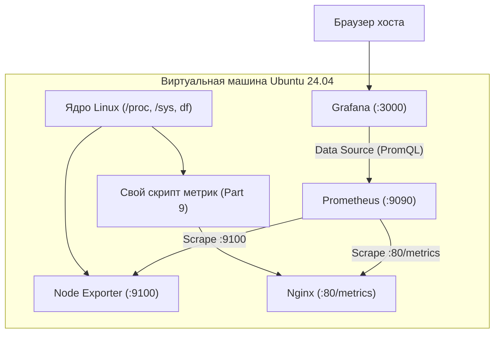

# Linux Monitoring v2.0 (DO4) — Полный технический справочник и инструментарий

> [!NOTE]
> В данном справочнике **нет готовых решений или полных скриптов** задач DO4.  
> Здесь собраны исключительно **новые технические концепции, регулярные выражения, команды, их флаги, системные утилиты и конфигурации**, которые отсутствовали в проекте DO3, снабжённые подробными поясняющими комментариями к каждой строке и конструкции.

---

## Содержание

- [Linux Monitoring v2.0 (DO4) — Полный технический справочник и инструментарий](#linux-monitoring-v20-do4--полный-технический-справочник-и-инструментарий)
  - [Содержание](#содержание)
  - [1. Архитектура DO4 и глобальные отличия от DO3](#1-архитектура-do4-и-глобальные-отличия-от-do3)
  - [2. Новые регулярные выражения (Regex / ERE)](#2-новые-регулярные-выражения-regex--ere)
    - [2.1. Валидация набора букв для папок (Part 1, 2)](#21-валидация-набора-букв-для-папок-part-1-2)
    - [2.2. Валидация имени и расширения файла (Part 1, 2)](#22-валидация-имени-и-расширения-файла-part-1-2)
    - [2.3. Валидация размера файлов (kb / Mb) (Part 1, 2)](#23-валидация-размера-файлов-kb--mb-part-1-2)
      - [Килобайты (Part 1):](#килобайты-part-1)
      - [Мегабайты (Part 2):](#мегабайты-part-2)
    - [2.4. Валидация абсолютного пути (Part 1)](#24-валидация-абсолютного-пути-part-1)
    - [2.5. Проверка исключения папок bin и sbin (Part 2)](#25-проверка-исключения-папок-bin-и-sbin-part-2)
    - [2.6. Валидация временного диапазона для очистки (Part 3)](#26-валидация-временного-диапазона-для-очистки-part-3)
    - [2.7. Маска имени для поиска при очистке (Part 3)](#27-маска-имени-для-поиска-при-очистке-part-3)
    - [2.8. Валидация IPv4 и кодов состояния HTTP (Part 4, 5)](#28-валидация-ipv4-и-кодов-состояния-http-part-4-5)
  - [3. Новые команды и их флаги (Command Reference)](#3-новые-команды-и-их-флаги-command-reference)
    - [3.1. Генерация файлов заданного размера (`fallocate`, `truncate`, `dd`)](#31-генерация-файлов-заданного-размера-fallocate-truncate-dd)
      - [1. `fallocate` (Мгновенное резервирование блоков на диске)](#1-fallocate-мгновенное-резервирование-блоков-на-диске)
      - [2. `truncate` (Изменение размера через ftruncate)](#2-truncate-изменение-размера-через-ftruncate)
      - [3. `dd` (Побайтовая запись)](#3-dd-побайтовая-запись)
    - [3.2. Контроль дискового пространства и парсинг `df -h /`](#32-контроль-дискового-пространства-и-парсинг-df--h-)
      - [Структура вывода `df -h /`:](#структура-вывода-df--h-)
      - [Проблема:](#проблема)
      - [Решения для парсинга и сравнения:](#решения-для-парсинга-и-сравнения)
    - [3.3. Мощный поиск, фильтрация и удаление (`find`)](#33-мощный-поиск-фильтрация-и-удаление-find)
      - [1. Безопасный поиск целевых папок для засорения (Part 2):](#1-безопасный-поиск-целевых-папок-для-засорения-part-2)
      - [2. Фильтрация по времени модификации (Part 3):](#2-фильтрация-по-времени-модификации-part-3)
      - [3. Порядок обхода и удаление:](#3-порядок-обхода-и-удаление)
    - [3.4. Случайная выборка и перемешивание (`shuf`, `$RANDOM`)](#34-случайная-выборка-и-перемешивание-shuf-random)
      - [1. Утилита `shuf`:](#1-утилита-shuf)
      - [2. Внутренняя переменная Bash `$RANDOM`:](#2-внутренняя-переменная-bash-random)
    - [3.5. Работа со временем, интервалами и таймингами (`date`)](#35-работа-со-временем-интервалами-и-таймингами-date)
      - [Спецификаторы формата:](#спецификаторы-формата)
      - [Расчет времени выполнения скрипта (Part 2):](#расчет-времени-выполнения-скрипта-part-2)
      - [Конвертация пользовательского ввода даты в Unix Timestamp (Part 3):](#конвертация-пользовательского-ввода-даты-в-unix-timestamp-part-3)
    - [3.6. Продвинутый парсинг и агрегация логов (`awk`)](#36-продвинутый-парсинг-и-агрегация-логов-awk)
      - [Позиции полей в стандартной строке лога (разделитель по умолчанию — пробел):](#позиции-полей-в-стандартной-строке-лога-разделитель-по-умолчанию--пробел)
      - [4 режима фильтрации из Part 5:](#4-режима-фильтрации-из-part-5)
    - [3.7. Сортировка и дедупликация (`sort`, `uniq`)](#37-сортировка-и-дедупликация-sort-uniq)
    - [3.8. Интерактивный веб-анализ логов (`goaccess`)](#38-интерактивный-веб-анализ-логов-goaccess)
      - [Режимы запуска:](#режимы-запуска)
    - [3.9. Синтетическая нагрузка системы (`stress`)](#39-синтетическая-нагрузка-системы-stress)
      - [Параметры из Part 7:](#параметры-из-part-7)
    - [3.10. Измерение пропускной способности сети (`iperf3`)](#310-измерение-пропускной-способности-сети-iperf3)
    - [3.11. Диагностика сети и портов (`ss`, `curl`)](#311-диагностика-сети-и-портов-ss-curl)
  - [4. Строковые манипуляции и алгоритмы генерации имён в Bash](#4-строковые-манипуляции-и-алгоритмы-генерации-имён-в-bash)
    - [4.1. Длина строки и посимвольный доступ (Substring Expansion)](#41-длина-строки-и-посимвольный-доступ-substring-expansion)
    - [4.2. Алгоритм соблюдения порядка букв и дополнения до минимальной длины](#42-алгоритм-соблюдения-порядка-букв-и-дополнения-до-минимальной-длины)
      - [Логика формирования:](#логика-формирования)
  - [5. Сетевые спецификации, форматы данных и мониторинг](#5-сетевые-спецификации-форматы-данных-и-мониторинг)
    - [5.1. Спецификация Combined Log Format и коды HTTP](#51-спецификация-combined-log-format-и-коды-http)
      - [Описание кодов состояния HTTP (по требованию задания Part 4):](#описание-кодов-состояния-http-по-требованию-задания-part-4)
    - [5.2. Спецификация Prometheus Text-Based Exposition Format](#52-спецификация-prometheus-text-based-exposition-format)
    - [5.3. Архитектура Prometheus + Node Exporter + Grafana](#53-архитектура-prometheus--node-exporter--grafana)
    - [5.4. Ключевые PromQL запросы для дашбордов](#54-ключевые-promql-запросы-для-дашбордов)
    - [5.5. Настройка Nginx для отдачи собственных метрик (Part 9)](#55-настройка-nginx-для-отдачи-собственных-метрик-part-9)
    - [5.6. Настройка сетевого адаптера для 2 виртуальных машин (Part 8)](#56-настройка-сетевого-адаптера-для-2-виртуальных-машин-part-8)
  - [6. Подводные камни и частые ошибки (Gotchas \& Traps)](#6-подводные-камни-и-частые-ошибки-gotchas--traps)

---

## 1. Архитектура DO4 и глобальные отличия от DO3

В DO3 фокус был направлен на пассивный сбор системной информации (`free`, `df`, `uptime`), ANSI-цвета в терминале и парсинг конфигов вида `key=value`.

В **DO4 (LinuxMonitoring v2.0)** акцент смещается на **активное воздействие на ОС, анализ веб-логов и индустриальный стек Observability**:
1. **Генерация нагрузки и файлов (Part 1, 2):** скрипт непрерывно создает файловую структуру с жесткими правилами именования, контролируя дисковое пространство в `/` в реальном времени.
2. **Очистка системы тремя способами (Part 3):** лог-файл, временные интервалы (минутная точность), маски имен с датой.
3. **Моделирование и обработка веб-трафика (Part 4, 5, 6):** создание реалистичных логов Nginx Combined Log Format со случайными IP, возрастающими таймстемпами и последующий парсинг через фильтры `awk`, а также визуализация через `GoAccess`.
4. **Инфраструктурный мониторинг (Part 7, 8, 9):**
   - Развертывание `Prometheus`, `Node Exporter` и `Grafana`.
   - Проведение стресс-тестов (`stress`) и анализ дискового I/O, памяти и CPU.
   - Межмашинное сетевое тестирование с помощью `iperf3`.
   - Создание собственного микросервиса метрик на Bash/Nginx.

---

## 2. Новые регулярные выражения (Regex / ERE)

Все регулярные выражения проверяются в Bash через оператор `[[ "$var" =~ <regex> ]]`.

### 2.1. Валидация набора букв для папок (Part 1, 2)
Параметр должен содержать только буквы английского алфавита и не превышать 7 символов:
```bash
# Регулярное выражение: от 1 до 7 латинских букв любого регистра
regex_dir_letters='^[a-zA-Z]{1,7}$'

if [[ "$letters_param" =~ $regex_dir_letters ]]; then
    # Проверка пройдена: строка содержит только английские буквы допустимой длины
    echo "Параметр валиден: $letters_param"
else
    # Ошибка: переданы цифры, спецсимволы, русские буквы или длина > 7
    echo "Ошибка: параметр должен содержать от 1 до 7 английских букв" >&2
    exit 1
fi
```
**Разбор токенов:**
- `^` и `$` — якоря начала и конца строки (гарантируют проверку всей строки целиком без посторонних символов по краям).
- `[a-zA-Z]` — класс символов: латинские буквы от `a` до `z` в нижнем и верхнем регистрах.
- `{1,7}` — квантификатор: совпадение должно повторяться от 1 до 7 раз включительно.

---

### 2.2. Валидация имени и расширения файла (Part 1, 2)
Формат: `имя.расширение`, где имя — до 7 латинских букв, расширение — до 3 латинских букв:
```bash
# Регулярное выражение с группами захвата в круглых скобках
regex_file_letters='^([a-zA-Z]{1,7})\.([a-zA-Z]{1,3})$'

if [[ "$file_param" =~ $regex_file_letters ]]; then
    # BASH_REMATCH[1] содержит то, что совпало с первой группой (имя файла)
    name_chars="${BASH_REMATCH[1]}"
    
    # BASH_REMATCH[2] содержит то, что совпало со второй группой (расширение файла)
    ext_chars="${BASH_REMATCH[2]}"
    
    echo "Буквы имени: $name_chars, буквы расширения: $ext_chars"
else
    echo "Ошибка: неверный формат (ожидалось: букв_до_7.букв_до_3)" >&2
    exit 1
fi
```
**Разбор токенов:**
- `(...)` — группа захвата (Capture Group). В Bash найденные подстроки автоматически сохраняются в системный массив `${BASH_REMATCH[@]}`: индекс `0` — полное совпадение, `1` — первая группа, `2` — вторая.
- `\.` — экранированная точка. Символ `.` в регулярных выражениях обозначает любой символ. Экранирование обратным слэшем заставляет искать буквальный символ точки-разделителя.
- `{1,3}` — ограничение длины расширения от 1 до 3 символов.

---

### 2.3. Валидация размера файлов (kb / Mb) (Part 1, 2)
**Part 1:** размер в килобайтах, не более 100kb (например: `3kb`, `100kb`, `100Kb`).  
**Part 2:** размер в мегабайтах, не более 100Mb (например: `3Mb`, `100Mb`, `50mb`).

#### Килобайты (Part 1):
```bash
# Допустимы целые числа от 1 до 100 с суффиксом kb (в любом регистре)
regex_size_kb='^([1-9]|[1-9][0-9]|100)[kK][bB]$'

if [[ "$size_param" =~ $regex_size_kb ]]; then
    # Удаление суффикса 'kb'/'Kb' через Parameter Expansion (${var%шаблон})
    # Получаем чистое числовое значение для передачи в команду создания файла
    size_num="${size_param%[kK][bB]}"
    echo "Размер файла: $size_num Кб"
else
    echo "Ошибка: размер должен быть целым числом от 1 до 100 с суффиксом kb (например: 3kb)" >&2
    exit 1
fi
```

#### Мегабайты (Part 2):
```bash
# Допустимы целые числа от 1 до 100 с суффиксом Mb (в любом регистре)
regex_size_mb='^([1-9]|[1-9][0-9]|100)[mM][bB]$'

if [[ "$size_param" =~ $regex_size_mb ]]; then
    # Удаление суффикса 'Mb'/'mb'
    size_num="${size_param%[mM][bB]}"
    echo "Размер файла: $size_num Мб"
else
    echo "Ошибка: размер должен быть целым числом от 1 до 100 с суффиксом Mb (например: 3Mb)" >&2
    exit 1
fi
```
**Разбор токенов:**
- `[1-9]` — однозначные числа от 1 до 9 (ведущий ноль `05` отсекается).
- `|` — логическое ИЛИ.
- `[1-9][0-9]` — двузначные числа от 10 до 99.
- `100` — ровно число 100.
- `[kK][bB]` — совпадение с буквой `k`/`K`, за которой следует `b`/`B` (регистронезависимо).

---

### 2.4. Валидация абсолютного пути (Part 1)
Путь должен начинаться со слэша `/` и указывать на существующую директорию:
```bash
# 1. Проверка синтаксиса абсолютного пути (первый символ строго '/')
if [[ ! "$path_param" =~ ^/ ]]; then
    echo "Ошибка: путь должен быть абсолютным (начинаться со слэша /)" >&2
    exit 1
fi

# 2. Проверка физического существования каталога на диске (-d)
if [[ ! -d "$path_param" ]]; then
    echo "Ошибка: каталог $path_param не существует на файловой системе" >&2
    exit 1
fi

# 3. Проверка прав на запись в каталог (-w)
if [[ ! -w "$path_param" ]]; then
    echo "Ошибка: нет прав на запись в каталог $path_param" >&2
    exit 1
fi
```

---

### 2.5. Проверка исключения папок bin и sbin (Part 2)
Скрипт засорения системы не имеет права писать в пути, содержащие сегменты `bin` или `sbin`:
```bash
# Регулярка для обнаружения сегментов /bin/ или /sbin/ в пути
regex_forbidden='/(bin|sbin)(/|$)'

if [[ "$candidate_dir" =~ $regex_forbidden ]]; then
    # Каталог содержит системный бинарный путь — создание файлов запрещено!
    echo "Пропуск системной директории: $candidate_dir"
fi
```
**Разбор токенов:**
- `/(bin|sbin)` — слэш, за которым следует либо слово `bin`, либо `sbin`.
- `(/|$)` — следом должен идти либо следующий вложенный слэш `/`, либо конец строки `$`. Это предотвращает ошибочную блокировку безопасных каталогов вроде `/my_bin_archive/` или `/cabinet/`.

---

### 2.6. Валидация временного диапазона для очистки (Part 3)
Пользователь вводит дату и время начала и конца с точностью до минуты:
```bash
# Формат: YYYY-MM-DD HH:MM (например: 2026-09-17 14:30)
regex_datetime='^[0-9]{4}-(0[1-9]|1[0-2])-(0[1-9]|[12][0-9]|3[01]) ([01][0-9]|2[0-3]):[0-5][0-9]$'

if [[ "$user_datetime" =~ $regex_datetime ]]; then
    # Дата и время введены синтаксически верно
    echo "Формат даты принят: $user_datetime"
else
    echo "Ошибка: дата должна быть в формате YYYY-MM-DD HH:MM (например: 2026-09-17 14:30)" >&2
    exit 1
fi
```
**Разбор токенов:**
- `[0-9]{4}` — ровно 4 цифры года.
- `(0[1-9]|1[0-2])` — валидный месяц от `01` до `12`.
- `(0[1-9]|[12][0-9]|3[01])` — валидный день от `01` до `31`.
- `([01][0-9]|2[0-3])` — часы в 24-часовом формате от `00` до `23`.
- `[0-5][0-9]` — минуты от `00` до `59`.

---

### 2.7. Маска имени для поиска при очистке (Part 3)
Удаление файлов и папок вида `символы_DDMMYY` или `символы.расширение_DDMMYY`:
```bash
# Расширенное регулярное выражение (POSIX ERE) для передачи в команду find -regex
# Сопоставляет полный путь к файлу, оканчивающийся на _DDMMYY (6 цифр)
regex_name_mask='^.+/[a-zA-Z]+(\.[a-zA-Z]+)?_[0-9]{6}$'

# Простой шаблон для find -name (поиск по имени без учета пути)
glob_name_mask="*_[0-9][0-9][0-9][0-9][0-9][0-9]"
```

---

### 2.8. Валидация IPv4 и кодов состояния HTTP (Part 4, 5)
```bash
# Валидация одного октета IPv4 (значения от 0 до 255):
# [0-9]           -> 0-9
# [1-9][0-9]      -> 10-99
# 1[0-9]{2}       -> 100-199
# 2[0-4][0-9]     -> 200-249
# 25[0-5]         -> 250-255
regex_octet='([0-9]|[1-9][0-9]|1[0-9]{2}|2[0-4][0-9]|25[0-5])'

# Полный IPv4 из 4-х октетов, разделенных точками:
regex_ip="^${regex_octet}\.${regex_octet}\.${regex_octet}\.${regex_octet}$"

# Коды клиентских (4xx) и серверных (5xx) ошибок для Part 5:
regex_error_code='^[45][0-9]{2}$'

# Разрешенные заданием коды состояния:
regex_valid_codes='^(200|201|400|401|403|404|500|501|502|503)$'
```

---

## 3. Новые команды и их флаги (Command Reference)

### 3.1. Генерация файлов заданного размера (`fallocate`, `truncate`, `dd`)

#### 1. `fallocate` (Мгновенное резервирование блоков на диске)
Самый быстрый способ создания файлов в Linux:
- `-l, --length <size>` — размер файла (`K`, `M`, `G`).

```bash
# Создание файла размером ровно 3 Килобайта (3 * 1024 байт)
fallocate -l 3K /target/path/file_3kb.az

# Создание файла размером ровно 10 Мегабайт (10 * 1024 * 1024 байт)
fallocate -l 10M /target/path/file_10mb.az
```
> [!WARNING]
> Если целевой раздел смонтирован с файловой системой, не поддерживающей `fallocate` (например, некоторые FUSE или сетевые шары), команда вернет ошибку `fallocate failed: Operation not supported`. В качестве альтернативы используйте `truncate` или `dd`.

#### 2. `truncate` (Изменение размера через ftruncate)
Создает разреженный (sparse) файл за доли миллисекунды:
- `-s, --size <size>` — целевой размер.
```bash
# Установка размера файла в 5 Мегабайт без физической записи нулей на диск
truncate -s 5M /target/path/file_5mb.az
```

#### 3. `dd` (Побайтовая запись)
Гарантированно работает везде:
- `if=/dev/zero` — источник нулей.
- `of=<file>` — целевой файл.
- `bs=<size>` — размер блока (`1K`, `1M`).
- `count=<N>` — число блоков.
- `status=none` — тихий режим без служебного вывода.
```bash
# Запись 3 блоков по 1M из /dev/zero в целевой файл без вывода статистики
dd if=/dev/zero of=/target/file.az bs=1M count=3 status=none
```

---

### 3.2. Контроль дискового пространства и парсинг `df -h /`

В Part 2 явно задано условие: **«Свободное место в файловой системе определять командой: `df -h /`»**.

#### Структура вывода `df -h /`:
```text
Filesystem      Size  Used Avail Use% Mounted on
/dev/sda1        50G   45G  1.2G  98% /
```

#### Проблема:
Вывод колонки `Avail` содержит человекочитаемые суффиксы: `1.2G`, `950M`, `450K`.  
В чистом Bash **нельзя** сравнить дробные числа: `1.2 < 1` вернет `syntax error: invalid arithmetic operator`.

#### Решения для парсинга и сравнения:
```bash
# 1. Извлекаем 4-ю колонку второй строки вывода df -h / (например: "1.2G" или "950M")
avail_str=$(df -h / | awk 'NR==2 {print $4}')

# 2. Логика проверки через awk (возвращает 1, если свободно <= 1 Гб, иначе 0):
is_disk_full=$(echo "$avail_str" | awk '{
    # Выделяем числовую часть (от первого символа до предпоследнего)
    val = substr($1, 1, length($1)-1);
    # Выделяем единицу измерения (последний символ: G, M, K или B)
    unit = substr($1, length($1));
    
    # Если единица измерения M, K или B — свободного места точно меньше 1 Гб
    if (unit == "M" || unit == "K" || unit == "B") {
        print 1;
    # Если единица измерения G, проверяем число: если <= 1.0, лимит исчерпан
    } else if (unit == "G" && val <= 1.0) {
        print 1;
    # Места достаточно (например, 2G, 10G)
    } else {
        print 0;
    }
}')

# 3. Ветвление в Bash по результату проверки:
if [ "$is_disk_full" -eq 1 ]; then
    echo "Внимание: на диске / осталось 1 Гб или менее свободной памяти! Остановка."
    exit 0
fi
```

Для внутренней логики скрипта также удобно параллельно запрашивать точные килобайты:
```bash
# 1 Гб = 1024 * 1024 Кб = 1048576 Кб
avail_kb=$(df -k / | awk 'NR==2 {print $4}')
if [ "$avail_kb" -le 1048576 ]; then
    # Свободного места осталось 1 Гб или меньше
    echo "Лимит исчерпан"
fi
```

---

### 3.3. Мощный поиск, фильтрация и удаление (`find`)

#### 1. Безопасный поиск целевых папок для засорения (Part 2):
Если запустить поиск по всему `/`, `find` пойдет в виртуальные каталоги ядра `/proc`, `/sys`, `/dev` и зависнет или выбросит тысячи ошибок доступа.
- `-path '<шаблон>' -prune` — пропустить указанную ветку каталогов.
- `-writable` — выбирать только каталоги, куда текущий пользователь имеет право записи.
- `2>/dev/null` — скрыть ошибки `Permission denied`.

```bash
# Поиск реальных каталогов с правами на запись на глубине до 3 уровней
# исключая псевдо-файловые системы ядра Linux:
find / -maxdepth 3 \
    \( -path '/proc' -o -path '/sys' -o -path '/dev' -o -path '/run' \) -prune \
    -o -type d -writable 2>/dev/null
```

#### 2. Фильтрация по времени модификации (Part 3):
- `-newermt "YYYY-MM-DD HH:MM:SS"` — файлы, чье время изменения новее указанной даты.
- `! -newermt "YYYY-MM-DD HH:MM:SS"` — файлы, чье время изменения НЕ новее указанной даты (т.е. раньше).

```bash
# Поиск файлов, созданных строго внутри заданного пользователем интервала времени:
find /target_dir -type f -newermt "$start_time" ! -newermt "$end_time"
```

#### 3. Порядок обхода и удаление:
- `-depth` — обрабатывать файлы внутри каталога **до** удаления самого каталога.
- `-delete` — прямое удаление файлов и пустых папок (автоматически включает `-depth`).
- `-exec rm -rf {} +` — удаление пачкой аргументов без переполнения буфера командной строки.

---

### 3.4. Случайная выборка и перемешивание (`shuf`, `$RANDOM`)

В Part 2 требуется: «создать папки в различных местах ФС (до 100) и случайное число файлов в каждой».

#### 1. Утилита `shuf`:
- `shuf -n <N>` — случайный выбор $N$ строк из входящего потока данных.
- `shuf -i <MIN>-<MAX> -n 1` — генерация одного случайного числа в диапазоне от `MIN` до `MAX`.

```bash
# Выбор до 100 случайных путей из списка доступных каталогов:
candidate_dirs=$(echo "$all_dirs" | shuf -n 100)

# Генерация случайного числа файлов от 5 до 30:
num_files=$(shuf -i 5-30 -n 1)
```

#### 2. Внутренняя переменная Bash `$RANDOM`:
Генерирует псевдослучайное целое число от `0` до `32767`.
```bash
min=10
max=50
# Формула генерации случайного числа в диапазоне [min, max]
rand_val=$(( RANDOM % (max - min + 1) + min ))
```

---

### 3.5. Работа со временем, интервалами и таймингами (`date`)

#### Спецификаторы формата:
- `%d%m%y` — день, месяц, двухзначный год (например: `170926`).
- `%Y-%m-%d %H:%M:%S` — полный ISO-формат для логов.
- `%b` — трехбуквенное сокращение месяца на английском (`Jan`, `Feb`, ..., `Sep`).  
  > [!IMPORTANT]
  > Всегда используйте `LC_ALL=C date +%b`, иначе в русскоязычной системе будет выведено `сен`.
- `%z` — часовой пояс (`+0300`).
- `%s` — секунды с начала Unix-эпохи (для вычисления дельты времени).

#### Расчет времени выполнения скрипта (Part 2):
```bash
# Фиксируем время старта в секундах (для вычислений) и в читаемом виде (для лога)
start_ts=$(date +%s)
start_readable=$(date +"%H:%M:%S")

# ... здесь выполняется основная логика создания файлов ...

# Фиксируем время завершения
end_ts=$(date +%s)
end_readable=$(date +"%H:%M:%S")

# Вычисляем разницу в секундах
duration_sec=$(( end_ts - start_ts ))

# Красивый вывод времени работы
printf "Старт: %s | Конец: %s | Общее время: %d сек\n" \
    "$start_readable" "$end_readable" "$duration_sec"
```

#### Конвертация пользовательского ввода даты в Unix Timestamp (Part 3):
- Флаг `-d, --date="STRING"`:
```bash
# Преобразование строки в секунды с начала эпохи:
user_start_ts=$(date -d "2026-09-17 14:30" +%s)
```

---

### 3.6. Продвинутый парсинг и агрегация логов (`awk`)

В Part 5 разбор логов Nginx Combined Log Format выполняется исключительно через `awk`.

#### Позиции полей в стандартной строке лога (разделитель по умолчанию — пробел):
- `$1` = IP адрес клиента (например: `192.168.1.100`)
- `$2` = RFC 1413 идентификатор (`-`)
- `$3` = Имя пользователя (`-`)
- `$4` = Дата открытия запроса (`[17/Sep/2026:14:20:00`)
- `$5` = Таймзона (`+0300]`)
- `$6` = Метод запроса (`"GET`)
- `$7` = Запрошенный URL (`/index.html`)
- `$8` = Протокол (`HTTP/1.1"`)
- `$9` = **Код статуса HTTP** (`200`, `404`, `500`)
- `$10` = Размер ответа в байтах (`1420`)

#### 4 режима фильтрации из Part 5:
1. **Сортировка по коду ответа:**
   ```bash
   # Выводим все строки и сортируем по 9-й колонке числовой сортировкой (-n)
   awk '{print $0}' *.log | sort -k9,9n
   ```
2. **Все уникальные IP:**
   ```bash
   # Ассоциативный массив seen: выводит $1 только при первом появлении
   awk '!seen[$1]++ {print $1}' *.log
   ```
3. **Все запросы с ошибками (коды 4xx и 5xx):**
   ```bash
   # Проверка совпадения 9-го поля с кодами 4xx и 5xx через регулярное выражение
   awk '$9 ~ /^[45][0-9]{2}$/ {print $0}' *.log
   ```
4. **Все уникальные IP среди ошибочных запросов:**
   ```bash
   # Комбинация условий: код ответа 4xx/5xx И адрес еще не встречался в массиве seen
   awk '($9 ~ /^[45][0-9]{2}$/) && !seen[$1]++ {print $1}' *.log
   ```

---

### 3.7. Сортировка и дедупликация (`sort`, `uniq`)

- `sort -k9,9n` — числовая (`-n`) сортировка строго по 9-й колонке (`-k9,9`).
- `sort -u` — сортировка с удалением дубликатов.
- `uniq -c` — подсчет количества повторений соседних строк.
- `uniq -u` — вывод только уникальных (не повторявшихся) строк.

---

### 3.8. Интерактивный веб-анализ логов (`goaccess`)

Установка: `sudo apt update && sudo apt install -y goaccess`

#### Режимы запуска:
1. **Интерактивный TUI в терминале:**
   ```bash
   # Открывает интерактивный псевдографический интерфейс в окне терминала
   goaccess access.log --log-format=COMBINED
   ```
2. **Генерация статического HTML:**
   ```bash
   # Парсит лог и генерирует автономный HTML-отчет с графиками
   goaccess access.log --log-format=COMBINED -o /var/www/html/report.html
   ```
3. **Real-time HTML дашборд с WebSocket-обновлением:**
   ```bash
   # Запускает WebSocket-сервер, транслирующий новые записи лога в веб-браузер на лету
   goaccess access.log --log-format=COMBINED -o /var/www/html/report.html --real-time-html --ws-url=ws://<IP_сервера>:7890
   ```

---

### 3.9. Синтетическая нагрузка системы (`stress`)

Установка: `sudo apt install -y stress`

#### Параметры из Part 7:
```bash
stress -c 2 -i 1 -m 1 --vm-bytes 32M -t 10s
```
- `-c 2` — запуск 2 рабочих потоков CPU, непрерывно вычисляющих квадратные корни `sqrt()`.
- `-i 1` — запуск 1 рабочего потока дискового ввода-вывода, непрерывно вызывающего `sync()`.
- `-m 1 --vm-bytes 32M` — 1 поток аллокации 32 Мегабайт оперативной памяти в цикле `malloc/free`.
- `-t 10s` — автоматическое завершение тестирования ровно через 10 секунд.

---

### 3.10. Измерение пропускной способности сети (`iperf3`)

Установка: `sudo apt install -y iperf3`

- **Серверная сторона (ВМ-1):**
  ```bash
  # Запуск в режиме сервера, слушающего порт 5201
  iperf3 -s -p 5201
  ```
- **Клиентская сторона (ВМ-2):**
  ```bash
  # Подключение к серверу на 15 секунд с передачей в 2 параллельных потока
  iperf3 -c <IP_ВМ-1> -p 5201 -t 15 -P 2
  ```
  - `-c <IP>` — адрес целевого сервера.
  - `-t 15` — длительность теста 15 секунд.
  - `-P 2` — передача в 2 параллельных TCP-потока.

---

### 3.11. Диагностика сети и портов (`ss`, `curl`)

- `ss -tulpn` — просмотр всех активных слушающих TCP/UDP сокетов и ассоциированных с ними PID процессов (позволяет быстро проверить, запущены ли Prometheus `:9090`, Node Exporter `:9100`, Grafana `:3000`, Nginx `:80`).
- `curl -I http://localhost:80/metrics` — запрос только HTTP-заголовков ответа сервера (быстрая проверка корректности отдачи заголовка `Content-Type: text/plain;`).

---

## 4. Строковые манипуляции и алгоритмы генерации имён в Bash

### 4.1. Длина строки и посимвольный доступ (Substring Expansion)

В Bash не требуется вызывать внешние утилиты `cut`, `sed` или `awk` для посимвольной работы со строкой:
```bash
str="abcde"

# 1. Вычисление длины строки через встроенный синтаксис ${#var}:
len=${#str}  # Возвращает 5

# 2. Посимвольный доступ по индексу и длине: ${var:offset:length}
first_char="${str:0:1}"  # 'a' (смещение 0, длина 1)
second_char="${str:1:1}" # 'b' (смещение 1, длина 1)
third_char="${str:2:1}"  # 'c' (смещение 2, длина 1)

# 3. Извлечение последнего символа строки (обратите внимание на обязательный пробел перед минусом!):
last_char="${str: -1}"   # 'e'
```

---

### 4.2. Алгоритм соблюдения порядка букв и дополнения до минимальной длины

**Требование заданий Part 1 и Part 2:**
1. Использовать каждую букву из параметра хотя бы один раз.
2. Общая длина имени должна быть $\ge 4$ (Part 1) или $\ge 5$ (Part 2) знаков.
3. Порядок следования символов должен сохраняться: при `az` допустимо `aaaz` или `aazzz`, но категорически запрещено `zaaa`.

#### Логика формирования:
- Если переданный параметр `chars` короче минимальной длины (например, передано 2 буквы `az`, а нужно $\ge 4$), мы должны размножить буквы:
  - Берём первую букву и повторяем её несколько раз, затем добавляем остальные буквы в их исходном порядке.
  - Либо размножаем последнюю букву: `a` + `zzz` = `azzz`.
- **Простая конкатенация в цикле:**
  ```bash
  # Пример расширения строки до нужной длины:
  current_name="$chars"
  while [ ${#current_name} -lt 5 ]; do
      # Добавляем повторение первой буквы в начало строки, сохраняя алфавитный порядок
      current_name="${current_name:0:1}${current_name}"
  done
  ```
- Для создания уникальных имен в цикле достаточно увеличивать счетчик повторений одного из символов, никогда не меняя их взаимный порядок!

---

## 5. Сетевые спецификации, форматы данных и мониторинг

### 5.1. Спецификация Combined Log Format и коды HTTP

Стандартная строка Nginx Combined:
```text
192.168.1.50 - - [17/Sep/2026:12:00:00 +0300] "GET /index.html HTTP/1.1" 200 4235 "http://example.com" "Mozilla/5.0"
```
- `%h` — IP-адрес клиента.
- `%l` — RFC 1413 identity (в современных системах всегда дефис `-`).
- `%u` — имя аутентифицированного пользователя (всегда дефис `-`).
- `%t` — дата и время запроса в квадратных скобках `[DD/Mon/YYYY:HH:MM:SS +TZ]`.
- `\"%r\"` — строка HTTP-запроса в кавычках: `"<METHOD> <URL> <PROTO>"`.
- `%>s` — код состояния HTTP (Status Code).
- `%b` — размер переданного ответа в байтах.
- `\"%{Referer}i\"` — URL источника перехода (Referer) в кавычках.
- `\"%{User-agent}i\"` — браузерная строка идентификации клиента (User-Agent) в кавычках.

#### Описание кодов состояния HTTP (по требованию задания Part 4):
> [!IMPORTANT]
> Задание Part 4 явно требует: **«В комментариях к своему скрипту/программе укажи, что означает каждый из использованных кодов ответа»**.

1. **200 (OK)** — Запрос успешно выполнен. Сервер вернул запрошенные данные.
2. **201 (Created)** — Запрос выполнен успешно, и в результате был создан новый ресурс (обычно ответ на `POST`/`PUT`).
3. **400 (Bad Request)** — Сервер обнаружил синтаксическую ошибку в запросе клиента и не может его обработать.
4. **401 (Unauthorized)** — Для доступа к запрашиваемому ресурсу требуется прохождение аутентификации.
5. **403 (Forbidden)** — Сервер понял запрос, но доступ категорически запрещен политиками безопасности или правами.
6. **404 (Not Found)** — Запрашиваемый ресурс не найден на сервере по указанному URL.
7. **500 (Internal Server Error)** — Непредвиденная ошибка на стороне сервера при выполнении запроса.
8. **501 (Not Implemented)** — Сервер не поддерживает функциональность, необходимую для выполнения запроса (например, неизвестный метод).
9. **502 (Bad Gateway)** — Сервер, действуя в качестве шлюза или прокси, получил недопустимый ответ от вышестоящего бэкенда.
10. **503 (Service Unavailable)** — Сервер временно недоступен по причине технического обслуживания или чрезмерной нагрузки.

---

### 5.2. Спецификация Prometheus Text-Based Exposition Format

В Part 9 собственная страница `/metrics` должна строго следовать формату Prometheus:
```text
# HELP my_cpu_usage_percent CPU utilization percentage
# TYPE my_cpu_usage_percent gauge
my_cpu_usage_percent 14.2

# HELP my_mem_free_bytes Available RAM in bytes
# TYPE my_mem_free_bytes gauge
my_mem_free_bytes 1048576000

# HELP my_disk_free_bytes Free disk space on root in bytes
# TYPE my_disk_free_bytes gauge
my_disk_free_bytes 15728640000
```
- `# HELP <имя> <описание>` — текстовое пояснение назначения метрики.
- `# TYPE <имя> <gauge|counter>` — тип метрики (`gauge` — значение, которое может произвольно расти и падать: температура, оперативная память, свободный диск).
- Строка значения: `<имя_метрики> <числовое_значение>`.

---

### 5.3. Архитектура Prometheus + Node Exporter + Grafana



- **Prometheus** опрашивает цели, указанные в `/etc/prometheus/prometheus.yml`, через HTTP GET-запросы с интервалом `scrape_interval`.
- **Node Exporter** считывает системные счетчики ядра Linux и экспортирует их.
- **Grafana** берет временные ряды из Prometheus и отрисовывает графики.

---

### 5.4. Ключевые PromQL запросы для дашбордов

При настройке дашборда в Part 7 используются следующие выражения языка PromQL:
- **Загрузка CPU (%):**
  ```promql
  100 - (avg by (instance) (rate(node_cpu_seconds_total{mode="idle"}[1m])) * 100)
  ```
- **Доступная оперативная память (байты):**
  ```promql
  node_memory_MemAvailable_bytes
  ```
- **Свободное место на корневом разделе (байты):**
  ```promql
  node_filesystem_avail_bytes{mountpoint="/"}
  ```
- **Операции чтения/записи на диск (IOPS):**
  ```promql
  rate(node_disk_reads_completed_total[1m])
  rate(node_disk_writes_completed_total[1m])
  ```
- **Сетевой трафик (Part 8 для `iperf3`):**
  ```promql
  rate(node_network_receive_bytes_total[1m])
  rate(node_network_transmit_bytes_total[1m])
  ```

---

### 5.5. Настройка Nginx для отдачи собственных метрик (Part 9)

Чтобы Prometheus смог прочитать страницу, сформированную твоим скриптом:
1. Nginx должен отдавать заголовок `Content-Type: text/plain`.
2. Конфигурация блока `/etc/nginx/sites-available/default`:
   ```nginx
   server {
       listen 80 default_server;
       server_name _;

       # Путь к метрикам для Prometheus с обязательным заголовком text/plain
       location /metrics {
           alias /var/www/html/metrics.html;
           default_type text/plain;
       }
   }
   ```
3. Конфигурация `/etc/prometheus/prometheus.yml`:
   ```yaml
   scrape_configs:
     - job_name: 'custom_exporter'
       scrape_interval: 3s
       static_configs:
         - targets: ['localhost:80']
   ```
4. Перезагрузка служб:
   ```bash
   sudo systemctl restart nginx
   sudo systemctl restart prometheus
   ```

---

### 5.6. Настройка сетевого адаптера для 2 виртуальных машин (Part 8)

Для выполнения сетевого теста с `iperf3` требуются две виртуальные машины, видящие друг друга по IP:
1. **VirtualBox:**
   - В настройках обеих ВМ переключить сетевой адаптер на **Виртуальный адаптер хоста (Host-Only Adapter)** или **Сетевой мост (Bridged Adapter)**.
2. **Проверка связи:**
   - На ВМ-1: `ip a` (узнать IP-адрес, например `192.168.56.10`).
   - На ВМ-2: `ping 192.168.56.10`.
   - Если пинг проходит, запускаем `iperf3 -s` на ВМ-1 и `iperf3 -c 192.168.56.10` на ВМ-2.

---

## 6. Подводные камни и частые ошибки (Gotchas & Traps)

1. **Зависание `find` в `/proc` и `/sys`:**
   Никогда не делайте поиск по всему диску `find /` без флага `-prune` для каталогов `/proc`, `/sys`, `/dev`. В противном случае скрипт зависнет в бесконечных псевдо-файлах ядра.
2. **Сравнение дробных чисел в `df -h /`:**
   Никогда не сравнивайте `1.5G` и `1.0G` напрямую в условиях Bash `(( $a <= $b ))`. Извлекайте числовые килобайты через `df -k /` либо делегируйте логику `awk`.
3. **Локаль в `date +%b`:**
   Если не указать `LC_ALL=C`, скрипт сформирует месяц на русском языке, и GoAccess / Prometheus откажутся парсить такой лог.
4. **Удаление родительских каталогов раньше файлов:**
   В `find` всегда используйте флаг `-depth` или `-delete`, чтобы сначала удалялись файлы внутри каталога, а затем сам пустой каталог.
5. **Заголовок `Content-Type` в Nginx для Prometheus:**
   Если файл метрик отдается как `text/html`, Prometheus зафиксирует ошибку скрейпинга `expected text/plain format`. Обязательно настраивайте `default_type text/plain;`.
6. **Буферизация `uniq`:**
   `uniq` не умеет удалять дубликаты, если они не идут друг за другом подряд. Перед `uniq` обязателен вызов `sort` (либо используйте `awk '!seen[$1]++'`).
