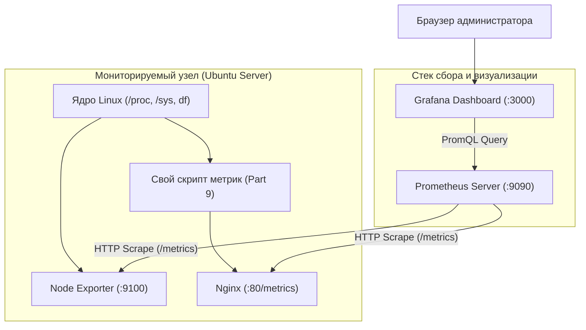

# Linux Monitoring v2.0 (DO4) — Полный технический справочник и мастер-руководство

> [!NOTE]
> Данный справочник представляет собой **структурированную инженерную базу знаний** по проекту DO4.  
> Здесь собраны архитектурные паттерны, регулярные выражения (ERE), команды, флаги, алгоритмы работы со строками, сетевые спецификации и разбор реальных системных ловушек Linux, основанные на практическом опыте выполнения задач.

---

## Содержание

1. [Архитектурный стандарт проекта DO4 (Как правильно собирать скрипты)](#1-архитектурный-стандарт-проекта-do4-как-правильно-собирать-скрипты)
   - [1.1. Модульная декомпозиция и единая точка входа (`main.sh`)](#11-модульная-декомпозиция-и-единая-точка-входа-mainsh)
   - [1.2. Определение пути скрипта через `BASH_SOURCE`](#12-определение-пути-скрипта-через-bash_source)
   - [1.3. Подключение модулей через `source`](#13-подключение-модулей-через-source)
   - [1.4. Паттерн Guard Clauses (Защитные барьеры)](#14-паттерн-guard-clauses-защитные-барьеры)
   - [1.5. Потоки вывода (stdout vs stderr) и коды возврата](#15-потоки-вывода-stdout-vs-stderr-и-коды-возврата)
   - [1.6. Золотые правила регулярок в переменных Bash](#16-золотые-правила-регулярок-в-переменных-bash)
2. [Часть I: Файловая система и генерация данных (Part 1, 2, 3)](#2-часть-i-файловая-система-и-генерация-данных-part-1-2-3)
   - [2.1. Регулярные выражения для валидации параметров](#21-регулярные-выражения-для-валидации-параметров)
   - [2.2. Манипуляции со строками (Bash Parameter Expansion)](#22-манипуляции-со-строками-bash-parameter-expansion)
   - [2.3. Алгоритм генерации имён с сохранением алфавитного порядка](#23-алгоритм-генерации-имён-с-сохранением-алфавитного-порядка)
   - [2.4. Выделение дискового пространства (`fallocate`, `truncate`, `dd`)](#24-выделение-дискового-пространства-fallocate-truncate-dd)
   - [2.5. Контроль свободного места и ловушка сдвига колонок `df`](#25-контроль-свободного-места-и-ловушка-сдвига-колонок-df)
   - [2.6. Продвинутый поиск, фильтрация и удаление (`find`)](#26-продвинутый-поиск-фильтрация-и-удаление-find)
   - [2.7. Случайная выборка папок и генерация чисел (`shuf`, `$RANDOM`)](#27-случайная-выборка-папок-и-генерация-чисел-shuf-random)
   - [2.8. Замер времени выполнения и форматирование дат (`date`)](#28-замер-времени-выполнения-и-форматирование-дат-date)
3. [Часть II: Веб-логи и потоковый анализ данных (Part 4, 5, 6)](#3-часть-ii-веб-логи-и-потоковый-анализ-данных-part-4-5-6)
   - [3.1. Спецификация Combined Log Format (Nginx / Apache)](#31-спецификация-combined-log-format-nginx--apache)
   - [3.2. Коды состояния HTTP и их смысловые описания](#32-коды-состояния-http-и-их-смысловые-описания)
   - [3.3. Моделирование логов (IP, возрастающие таймстемпы, агенты)](#33-моделирование-логов-ip-возрастающие-таймстемпы-агенты)
   - [3.4. Анализ и фильтрация логов через `awk`](#34-анализ-и-фильтрация-логов-через-awk)
   - [3.5. Сортировка и дедупликация (`sort`, `uniq`)](#35-сортировка-и-дедупликация-sort-uniq)
   - [3.6. Интерактивный анализ и веб-отчёты с `goaccess`](#36-интерактивный-анализ-и-веб-отчёты-с-goaccess)
4. [Часть III: Системный мониторинг и сетевой стек (Part 7, 8, 9)](#4-часть-iii-системный-мониторинг-и-сетевой-стек-part-7-8-9)
   - [4.1. Архитектура Prometheus + Node Exporter + Grafana](#41-архитектура-prometheus--node-exporter--grafana)
   - [4.2. Ключевые запросы PromQL для дашбордов](#42-ключевые-запросы-promql-для-дашбордов)
   - [4.3. Стресс-тестирование подсистем ОС (`stress`)](#43-стресс-тестирование-подсистем-ос-stress)
   - [4.4. Межмашинное сетевое тестирование (`iperf3`)](#44-межмашинное-сетевое-тестирование-iperf3)
   - [4.5. Собственный экспортер метрик на Nginx + Bash (Part 9)](#45-собственный-экспортер-метрик-на-nginx--bash-part-9)
5. [Сводная таблица системных граблей и ловушек (Gotchas & Traps)](#5-сводная-таблица-системных-граблей-и-ловушек-gotchas--traps)

---

## 1. Архитектурный стандарт проекта DO4 (Как правильно собирать скрипты)

В DO4 скрипты перестают быть простыми утилитами вывода текста — они активно модифицируют диск, анализируют логи и эмулируют сервисы мониторинга. Грамотная модульная архитектура защищает от ошибок и упрощает защиту на P2P.

### 1.1. Модульная декомпозиция и единая точка входа (`main.sh`)
Каждое задание декомпозируется минимум на 3–4 функциональных файла:
* **`main.sh`** — входная точка. Содержит только инициализацию путей, директивы `source` и последовательный запуск функций.
* **`validate.sh`** — изолированная проверка аргументов командной строки.
* **`generator.sh`** — чистые алгоритмические функции (Pure Functions) без побочных эффектов.
* **`create.sh`** / **`clean.sh`** — файловые операции, системные вызовы и логирование.

---

### 1.2. Определение пути скрипта через `BASH_SOURCE`
Чтобы скрипт корректно находил свои модули при запуске из любой рабочей директории системы, в начале `main.sh` всегда используется каноническая конструкция:

```bash
DIR="$(cd "$(dirname "${BASH_SOURCE[0]}")" && pwd)"
```
* `${BASH_SOURCE[0]}` — системный массив Bash. Нулевой индекс указывает точный путь к исполняемому файлу (в отличие от `$0`, который при `source` может указывать на имя родительского шелла).
* `dirname` — отрезает имя самого файла.
* `cd ... && pwd` — переходит в каталог и возвращает его **абсолютный путь**, разрешая любые относительные переходы (`.`, `..`).
* Кавычки `"$DIR/..."` защищают от поломки пути при наличии пробелов в названиях каталогов.

---

### 1.3. Подключение модулей через `source`
```bash
source "$DIR/validate.sh"
source "$DIR/generator.sh"
source "$DIR/create.sh"
```
* Команда `source` (синоним точки `.`) читает файл и загружает функции в **текущее адресное пространство процесса шелла**.
* *В чем отличие от запуска `./validate.sh`?* Прямой запуск запускает скрипт в отдельном дочернем процессе (subshell), чьи переменные и функции уничтожаются сразу при выходе. `source` оставляет все функции доступными для `main.sh`.

---

### 1.4. Паттерн Guard Clauses (Защитные барьеры)
Вместо лесенок из глубоко вложенных `if ... else ... if` все проверки строятся по принципу отсечения ошибок на входе:
> *«Если параметр НЕ соответствует правилу $\to$ выводим ошибку и немедленно выходим (`exit 1`). Если соответствует $\to$ идём дальше»*.

Это делает код плоским, читаемым и легко расширяемым.

---

### 1.5. Потоки вывода (stdout vs stderr) и коды возврата
* **Стандартный вывод (stdout, fd 1):** предназначен для полезных данных скрипта (результаты работы, сгенерированные имена, отчёты).
* **Стандартный поток ошибок (stderr, fd 2):** предназначен для сообщений о сбоях. Перенаправление выполняется через **`>&2`**:
  ```bash
  echo "Error: Path must be absolute" >&2
  exit 1
  ```
* **Разница между `exit` и `return`:**
  * `exit 1` — полностью убивает текущий процесс скрипта (применяется при фатальных ошибках валидации).
  * `return 1` — завершает выполнение **только текущей функции** и возвращает статус ошибки вызывающему коду (применяется внутри вспомогательных проверок, например `check_free_space`).

---

### 1.6. Золотые правила регулярок в переменных Bash
При выносе регулярных выражений в переменные (Best Practice) соблюдаются два строгих правила:
1. **Объявление:** всегда в одинарных кавычках `'...'`, чтобы Bash не пытался интерпретировать спецсимволы (`$`, `*`, `\`):
   ```bash
   num_regex='^[1-9][0-9]*$'
   ```
2. **Использование:** справа от оператора `=~` переменная передаётся **БЕЗ КАВЫЧЕК**:
   ```bash
   if [[ ! "$2" =~ $num_regex ]]; then   # РАБОТАЕТ как регулярка
   if [[ ! "$2" =~ "$num_regex" ]]; then # НЕ РАБОТАЕТ (ищет буквальный текст)
   ```

---

## 2. Часть I: Файловая система и генерация данных (Part 1, 2, 3)

### 2.1. Регулярные выражения для валидации параметров

| Проверяемый параметр | Регулярное выражение (ERE) | Пояснение механики |
|---|---|---|
| **Количество аргументов** | `[ "$#" -ne 6 ]` | `$#` — точное число переданных позиционных параметров |
| **Абсолютный путь** | `^/` | Проверяет наличие слэша `/` в самом начале строки |
| **Натуральные числа (кол-во)** | `^[1-9][0-9]*$` | Первая цифра `[1-9]` (без 0 и минуса), далее `[0-9]*` (любые цифры от 0 повторений) |
| **Буквы папки ($\le 7$)** | `^[a-zA-Z]{1,7}$` | Только английские буквы от 1 до 7 знаков |
| **Имя и расширение файла** | `^([a-zA-Z]{1,7})\.([a-zA-Z]{1,3})$` | Группы захвата `(...)`: до 7 букв имени, буквальная точка `\.`, до 3 букв расширения |
| **Размер файла в Кб ($\le 100$)** | `^([1-9]\|[1-9][0-9]\|100)[kK][bB]$` | Числа от 1 до 100, регистронезависимый суффикс `kb` |
| **Размер файла в Мб ($\le 100$)** | `^([1-9]\|[1-9][0-9]\|100)[mM][bB]$` | Числа от 1 до 100, регистронезависимый суффикс `Mb` |
| **Запрещённые каталоги `bin`/`sbin`** | `/(bin\|sbin)(/\|$)` | Обнаруживает сегменты `/bin/` и `/sbin/`, исключая ложные срабатывания на `cabinet` |
| **Временной интервал очистки** | `^[0-9]{4}-(0[1-9]\|1[0-2])-(0[1-9]\|[12][0-9]\|3[01]) ([01][0-9]\|2[0-3]):[0-5][0-9]$` | Валидация формата `YYYY-MM-DD HH:MM` с контролем дней (01..31) и часов (00..23) |

---

### 2.2. Манипуляции со строками (Bash Parameter Expansion)

Bash умеет выполнять быстрые манипуляции над строками прямо в оперативной памяти без порождения дочерних процессов `sed`, `awk` или `cut`:

```bash
str="az.txt"

# 1. Длина строки: ${#var}
echo "${#str}"          # Выведет 6

# 2. Посимвольный срез (Substring): ${var:offset:length}
first="${str:0:1}"      # Смещение 0, длина 1 -> 'a'
second="${str:1:1}"     # Смещение 1, длина 1 -> 'z'

# 3. Последний символ строки: ${var: -1} (ПРОБЕЛ ПЕРЕД МИНУСОМ ОБЯЗАТЕЛЕН!)
last="${str: -1}"       # Выведет 't'

# 4. Удаление кратчайшего суффикса по шаблону: ${var%pattern}
name="${str%.*}"        # Отрезает точку и всё после неё -> "az"

# 5. Удаление кратчайшего префикса по шаблону: ${var#pattern}
ext="${str#*.}"         # Отрезает всё до точки включительно -> "txt"

# 6. Отрезание единицы измерения от размера:
size_str="3kb"
size_kb="${size_str%[kK][bB]}" # Отрезает суффикс kb -> "3"
```

---

### 2.3. Алгоритм генерации имён с сохранением алфавитного порядка

По условию задания длина буквенной части имени папки и файла обязана быть **не менее 4 знаков** (Part 1) или **не менее 5 знаков** (Part 2), а относительный порядок символов не должен меняться (при `az` запрещено `zaaa`).

#### Двухэтапная реализация алгоритма:

```bash
# Этап 1: Дополнение до минимальной длины (>= 4 символов)
local name="$letters"
local first_char="${letters:0:1}"
local last_char="${letters: -1}"

while [ "${#name}" -lt 4 ]; do
    name="${first_char}${name}" # Дописываем первую букву в начало: az -> aaz -> aaaz
done

# Этап 2: Генерация уникального суффикса по номеру итерации (index)
for (( i=1; i<index; i++ )); do
    name="${name}${last_char}"  # Дописываем последнюю букву в конец: aaaz -> aaazz -> aaazzz
done

# Финал: Склейка с датой запуска
echo "${name}_${date_str}"
```

#### Принцип DRY для файлов:
Имя файла до точки формируется по тем же правилам, поэтому функция файла вызывает функцию папки:
```bash
generate_file_name() {
    local letters="$1"
    local ext="$2"
    local index="$3"
    local base_name=$(generate_folder_name "$letters" "$index")
    echo "${base_name}.${ext}"
}
```

---

### 2.4. Выделение дискового пространства (`fallocate`, `truncate`, `dd`)

В Linux есть три способа создания файлов фиксированного веса:

| Команда | Принцип работы | Скорость создания 1 000 файлов | Влияние на накопитель |
|---|---|---|---|
| **`fallocate -l 3K file`** *(Рекомендуется)* | Системный вызов ядра `fallocate()`. Мгновенно резервирует непрерывные экстенты в метаданных ФС (ext4, xfs) без физической записи нулей. | **Мгновенно (< 0.05 сек)** | Нулевой износ SSD |
| **`truncate -s 3K file`** | Создаёт разреженный (sparse) файл через `ftruncate()`. Блоки выделяются только виртуально. | Мгновенно (< 0.05 сек) | Нулевой износ |
| **`dd if=/dev/zero of=file bs=1K count=3 status=none`** | Физически перегоняет байты нулей из псевдоустройства `/dev/zero` на диск. | Медленно (секунды) | Реальный износ диска и дисковый bottleneck |

---

### 2.5. Контроль свободного места и ловушка сдвига колонок `df`

По заданию скрипт обязан остановиться, если на корневом разделе `/` осталось $\le 1$ Гб свободного места.

#### Опасность парсинга через `awk`:
Обычный вызов `df -m / | awk 'NR==2 {print $4}'` в контейнерах, виртуальных окружениях или при длинных именах устройств сдвигает колонки: первая колонка `Filesystem` может быть пустой, и в переменную попадёт процент использования (`1%`), что вызовет фатальную ошибку: `[: 1%: integer expression expected`.

#### Эталонное промышленное решение:
Использование флага GNU `df` **`--output=avail`**:
```bash
check_free_space() {
    # Флаг --output=avail гарантирует вывод строго одной колонки со свободным местом
    # Флаг -m переводит расчет в Мегабайты (1 Гб = 1024 Мб)
    local free_mb=$(df --output=avail -m / | tail -n 1)

    if [ "$free_mb" -le 1024 ]; then
        echo "Attention: there is less than 1GB of space left on the disk" >&2
        return 1
    fi
    return 0
}
```

---

### 2.6. Продвинутый поиск, фильтрация и удаление (`find`)

Утилита `find` — ключевой инструмент для засорения (Part 2) и очистки (Part 3).

#### 1. Безопасный поиск записываемых каталогов (Part 2):
Поиск по корню `/` без фильтрации приводит к зависанию в псевдофайловых системах ядра (`/proc`, `/sys`, `/dev`).
```bash
# Исключение системных веток ядра через -prune:
find / -maxdepth 3 \
    \( -path '/proc' -o -path '/sys' -o -path '/dev' -o -path '/run' \) -prune \
    -o -type d -writable 2>/dev/null
```

#### 2. Поиск по временным интервалам (Part 3, Метод 2):
```bash
# Поиск файлов, созданных строго внутри заданного интервала времени:
find "$target_dir" -type f -newermt "2026-09-23 12:00:00" ! -newermt "2026-09-23 13:00:00"
```
* `-newermt "time"` — время изменения новее указанной даты.
* `! -newermt "time"` — время изменения НЕ новее указанной даты.

#### 3. Удаление и порядок обхода (`-depth`):
* `-depth` — обрабатывает содержимое каталога **до** самого каталога. При удалении папок этот флаг обязателен, иначе `find` попытается удалить непустой каталог и выбросит ошибку.
* `-delete` — прямое удаление через системный вызов (автоматически включает режим `-depth`).

---

### 2.7. Случайная выборка папок и генерация чисел (`shuf`, `$RANDOM`)

В Part 2 требуется выбрать до 100 случайных папок и создать в каждой случайное число файлов:
```bash
# Выбор 100 случайных каталогов из найденного списка:
selected_dirs=$(echo "$all_writable_dirs" | shuf -n 100)

# Генерация случайного числа файлов от min до max через $RANDOM:
min=5
max=30
count=$(( RANDOM % (max - min + 1) + min ))
```

---

### 2.8. Замер времени выполнения и форматирование дат (`date`)

* `%d%m%y` — компактная дата запуска: `230926` (день, месяц, двухзначный год).
* `%Y-%m-%d %H:%M:%S` — ISO-формат даты для логирования.
* `%s` — секунды эпохи Unix для расчёта длительности работы:
```bash
start_ts=$(date +%s)
# ... выполнение операций ...
end_ts=$(date +%s)
duration=$(( end_ts - start_ts ))
printf "Время выполнения: %d секунд\n" "$duration"
```

---

## 3. Часть II: Веб-логи и потоковый анализ данных (Part 4, 5, 6)

### 3.1. Спецификация Combined Log Format (Nginx / Apache)

Стандартная строка комбинированного лога:
```text
192.168.1.50 - - [23/Sep/2026:14:20:00 +0300] "GET /index.html HTTP/1.1" 200 4235 "http://example.com" "Mozilla/5.0"
```

| Поле в логе | Номер колонки в `awk` | Описание | Пример значения |
|---|---|---|---|
| `$1` | `$1` | IP-адрес клиента | `192.168.1.50` |
| `$2` | `$2` | RFC 1413 identity | `-` |
| `$3` | `$3` | Аутентифицированный пользователь | `-` |
| `$4` | `$4` | Дата и время открытия запроса | `[23/Sep/2026:14:20:00` |
| `$5` | `$5` | Часовой пояс | `+0300]` |
| `$6` | `$6` | Метод HTTP | `"GET` |
| `$7` | `$7` | Запрошенный ресурс (URI) | `/index.html` |
| `$8` | `$8` | Протокол | `HTTP/1.1"` |
| `$9` | `$9` | **Код состояния HTTP** | `200` |
| `$10` | `$10` | Размер ответа в байтах | `4235` |
| `$11` | `$11` | Реферер (URL перехода) | `"http://example.com"` |
| `$12+` | `$12..$NF` | User-Agent браузера | `"Mozilla/5.0 ..."` |

---

### 3.2. Коды состояния HTTP и их смысловые описания

> **Требование задания Part 4:** в комментариях к коду указать назначение каждого используемого статуса:

1. **200 (OK)** — Запрос успешно обработан, сервер возвращает запрошенные данные.
2. **201 (Created)** — Запрос выполнен успешно, и в результате на сервере создан новый ресурс (`POST`/`PUT`).
3. **400 (Bad Request)** — Синтаксическая ошибка в запросе клиента, сервер не может его разобрать.
4. **401 (Unauthorized)** — Требуется аутентификация пользователя (неверные или отсутствующие учетные данные).
5. **403 (Forbidden)** — Сервер понял запрос, но доступ к ресурсу категорически запрещен правами доступа.
6. **404 (Not Found)** — Запрашиваемый ресурс не найден по указанному URL.
7. **500 (Internal Server Error)** — Непредвиденная внутренняя ошибка на стороне сервера при выполнении логики.
8. **501 (Not Implemented)** — Метод запроса не поддерживается сервером и не может быть обработан.
9. **502 (Bad Gateway)** — Сервер, действуя как шлюз или прокси, получил недопустимый ответ от вышестоящего узла.
10. **503 (Service Unavailable)** — Сервер временно не готов обрабатывать запросы (перегрузка или техработы).

---

### 3.3. Моделирование логов (IP, возрастающие таймстемпы, агенты)

* **Генерация случайного валидного IPv4:**
  ```bash
  ip="$(( RANDOM % 254 + 1 )).$(( RANDOM % 256 )).$(( RANDOM % 256 )).$(( RANDOM % 254 + 1 ))"
  ```
* **Возрастающие даты (Строгая хронология):**
  Начинаем день с `00:00:00` и на каждой сгенерированной строке лога добавляем случайное число секунд (например, `$(( RANDOM % 60 + 5 ))`).
* **Локаль даты (`LC_ALL=C`):**
  Месяцы в Combined Log Format обязаны быть на английском (`Sep`, `Oct`). Вызов даты строго через:
  ```bash
  LC_ALL=C date +"%d/%b/%Y:%H:%M:%S %z"
  ```

---

### 3.4. Анализ и фильтрация логов через `awk`

В Part 5 все 4 режима фильтрации реализуются через `awk`:

```bash
# 1. Все записи, отсортированные по коду ответа:
awk '{print $0}' *.log | sort -k9,9n

# 2. Все уникальные IP:
awk '!seen[$1]++ {print $1}' *.log

# 3. Все запросы с ошибками (коды 4xx и 5xx):
awk '$9 ~ /^[45][0-9]{2}$/ {print $0}' *.log

# 4. Все уникальные IP среди ошибочных запросов:
awk '($9 ~ /^[45][0-9]{2}$/) && !seen[$1]++ {print $1}' *.log
```

---

### 3.5. Сортировка и дедупликация (`sort`, `uniq`)

* `sort -k9,9n` — числовая (`-n`) сортировка строго по полю 9 (код ответа).
* `sort -u` — сортировка с удалением дубликатов.
* `!seen[$1]++` в `awk` — высокопроизводительная дедупликация в оперативной памяти за один проход без необходимости внешнего вызова пайплайна `sort | uniq`.

---

### 3.6. Интерактивный анализ и веб-отчёты с `goaccess`

* **Интерактивный терминальный интерфейс (TUI):**
  ```bash
  goaccess access.log --log-format=COMBINED
  ```
* **Генерация статического HTML отчёта:**
  ```bash
  goaccess access.log --log-format=COMBINED -o /var/www/html/report.html
  ```
* **Real-time режим с WebSocket трансляцией:**
  ```bash
  goaccess access.log --log-format=COMBINED -o /var/www/html/report.html --real-time-html --ws-url=ws://<IP>:7890
  ```

---

## 4. Часть III: Системный мониторинг и сетевой стек (Part 7, 8, 9)

### 4.1. Архитектура Prometheus + Node Exporter + Grafana



* **Node Exporter:** агент сбора метрик ОС из `/proc` и `/sys`.
* **Prometheus:** TSDB (Time Series Database). Опрашивает целевые эндпоинты через заданный `scrape_interval`.
* **Grafana:** UI-платформа визуализации временных рядов через язык PromQL.

---

### 4.2. Ключевые запросы PromQL для дашбордов

* **Утилизация процессора (CPU %):**
  ```promql
  100 - (avg by (instance) (rate(node_cpu_seconds_total{mode="idle"}[1m])) * 100)
  ```
* **Доступная оперативная память (RAM bytes):**
  ```promql
  node_memory_MemAvailable_bytes
  ```
* **Свободное место на диске `/`:**
  ```promql
  node_filesystem_avail_bytes{mountpoint="/"}
  ```
* **Дисковые операции ввода/вывода (IOPS):**
  ```promql
  rate(node_disk_reads_completed_total[1m])
  rate(node_disk_writes_completed_total[1m])
  ```
* **Сетевой трафик (Байт/сек для `iperf3`):**
  ```promql
  rate(node_network_receive_bytes_total[1m])
  rate(node_network_transmit_bytes_total[1m])
  ```

---

### 4.3. Стресс-тестирование подсистем ОС (`stress`)

Команда синтетической нагрузки из Part 7:
```bash
stress -c 2 -i 1 -m 1 --vm-bytes 32M -t 10s
```
* `-c 2` — 2 вычислительных потока CPU (`sqrt()`).
* `-i 1` — 1 поток операций дискового ввода-вывода (`sync()`).
* `-m 1 --vm-bytes 32M` — 1 воркер непрерывной аллокации 32 Мб RAM в цикле `malloc/free`.
* `-t 10s` — продолжительность теста ровно 10 секунд.

---

### 4.4. Межмашинное сетевое тестирование (`iperf3`)

* **Серверная машина (ВМ-1):**
  ```bash
  iperf3 -s -p 5201
  ```
* **Клиентская машина (ВМ-2):**
  ```bash
  iperf3 -c <IP_ВМ-1> -p 5201 -t 15 -P 2
  ```
  * `-t 15` — длительность теста 15 секунд.
  * `-P 2` — передача в 2 параллельных TCP-потока.
  * В VirtualBox обе ВМ настраиваются в режим **Host-Only Adapter** или **Bridged Adapter** для прямой связи по IP.

---

### 4.5. Собственный экспортер метрик на Nginx + Bash (Part 9)

#### 1. Текстовый формат Prometheus (Exposition Format):
```text
# HELP my_cpu_usage_percent CPU utilization percentage
# TYPE my_cpu_usage_percent gauge
my_cpu_usage_percent 14.5

# HELP my_mem_free_bytes Available RAM in bytes
# TYPE my_mem_free_bytes gauge
my_mem_free_bytes 1073741824

# HELP my_disk_free_bytes Free disk space on root in bytes
# TYPE my_disk_free_bytes gauge
my_disk_free_bytes 15728640000
```

#### 2. Конфигурация Nginx (`/etc/nginx/sites-available/default`):
> [!IMPORTANT]
> Директива `default_type text/plain;` обязательна! Без неё Nginx отдаст страницу как `text/html`, и Prometheus выбросит ошибку парсинга.

```nginx
server {
    listen 80 default_server;
    server_name _;

    location /metrics {
        alias /var/www/html/metrics.html;
        default_type text/plain;
    }
}
```

#### 3. Настройка `prometheus.yml`:
```yaml
scrape_configs:
  - job_name: 'custom_exporter'
    scrape_interval: 3s
    static_configs:
      - targets: ['localhost:80']
```

---

## 5. Сводная таблица системных граблей и ловушек (Gotchas & Traps)

| № | Симптом / Ловушка | Первопричина | Надежное решение |
|---|---|---|---|
| **1** | `df -m /` сбоит: `[: 1%: integer expression expected` | В виртуальных средах колонка `Filesystem` смещается, и `$4` берет процент вместо мегабайт. | Использовать `df --output=avail -m / \| tail -n 1`. |
| **2** | `[[ "$var" =~ "$regex" ]]` не работает | Переменная с регуляркой взята в кавычки $\to$ Bash переключается на буквальное строковое совпадение. | Убрать кавычки справа: `[[ "$var" =~ $regex ]]`. |
| **3** | `date +%b` выводит русские месяцы (`сен`) | В системе включена русская локаль `ru_RU.UTF-8` $\to$ нарушается формат Combined Log Format. | Принудительно задавать стандартную локаль: `LC_ALL=C date +%b`. |
| **4** | Срез `${letters: -1}` возвращает `1` | Пропущен пробел перед знаком минус $\to$ Bash считает это подстановкой значения по умолчанию `${var:-def}`. | Обязательно ставить пробел: `${letters: -1}`. |
| **5** | `find /` зависает при поиске папок | Скрипт заходит в псевдофайловые системы ядра (`/proc`, `/sys`). | Использовать `-prune`: `\( -path '/proc' -o -path '/sys' \) -prune`. |
| **6** | `uniq` не удаляет дубликаты | `uniq` сравнивает только соседние строки. Без сортировки он бессилен. | Либо связка `sort \| uniq`, либо ассоциативный массив в `awk`: `!seen[$1]++`. |
| **7** | Prometheus выдает ошибку скрейпинга в Part 9 | Nginx отдаёт файл метрик с MIME-типом `text/html`. | В блоке `location /metrics` Nginx явно прописать `default_type text/plain;`. |
| **8** | Ошибка при удалении папок в `find` | Родительская папка удаляется раньше файлов внутри нее. | Добавлять флаг `-depth` или использовать атомарный ключ `-delete`. |
