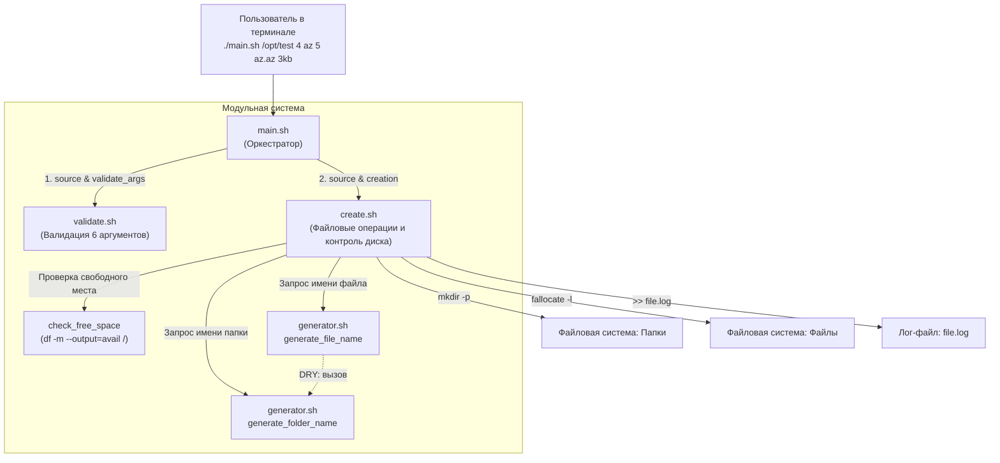

# Linux Monitoring v2.0 — Part 1 (Генератор файлов)
## Полный анатомический разбор и инженерный справочник решения

> **Назначение:** Персональное практическое руководство и база знаний для повторного использования паттернов в последующих частях (Part 4, Part 5) и реальной DevOps-практике.  
> **Окружение:** Ubuntu Server 24.04 LTS / Bash 5.x  
> **Директория модуля:** `monitoringv2/01/`  
> **Статус:** Разработан, протестирован, 100% готов к работе.

---

## Содержание

- [1. Паспорт задания и требования Школы 21](#1-паспорт-задания-и-требования-школы-21)
  - [Ключевые инварианты задачи](#ключевые-инварианты-задачи)
- [2. Архитектура решения (Декомпозиция)](#2-архитектура-решения-декомпозиция)
- [3. Анатомический разбор `main.sh` (Оркестратор)](#3-анатомический-разбор-mainsh-оркестратор)
  - [Построчный анализ `main.sh`](#построчный-анализ-mainsh)
- [4. Анатомический разбор `validate.sh` (Защитные барьеры)](#4-анатомический-разбор-validatesh-защитные-барьеры)
  - [Построчный анализ `validate.sh`](#построчный-анализ-validatesh)
- [5. Анатомический разбор `generator.sh` (Алгоритмы именования)](#5-анатомический-разбор-generatorsh-алгоритмы-именования)
  - [Построчный анализ `generator.sh`](#построчный-анализ-generatorsh)
- [6. Анатомический разбор `create.sh` (Системные вызовы и ФС)](#6-анатомический-разбор-createsh-системные-вызовы-и-фс)
  - [Построчный анализ `create.sh`](#построчный-анализ-createsh)
- [7. Технический справочник применённых механик Bash](#7-технический-справочник-применённых-механик-bash)
  - [1. Таблица операторов Parameter Expansion в Bash](#1-таблица-операторов-parameter-expansion-в-bash)
  - [2. Сравнение команд создания файлов в Linux](#2-сравнение-команд-создания-файлов-в-linux)
- [8. Инженерная шпаргалка: готовые синтаксические кирпичики](#8-инженерная-шпаргалка-готовые-синтаксические-кирпичики)

---

## 1. Паспорт задания и требования Школы 21

Скрипт запускается с **6 позиционными параметрами**:
```bash
./main.sh /opt/test 4 az 5 az.az 3kb
```

| № | Параметр | Ограничения и тип | Назначение в алгоритме |
|---|---|---|---|
| **1** | Базовый каталог | Абсолютный путь (`/path`), папка обязана физически существовать и быть доступна на запись | Место развёртывания файловой структуры |
| **2** | Кол-во папок | Натуральное целое число ($N \ge 1$) | Сколько поддиректорий создать в базовом каталоге |
| **3** | Буквы папок | Английский алфавит, $1 \le \text{длина} \le 7$ | Набор символов для формирования имени папок |
| **4** | Кол-во файлов | Натуральное целое число ($M \ge 1$) | Сколько файлов создать в **каждой** созданной папке |
| **5** | Буквы файла | Формат `name.ext` (имя $\le 7$ букв, расширение $\le 3$ буквы) | Набор символов для имени и расширения файлов |
| **6** | Размер файлов | От $1$ до $100$ с суффиксом `kb` (например: `3kb`, `100kb`) | Физический вес каждого генерируемого файла |

### Ключевые инварианты задачи:
1. **Длина буквенной части:** строго $\ge 4$ символов.
2. **Алфавитный порядок:** при вводе `az` допустимы `aaaz`, `aazzz`, но **категорически запрещено** `zaaa`. Порядок символов неизменен.
3. **Полнота использования:** каждая буква из переданного набора обязана встретиться в названии минимум 1 раз.
4. **Суффикс даты:** к имени папки и имени файла приклеивается дата запуска: `_DDMMYY` (например: `_280926`).
5. **Предохранитель диска:** скрипт аварийно завершает работу, если на корневом разделе `/` остаётся $\le 1$ Гб свободного места.
6. **Журналирование (Аудит):** все созданные папки и файлы фиксируются в лог `file.log`: `полный_путь дата_создания [размер]`.

---

## 2. Архитектура решения (Декомпозиция)

Логика разделена на 4 функциональных модуля по принципу единственной ответственности (**Single Responsibility Principle**):

```
01/
├── main.sh       # Единая точка входа: определение DIR, импорт модулей, оркестрация
├── validate.sh   # Слой валидации: проверка 6 аргументов по типам, путям и regex
├── generator.sh  # Алгоритмический слой: функции построения имён папок и файлов
└── create.sh     # Системный слой: проверка диска, fallocate, mkdir и логирование
```



---

## 3. Анатомический разбор `main.sh` (Оркестратор)

Файл `01/main.sh` отвечает за безопасную инициализацию окружения и передачу потока управления:

```bash
#!/bin/bash

DIR="$(cd "$(dirname "${BASH_SOURCE[0]}")" && pwd)"
source "$DIR/validate.sh"
source "$DIR/generator.sh"
source "$DIR/create.sh"

validate_args "$@"
creation "$@"
```

### Построчный анализ `main.sh`:

* **`DIR="$(cd "$(dirname "${BASH_SOURCE[0]}")" && pwd)"`**  
  **Стандарт надёжного определения директории скрипта в Linux:**
  1. `${BASH_SOURCE[0]}` — системный массив Bash. Нулевой элемент всегда указывает на файл, в котором эта переменная вызвана (в отличие от `$0`, который при запуске через `source` возвращает имя родительского шелла).
  2. `dirname` — отрезает имя файла от пути, оставляя только директорию.
  3. `cd ... && pwd` — выполняет переход в эту директорию и выводит её **абсолютный канонический путь**, разрешая любые символические ссылки и относительные переходы (`.`, `..`).
  4. Двойные кавычки `"$DIR/..."` предотвращают разделение пути на слова при наличии пробелов в именах папок.
  > **Результат:** скрипт можно запускать из любого каталога системы (например: `cd /var && /home/dev/school21/monitoringv2/01/main.sh ...`), и он всегда найдёт свои модули.

* **`source "$DIR/validate.sh"` (и остальные модули):**  
  Команда `source` (синоним `.`) читает файл и выполняет его инструкции **в текущем контексте процесса shell**.  
  *Отличие от `./validate.sh`:* прямой запуск `./script.sh` порождает дочерний subshell, чьи функции и переменные уничтожаются при выходе. Команда `source` загружает функции `validate_args`, `generate_folder_name` и `creation` напрямую в текущую память процесса `main.sh`.

* **`validate_args "$@"` и `creation "$@"`:**  
  Передача аргументов с использованием `"$@"`. В Bash двойные кавычки вокруг `$@` гарантируют сохранение целостности каждого аргумента: если в пути присутствуют пробелы, они останутся единым параметром.

---

## 4. Анатомический разбор `validate.sh` (Защитные барьеры)

В `01/validate.sh` применён паттерн **Guard Clauses (Защитные барьеры)**. Каждая проверка отсекает недопустимый ввод на входе, не допуская вложенности `if-else`:

```bash
#!/bin/bash

validate_args() {
if [ "$#" -ne 6 ]; then
    echo "Error: Six arguments are expected." >&2
    exit 1
fi

if [[ ! "$1" =~ ^/ ]]; then
    echo "Error: Path must be absolute" >&2
    exit 1
fi

if [[ ! -d "$1" ]]; then
    echo "Error: Directory "$1" does not exist on the file system" >&2
    exit 1
fi

if [[ ! -w "$1" ]]; then
    echo "Error: No right to write to the directory "$1""
    exit 1
fi

num_regex='^[1-9][0-9]*$'
if [[ ! "$2" =~ $num_regex ]] || [[ ! "$4" =~ $num_regex ]]; then
    echo "Eror: Argument is a stricly natural number."
    exit 1
fi

letters_arg3='^([a-zA-Z]{1,7})$'
if [[ ! "$3" =~ $letters_arg3 ]]; then
    echo "Error: Argument "$3" must contain from 1 to 7 letters"
    exit 1
fi

letters_arg5='^([a-zA-Z]{1,7})\.([a-zA-Z]{1,3})$'
if [[ ! "$5" =~ $letters_arg5 ]]; then
    echo "Error: invalid format"
    exit 1
fi

size_kb='^([1-9]|[1-9][0-9]|100)[kK][bB]$'
if [[ ! "$6" =~ $size_kb ]]; then
    echo "Error: Size must be an integer from 1 to 100"
    exit 1
fi
}
```

### Построчный анализ `validate.sh`:

1. **Количество аргументов (`[ "$#" -ne 6 ]`):**  
   Переменная `$#` содержит общее число аргументов. Оператор `-ne` производит строгое числовое сравнение. Если число не равно 6 — прерывание. Сообщение направляется в `stderr` (`>&2`).

2. **Синтаксис абсолютного пути (`[[ ! "$1" =~ ^/ ]]`):**  
   Оператор `=~` проверяет строку регулярным выражением. Символ `^/` означает, что первым знаком обязан быть слэш. Отрицание `!` отсекает относительные пути (`test`, `./test`).

3. **Физическое существование каталога (`[ ! -d "$1" ]`):**  
   Флаг файлового теста `-d` проверяет, что указанный путь существует на накопителе и является каталогом (а не файлом или пайпом).

4. **Права на запись (`[ ! -w "$1" ]`):**  
   Флаг `-w` (writable) проверяет наличие прав записи у текущего пользователя. Это защищает от падения при попытке создать папки в чужих каталогах без root-прав.

5. **Натуральные числа (`num_regex='^[1-9][0-9]*$'`):**  
   - `^` — начало строки.
   - `[1-9]` — первая цифра **строго от 1 до 9**. Это отсекает `0` (ноль), отрицательные числа и пустые строки.
   - `[0-9]*` — ноль или более любых цифр после первой. Пропускает `1`, `4`, `10`, `500`.
   - `$` — конец строки.
   - Условие `[[ ! "$2" =~ $num_regex ]] || [[ ! "$4" =~ $num_regex ]]`: проверяет сразу оба счётчика (папки и файлы). Переменная regex передаётся **без кавычек**.

6. **Буквы папки (`letters_arg3='^([a-zA-Z]{1,7})$'`):**  
   Класс `[a-zA-Z]` разрешает только латинские буквы обоих регистров. Квантификатор `{1,7}` задаёт диапазон от 1 до 7 знаков.

7. **Буквы файла и расширения (`letters_arg5='^([a-zA-Z]{1,7})\.([a-zA-Z]{1,3})$'`):**  
   - `([a-zA-Z]{1,7})` — первая группа: буквы имени (1–7 знаков).
   - `\.` — экранированная точка-разделитель.
   - `([a-zA-Z]{1,3})` — вторая группа: расширение (1–3 знака).

8. **Размер файла в Кб (`size_kb='^([1-9]|[1-9][0-9]|100)[kK][bB]$'`):**  
   - `([1-9]|[1-9][0-9]|100)` — числа от 1 до 100.
   - `[kK][bB]` — суффикс `kb` в любом регистре (`kb`, `Kb`, `KB`, `kB`).

---

## 5. Анатомический разбор `generator.sh` (Алгоритмы именования)

Модуль `01/generator.sh` отвечает за алгоритмическую трансформацию строк:

```bash
#!/bin/bash

datetime=$(date +%d%m%y)

generate_folder_name(){
  local letters="$1"
  local index="$2"
  local date_str=$datetime
  local name="$letters"
  local first_char="${letters:0:1}"
  local last_char="${letters: -1}"

  while [ "${#name}" -lt 4 ]; do
    name="${first_char}${name}"
  done
    
  local i
  for (( i=1; i<index; i++ )); do
    name="${name}${last_char}"
  done
    echo "${name}_${date_str}"
}

generate_file_name() {
  local letters="$1"
  local ext="$2"
  local index="$3"
  local base_name=$(generate_folder_name "$letters" "$index")
  echo "${base_name}.${ext}"
}
```

### Построчный анализ `generator.sh`:

* **`datetime=$(date +%d%m%y)`:**  
  Спецификатор `%d%m%y` возвращает текущую дату в компактном формате `DDMMYY` (например: `280926`). Переменная объявлена глобально для модуля, чтобы все созданные папки и файлы получали синхронную дату.

* **`local first_char="${letters:0:1}"`:**  
  **Substring Expansion (срез подстроки):** синтаксис `${parameter:offset:length}`. Смещение `0`, длина `1` извлекает **первый символ строки**. Для `az` вернёт `'a'`.

* **`local last_char="${letters: -1}"`:**  
  Извлекает **последний символ строки**.  
  > **Критический нюанс синтаксиса:** перед знаком минус **обязателен пробел** (`: -1`). Если написать `${letters:-1}`, Bash интерпретирует это как подстановку значения по умолчанию (*Parameter Default*), а не срез с конца!

* **Цикл дополнения до минимальной длины (строки 13–15):**
  ```bash
  while [ "${#name}" -lt 4 ]; do
    name="${first_char}${name}"
  done
  ```
  - `${#name}` — получение длины строки в символах.
  - `-lt 4` — пока длина строго меньше 4 символов.
  - На каждом шаге в самое начало строки приклеивается её первая буква (`first_char`).  
    *Пример:* `az` (длина 2) $\to$ `aaz` (длина 3) $\to$ `aaaz` (длина 4, цикл остановлен).  
    *Почему первая буква и почему в начало?* Это гарантирует соблюдение исходного алфавитного порядка (буква `a` идёт до буквы `z`) и сохраняет присутствие всех переданных символов.

* **Цикл уникальности имён (строки 17–20):**
  ```bash
  local i
  for (( i=1; i<index; i++ )); do
    name="${name}${last_char}"
  done
  ```
  - Для 1-й папки (`index=1`): условие `1 < 1` ложно $\to$ имя `aaaz`.
  - Для 2-й папки (`index=2`): цикл делает 1 шаг $\to$ `aaazz`.
  - Для 3-й папки (`index=3`): цикл делает 2 шага $\to$ `aaazzz`.
  - Последняя буква дублируется строго в конец, не нарушая алфавитный порядок `a...z` и гарантируя уникальность каждого созданного каталога.

* **Функция `generate_file_name` (Принцип DRY):**  
  Вместо дублирования аналогичных циклов `while` и `for` для файлов, функция повторно использует `generate_folder_name`, получая базовое имя `aaaz_280926`, и дописывает точку с расширением: `echo "${base_name}.${ext}"`.

---

## 6. Анатомический разбор `create.sh` (Системные вызовы и ФС)

Файл `01/create.sh` производит запись на накопитель, контролирует свободные ресурсы и ведёт журнал аудита:

```bash
#!/bin/bash

check_free_space() {
    local free_mb=$(df -m --output=avail / | tail -n 1)

    if [ "$free_mb" -le 1024 ]; then
        echo "Attention: there is less than 1GB of space left on the disk" >&2
        return 1
    fi
    return 0
}

creation() {
    local base_dir="$1"
    local folders_count="$2"
    local folder_letters="$3"
    local files_count="$4"
    local file_chars="$5"
    local file_size="$6"
    local log_file="$(pwd)/file.log"

    local file_name_letters=${file_chars%.*}
    local file_ext=${file_chars#*.}
    local size_kb=${file_size%[kK][bB]}

    for (( i=1; i<=folders_count; i++ )); do
        if ! check_free_space; then
        return 1
        fi

        local folder_name=$(generate_folder_name "$folder_letters" "$i")
        mkdir -p "$base_dir/$folder_name"
        local folder_path="$base_dir/$folder_name"
        echo "$folder_path $(date '+%Y-%m-%d %H:%M:%S')" >> "$log_file"

        for (( j=1; j<=files_count; j++ )); do
            if ! check_free_space; then
            return 1
            fi
            local file_name=$(generate_file_name "$file_name_letters" "$file_ext" "$j")
            local file_path="$folder_path/$file_name"
            fallocate -l "${size_kb}K" "$file_path"
            echo "$file_path $(date '+%Y-%m-%d %H:%M:%S') $file_size" >> "$log_file"
        done
    done
}
```

### Построчный анализ `create.sh`:

* **Функция `check_free_space()` (строки 3–11):**
  - `df -m --output=avail / | tail -n 1` — специализированный вызов GNU `df`:
    - Флаг `-m` переводит расчёт в Мегабайты ($1024^2$ байт).
    - Опция `--output=avail` возвращает **строго одну колонку** доступного пространства. Это защищает от сдвига колонок в контейнерах и overlay-файловых системах.
    - `tail -n 1` отсекает текстовый заголовок таблицы (`Avail`), возвращая чистое целое число.
  - Условие `[ "$free_mb" -le 1024 ]`: если свободного места меньше или равно 1024 Мб (1 Гб), функция возвращает код ошибки `return 1` с предупреждением в `stderr`.

* **Строки 22–24 (Разбор параметров через Parameter Expansion):**
  - `${file_chars%.*}` — удаление кратчайшего суффикса по шаблону `.*` с правого края строки. Отделяет имя файла от расширения (`az.txt` $\to$ `az`).
  - `${file_chars#*.}` — удаление кратчайшего префикса по шаблону `*.` с левого края строки. Отделяет расширение файла (`az.txt` $\to$ `txt`).
  - `${file_size%[kK][bB]}` — отсекает суффикс `kb` от размера, оставляя чистое число для утилиты `fallocate` (`3kb` $\to$ `3`).

* **Строка 32 (`mkdir -p "$base_dir/$folder_name"`):**  
  Флаг `-p` (*parents / no-error*) гарантирует идемпотентность: не выбрасывает ошибку, если папка уже существует, и создаёт всю цепочку промежуточных каталогов при необходимости.

* **Строка 42 (`fallocate -l "${size_kb}K" "$file_path"`):**  
  **Системный вызов `fallocate(2)`:**
  - Напрямую манипулирует экстентами (extents) в метаданных файловой системы (ext4/xfs).
  - Резервирует запрашиваемый объем дискового пространства **мгновенно**, без реальной записи нулей через шину ввода-вывода (в отличие от медленной утилиты `dd`).
  - Флаг `-l` принимает размер с суффиксом `K` (килобайты).

* **Строки 34 и 43 (`>> "$log_file"`):**  
  Оператор добавления в файл (`>>`) открывает лог с флагом ядра `O_APPEND`. Данные дописываются в конец файла без перезатирания предыдущих записей.

---

## 7. Технический справочник применённых механик Bash

### 1. Таблица операторов Parameter Expansion в Bash

| Синтаксис | Действие | Пример в нашем коде | Результат при `file_chars="az.txt"` |
|---|---|---|---|
| `${#var}` | Длина строки в символах | `${#name}` | Для `"aaaz"` вернёт `4` |
| `${var:offset:len}` | Срез подстроки от смещения `offset` длиной `len` | `${letters:0:1}` | Для `"az"` вернёт `'a'` |
| `${var: -1}` | Последний символ строки (с пробелом!) | `${letters: -1}` | Для `"az"` вернёт `'z'` |
| `${var%pattern}` | Удаление кратчайшего совпадения с конца | `${file_chars%.*}` | Для `"az.txt"` вернёт `"az"` |
| `${var#pattern}` | Удаление кратчайшего совпадения с начала | `${file_chars#*.}` | Для `"az.txt"` вернёт `"txt"` |
| `${var%[kK][bB]}` | Удаление суффикса размера | `${file_size%[kK][bB]}` | Для `"3kb"` вернёт `"3"` |

---

### 2. Сравнение команд создания файлов в Linux

| Команда | Принцип работы | Скорость на 10 000 файлов | Нагрузка на диск (I/O) |
|---|---|---|---|
| **`fallocate -l 3K file`** | Системный вызов ядра `fallocate()`. Выделяет блоки в метаданных inode без записи данных. | **Мгновенно (< 0.1 сек)** | Нулевая (только метаданные) |
| `truncate -s 3K file` | Создает sparse (разреженный) файл через системный вызов `ftruncate()`. | Мгновенно (< 0.1 сек) | Нулевая (блоки не выделяются) |
| `dd if=/dev/zero of=file bs=1K count=3` | Физическая побайтовая запись нулевых байт из псевдоустройства `/dev/zero`. | Медленно (секунды) | Высокая (износ накопителя) |

---

## 8. Инженерная шпаргалка: готовые синтаксические кирпичики

Этот раздел служит **быстрой справочной шпаргалкой**, куда удобно подсмотреть в любой момент при написании скриптов в следующих частях (Part 4, Part 5) и реальных DevOps-задачах:

### 1. Каноническое определение директории скрипта
```bash
# Получить абсолютный путь к папке, где лежит сам скрипт (независимо от pwd)
DIR="$(cd "$(dirname "${BASH_SOURCE[0]}")" && pwd)"
source "$DIR/validate.sh"
```

### 2. Одноколоночный замер свободного места через `df`
```bash
# Возвращает строго одно целое число (мегабайты) без сдвига колонок
free_mb=$(df -m --output=avail / | tail -n 1)

if [ "$free_mb" -le 1024 ]; then
    echo "Attention: less than 1GB free" >&2
    return 1
fi
```

### 3. Нарезка строк через Parameter Expansion (без вызова `cut` / `awk`)
```bash
# Разделить name.ext на имя и расширение
name="${full_name%.*}"   # всё до последней точки
ext="${full_name#*.}"    # всё после первой точки

# Отсечь суффикс размера (kb/mb)
size_num="${raw_size%[kK][bB]}"
```

### 4. Извлечение первого и последнего символа строки
```bash
first_char="${str:0:1}"  # первый символ
last_char="${str: -1}"   # последний символ (ПРОБЕЛ перед минусом обязателен!)
```

### 5. Алгоритм расширения строки до минимальной длины
```bash
# Дополнять строку первым символом слева, пока её длина меньше 4
while [ "${#name}" -lt 4 ]; do
    name="${first_char}${name}"
done
```

### 6. Мгновенная аллокация файла фиксированного размера (`fallocate`)
```bash
# Создаёт файл без реальной записи нулей через I/O
fallocate -l "${size_kb}K" "$file_path"
```

### 7. Идемпотентное создание вложенных директорий (`mkdir -p`)
```bash
# Не падает, если папка уже есть, создаёт родителей
mkdir -p "$base_dir/$folder_name"
```

### 8. Форматированная фиксация события в лог
```bash
# Формат даты ISO и дозапись с блокировкой конца файла (O_APPEND)
echo "$file_path $(date '+%Y-%m-%d %H:%M:%S') $file_size" >> "$log_file"
```
