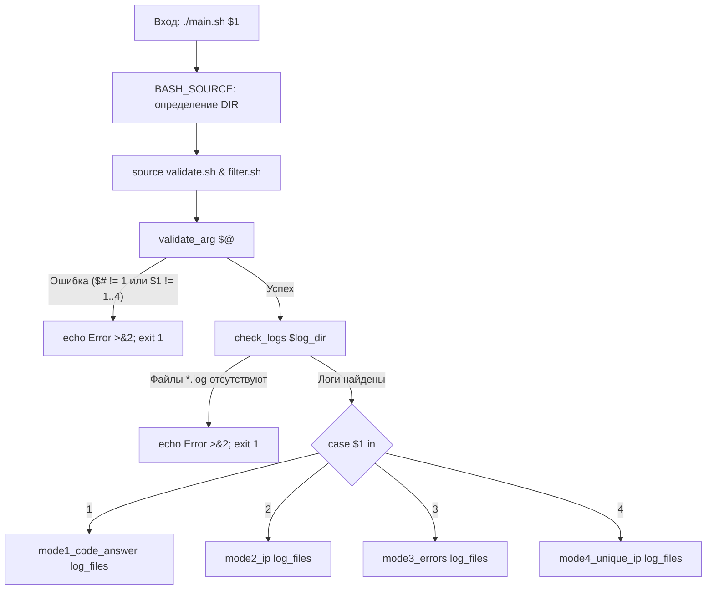

# Linux Monitoring v2.0 — Part 5 (Мониторинг логов Nginx через awk)
## Полный анатомический разбор и инженерный справочник решения

> **Назначение:** Персональное практическое руководство и база знаний для повторного использования паттернов в последующих частях (Part 6 GoAccess, Part 7–9 Prometheus/Grafana) и реальной DevOps-практике.  
> **Окружение:** Ubuntu Server 24.04 LTS / Bash 5.x / GNU awk 5.x  
> **Директория модуля:** `monitoringv2/05/`  
> **Статус:** Разработан, протестирован сквозным боевым прогоном, 100% готов к работе.

---

## Содержание

- [1. Паспорт задания и требования Школы 21](#1-паспорт-задания-и-требования-школы-21)
  - [4 режима работы](#4-режима-работы)
  - [Инварианты выполнения](#инварианты-выполнения)
- [2. Архитектура решения (Декомпозиция)](#2-архитектура-решения-декомпозиция)
- [3. Анатомический разбор `main.sh` (Оркестратор и диспетчер)](#3-анатомический-разбор-mainsh-оркестратор-и-диспетчер)
  - [Построчный анализ `main.sh`](#построчный-анализ-mainsh)
- [4. Анатомический разбор `validate.sh` (Защитные барьеры)](#4-анатомический-разбор-validatesh-защитные-барьеры)
  - [Построчный анализ `validate.sh`](#построчный-анализ-validatesh)
- [5. Анатомический разбор `filter.sh` (Потоковая обработка `awk`)](#5-анатомический-разбор-filtersh-потоковая-обработка-awk)
  - [Режим 1: Сортировка по коду ответа (`sort -k9,9n`)](#режим-1-сортировка-по-коду-ответа-sort--k99n)
  - [Режим 2: Уникальные IP (`!seen[$1]++`)](#режим-2-уникальные-ip-seen1)
  - [Режим 3: Ошибочные запросы (коды 4xx и 5xx)](#режим-3-ошибочные-запросы-коды-4xx-и-5xx)
  - [Режим 4: Уникальные IP среди ошибок](#режим-4-уникальные-ip-среди-ошибок)
- [6. Системные грабли и ловушки ядра Linux](#6-системные-грабли-и-ловушки-ядра-linux)
  - [1. Ловушка `sort -k9n` против `-k9,9n`](#1-ловушка-sort--k9n-против--k99n)
  - [2. Ловушка масок в тесте `[ -e $dir/*.log ]`](#2-ловушка-масок-в-тесте---e-dirlog-)
  - [3. Ловушка разворачивания массивов `$array` vs `"${array[@]}"`](#3-ловушка-разворачивания-массивов-array-vs-array)
  - [4. Ловушка потоков вывода в `compgen`](#4-ловушка-потоков-вывода-в-compgen)
- [7. Методология тестирования и верификации](#7-методология-тестирования-и-верификации)
  - [Синтетические тесты валидации](#синтетические-тесты-валидации)
  - [Проверка сортировки и уникальности](#проверка-сортировки-и-уникальности)
- [8. Инженерная шпаргалка: готовые синтаксические кирпичики](#8-инженерная-шпаргалка-готовые-синтаксические-кирпичики)

---

## 1. Паспорт задания и требования Школы 21

Скрипт предназначен для потокового анализа и мониторинга 5 лог-файлов Nginx, сгенерированных модулем Part 4 (`04/nginx_1.log` ... `04/nginx_5.log`).

Скрипт запускается с **1 позиционным параметром**:
```bash
./main.sh <режим>
```

Где `<режим>` принимает строго одно из значений: **`1`**, **`2`**, **`3`** или **`4`**.

### 4 режима работы:
1. **Режим 1:** Все записи, отсортированные по коду ответа.
2. **Режим 2:** Все уникальные IP, встречающиеся в записях.
3. **Режим 3:** Все запросы с ошибками (коды 4xx и 5xx).
4. **Режим 4:** Все уникальные IP, которые встречаются среди ошибочных запросов.

### Инварианты выполнения:
- **Строгий контроль параметров:** Любое отклонение от 1 аргумента в диапазоне `1..4` прерывает работу с выводом ошибки в `stderr` и кодом завершения `1`.
- **Защита от отсутствия логов:** Если логи Part 4 ещё не были сгенерированы, скрипт выводит внятное сообщение об ошибке в `stderr` и завершается с кодом `1`.
- **Независимость от `pwd`:** Скрипт корректно находит логи независимо от того, из какой директории запущен (`05/`, корень проекта или `/tmp`).
- **Высокая производительность:** Фильтрация и дедупликация производятся в потоке средствами `awk` за $O(N)$ без создания лишних временных файлов.

---

## 2. Архитектура решения (Декомпозиция)

В соответствии с инженерным стандартом проекта DO4, логика разделена на 3 независимых модуля:

```text
05/
├── main.sh       # Единая точка входа: определение DIR, импорт модулей, поиск логов, диспетчер case
├── validate.sh   # Слой валидации: проверка аргументов и zero-fork проверка наличия лог-файлов
└── filter.sh     # Исполнительный слой: 4 функции потокового парсинга и фильтрации awk
```



---

## 3. Анатомический разбор `main.sh` (Оркестратор и диспетчер)

Файл `05/main.sh` координирует вызовы, проверяет предусловия и направляет массив файлов в нужную функцию-фильтр:

```bash
#!/bin/bash

DIR="$(cd "$(dirname "${BASH_SOURCE[0]}")" && pwd)"
source "$DIR/validate.sh"
source "$DIR/filter.sh"

validate_arg "$@"

log_dir=$DIR/../04/
check_logs "$log_dir"
log_files=("$log_dir"/*.log)

case "$1" in
    1) mode1_code_answer "${log_files[@]}"
    ;;
    2) mode2_ip "${log_files[@]}"
    ;;
    3) mode3_errors "${log_files[@]}"
    ;;
    4) mode4_unique_ip "${log_files[@]}"
    ;;
    *)
    echo "Error: Unknown filer" >&2
    exit 1
    ;;
esac
```

### Построчный анализ `main.sh`:
- **Строки 3–5:** Каноническое вычисление абсолютного каталога скрипта через `${BASH_SOURCE[0]}` и подключение зависимостей `source`.
- **Строка 7 (`validate_arg "$@"`):** Защитный барьер: проверка аргументов командной строки до начала любых файловых операций.
- **Строки 9–11:**
  - `log_dir=$DIR/../04/` — относительный путь к каталогу логов разрешается относительно расположения скрипта, гарантируя работу при любом `$PWD`.
  - `check_logs "$log_dir"` — валидация физического присутствия логов.
  - `log_files=("$log_dir"/*.log)` — сохранение путей всех найденных файлов логов в индексированный массив Bash.
- **Строки 13–26:** Диспетчер `case`. Передаёт массив логов `"${log_files[@]}"` в соответствующую функцию фильтрации. Конструкция `*)` служит финальным защитным барьером от непредвиденных значений.

---

## 4. Анатомический разбор `validate.sh` (Защитные барьеры)

```bash
#!/bin/bash


validate_arg() {
if [ "$#" -ne 1 ]; then
  echo "Error: One argument." >&2
  exit 1
fi

if [[ ! "$1" =~ ^[1-4]$ ]]; then
  echo "Error: An argument from one to four." >&2
  exit 1
fi
}

check_logs() {
  local dir="$1"
  if ! compgen -G "$dir/*.log" >/dev/null; then
    echo "Error: Logs not found" >&2
    exit 1
  fi
}
```

### Построчный анализ `validate.sh`:
- **Строки 5–8:** Проверка количества аргументов. `$# -ne 1` перехватывает запуск без параметров или с избыточными параметрами. Ошибка уходит строго в дескриптор `2` (`stderr`).
- **Строки 10–13:** Регулярное выражение `^[1-4]$` строго проверяет, что передан ровно один символ в диапазоне от `1` до `4`. Отсекаются буквы, спецсимволы, отрицательные числа и многозначные цифры (`0`, `5`, `10`).
- **Строки 16–22 (`check_logs`):**
  - Использование встроенной команды `compgen -G "$dir/*.log"`.
  - В отличие от внешнего вызова `find ... | wc -l`, встроенный `compgen` не порождает дочерних процессов шелла (`fork()`), выполняя поиск в памяти процесса.
  - Перенаправление `>/dev/null` глушит вывод найденных путей в `stdout`.
  - Если файлы отсутствуют, `compgen` возвращает код `1`, условие `!` срабатывает, скрипт выводит ошибку в `stderr` и завершается с кодом `1`.

---

## 5. Анатомический разбор `filter.sh` (Потоковая обработка `awk`)

```bash
#!/bin/bash

mode1_code_answer() {
  awk '{print $0}' "$@" | sort -k9,9n
}

mode2_ip() {
  awk '!seen[$1]++ {print $1}' "$@"
}

mode3_errors() {
  awk '$9 ~ /^[45][0-9]{2}$/ {print $0}' "$@"
}

mode4_unique_ip() {
  awk '($9 ~ /^[45][0-9]{2}$/) && !seen[$1]++ {print $1}' "$@"
}
```

### Режим 1: Сортировка по коду ответа (`sort -k9,9n`)
```bash
awk '{print $0}' "$@" | sort -k9,9n
```
- `awk '{print $0}' "$@"` последовательно считывает все переданные файлы логов и выдаёт их общий поток строк в стандартный вывод.
- `sort -k9,9n`:
  - `-k9,9` задаёт строгие границы ключа сортировки: **начать со столбца 9 и закончить на столбце 9** (поле HTTP-статуса).
  - Модификатор `n` указывает числовое упорядочивание (`numeric sort`), предотвращая лексикографические ошибки (например, `400` перед `50`).

### Режим 2: Уникальные IP (`!seen[$1]++`)
```bash
awk '!seen[$1]++ {print $1}' "$@"
```
- `$1` — первое поле Combined Log Format (IP-адрес клиента).
- `seen` — ассоциативный массив (хэш-таблица) в памяти `awk`.
- Механика постфиксного инкремента:
  - При первой встрече IP ячейка `seen[$1]` не инициализирована и равна `0` (false). Инкремент `++` возвращает старое значение `0` и сразу увеличивает ячейку до `1`.
  - Оператор отрицания `!` обращает `0` в `1` (true). Условие истинно $\to$ выполняется действие `{print $1}`.
  - При повторных встречах ячейка уже содержит значение $\ge 1$. Выражение возвращает истину, а отрицание `!` делает его `0` (false) $\to$ дубликат отбрасывается.
- Сложность алгоритма: **$O(N)$** в один проход, без необходимости предварительной сортировки.

### Режим 3: Ошибочные запросы (коды 4xx и 5xx)
```bash
awk '$9 ~ /^[45][0-9]{2}$/ {print $0}' "$@"
```
- Оператор `~` в `awk` производит сопоставление поля с регулярным выражением.
- Регулярное выражение `/^[45][0-9]{2}$/`:
  - `^[45]` — первая цифра строго 4 (ошибки клиента) или 5 (ошибки сервера).
  - `[0-9]{2}$` — ровно две любые последующие цифры до конца поля (всего 3 цифры).
  - Корректно отбирает все статусы: 400, 401, 403, 404, 500, 501, 502, 503. Игнорирует успешные запросы (200, 201).
- Печатается вся строка целиком `{print $0}`.

### Режим 4: Уникальные IP среди ошибок
```bash
awk '($9 ~ /^[45][0-9]{2}$/) && !seen[$1]++ {print $1}' "$@"
```
- Объединение предикатов через логическое И (`&&`).
- **Оптимизация короткого замыкания (Short-Circuit Evaluation):**  
  Если запрос успешный (`$9` равен 200), первое условие ложно, и `awk` даже не обращается ко второй части `!seen[$1]++`. В итоге хэш-таблица `seen` не засоряется IP-адресами успешных запросов, экономя оперативную память.
- Выводится только дедуплицированный IP-адрес проблемного клиента.

---

## 6. Системные грабли и ловушки ядра Linux

### 1. Ловушка `sort -k9n` против `-k9,9n`
Если ключ указан как `-k9n` без ограничителя конца поля, утилита `sort` сравнивает 9-й столбец и **продолжает сравнение по всем последующим столбцам до конца строки**. Это искажает порядок сортировки, если строки имеют одинаковый статус, но разные рефереры или User-Agent. Запись `-k9,9n` гарантирует изоляцию строго 9-го поля.

### 2. Ловушка масок в тесте `[ -e $dir/*.log ]`
- Если написать `[ -e "$dir/*.log" ]` в кавычках, Bash будет искать файл с буквальным именем `*.log` (со звёздочкой).
- Если написать `[ -e $dir/*.log ]` без кавычек, при наличии 5 файлов логов маска раскроется в `[ -e f1 f2 f3 f4 f5 ]`, что вызовет синтаксический сбой `[: too many arguments`.
- **Решение:** использовать встроенный `compgen -G "$dir/*.log" >/dev/null`.

### 3. Ловушка разворачивания массивов `$array` vs `"${array[@]}"`
В Bash обращение к массиву как `$array` возвращает **только нулевой элемент** (первый файл). Чтобы передать все файлы массива целиком без разделения путей с пробелами, обязательно используется синтаксис `"${array[@]}"`.

### 4. Ловушка потоков вывода в `compgen`
Команда `compgen` при успешном поиске выводит все найденные имена в `stdout`. Перенаправление `2>/dev/null` глушит только ошибки, но оставляет вывод в консоль. Чтобы запустить проверку без лишнего шума, глушить нужно стандартный вывод: `>/dev/null`.

---

## 7. Методология тестирования и верификации

### Синтетические тесты валидации:
```bash
./05/main.sh           # Ошибка: One argument. (exit 1)
./05/main.sh 1 2       # Ошибка: One argument. (exit 1)
./05/main.sh 0         # Ошибка: An argument from one to four. (exit 1)
./05/main.sh 5         # Ошибка: An argument from one to four. (exit 1)
./05/main.sh test      # Ошибка: An argument from one to four. (exit 1)
```

### Проверка сортировки и уникальности:
1. **Проверка непрерывной числовой сортировки Режима 1:**
   ```bash
   ./05/main.sh 1 | awk '{print $9}' | sort -C -n && echo "OK: Sorted"
   ```
2. **Проверка отсутствия дубликатов в Режиме 2:**
   ```bash
   diff <(./05/main.sh 2) <(./05/main.sh 2 | sort -u) && echo "OK: All Unique"
   ```
3. **Проверка отсутствия кодов 2xx в Режиме 3:**
   ```bash
   ./05/main.sh 3 | awk '$9 < 400 {print "Error: " $9}'
   # Вывод должен быть абсолютно пуст
   ```

---

## 8. Инженерная шпаргалка: готовые синтаксические кирпичики

Этот раздел служит **быстрой справочной шпаргалкой**, куда удобно подсмотреть в любой момент при написании скриптов в следующих частях (Part 6–9) и реальных DevOps-задачах:

### 1. Zero-Fork проверка файлов по маске через `compgen -G`
```bash
# Проверяет наличие файлов без создания дочерних процессов find и wc
if ! compgen -G "$dir/*.log" >/dev/null; then
    echo "Error: No logs found in $dir" >&2
    exit 1
fi
```

### 2. Дедупликация потока данных в один проход $O(N)$ в `awk`
```bash
# Вывести только уникальные значения первого поля (IP, имена пользователей, ID)
awk '!seen[$1]++ { print $1 }' file.txt
```

### 3. Фильтрация числового диапазона через регулярные выражения в `awk`
```bash
# Отбор трёхзначных кодов 4xx и 5xx
awk '$9 ~ /^[45][0-9]{2}$/ { print $0 }' access.log
```

### 4. Объединение условий со Short-Circuit Evaluation
```bash
# Дедупликация выполняется ТОЛЬКО для строк, прошедших фильтр ошибки
awk '($9 ~ /^[45][0-9]{2}$/) && !seen[$1]++ { print $1 }' access.log
```

### 5. Строгая числовая сортировка по конкретной колонке
```bash
# Сортировать строго по 9-й колонке, игнорируя последующие поля строки
sort -k9,9n access.log
```

### 6. Передача массива файлов из `main.sh` и приём через `"$@"`
```bash
# В main.sh:
files=("$dir"/*.log)
my_filter "${files[@]}"

# В filter.sh:
my_filter() {
    awk '{ print $0 }' "$@"
}
```
