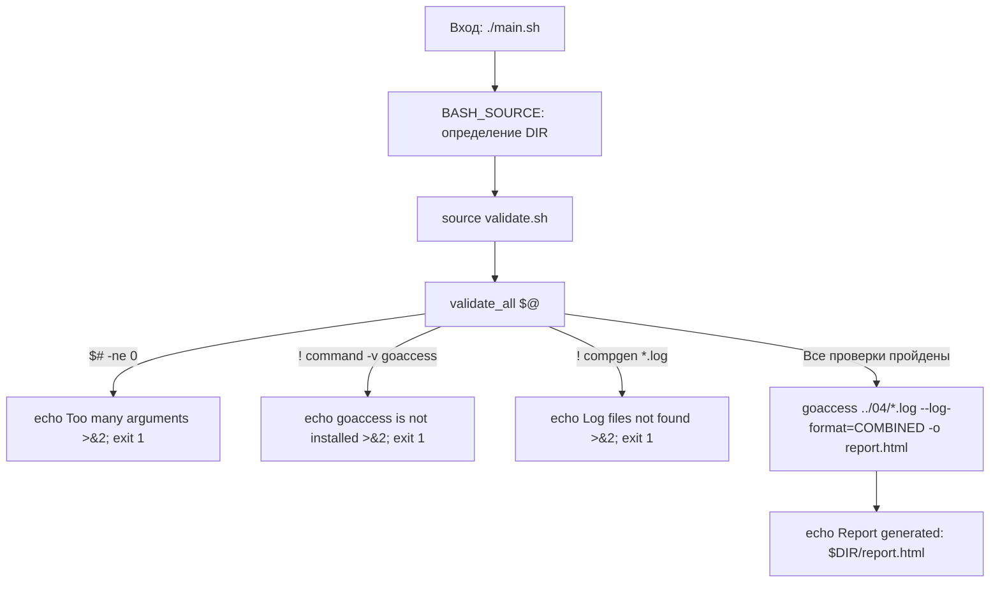
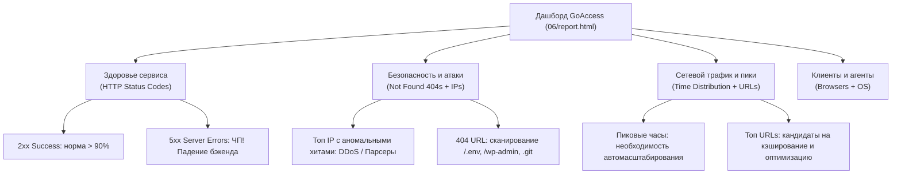

# Linux Monitoring v2.0 — Part 6 (GoAccess: веб-аналитика и мониторинг)
## Полный анатомический разбор и инженерный справочник решения

> **Назначение:** Персональное практическое руководство и база знаний для повторного использования паттернов в последующих частях (Part 7–9 Prometheus / Grafana) и реальной DevOps-практике.  
> **Окружение:** Ubuntu Server 24.04 LTS / Bash 5.x / GoAccess v1.8+  
> **Директория модуля:** `monitoringv2/06/`  
> **Статус:** Разработан, протестирован, 100% готов к работе.

---

## Содержание

- [1. Паспорт задания и требования Школы 21](#1-паспорт-задания-и-требования-школы-21)
  - [Сопоставление с 4 вопросами Part 5](#сопоставление-с-4-вопросами-part-5)
  - [Инварианты выполнения](#инварианты-выполнения)
- [2. Архитектура решения (Декомпозиция)](#2-архитектура-решения-декомпозиция)
- [3. Анатомический разбор `main.sh` (Оркестратор)](#3-анатомический-разбор-mainsh-оркестратор)
  - [Построчный анализ `main.sh`](#построчный-анализ-mainsh)
- [4. Анатомический разбор `validate.sh` (Защитные барьеры)](#4-анатомический-разбор-validatesh-защитные-барьеры)
  - [Построчный анализ `validate.sh`](#построчный-анализ-validatesh)
- [5. Разбор дашборда GoAccess: практический гид для DevOps](#5-разбор-дашборда-goaccess-практический-гид-для-devops)
  - [5.1. Макет интерфейса и анатомия дашборда](#51-макет-интерфейса-и-анатомия-дашборда)
  - [5.2. Верхняя панель KPI: глобальное здоровье сервера](#52-верхняя-панель-kpi-глобальное-здоровье-сервера)
  - [5.3. Полный разбор ключевых панелей: на что смотреть инженеру](#53-полный-разбор-ключевых-панелей-на-что-смотреть-инженеру)
  - [5.4. Инженерные сценарии расследования (DevOps Playbooks)](#54-инженерные-сценарии-расследования-devops-playbooks)
  - [5.5. Сопоставление с Part 5 и ограничение изолированных хэш-таблиц](#55-сопоставление-с-part-5-и-ограничение-изолированных-хэш-таблиц)
  - [5.6. Работа в консольном режиме TUI (терминал)](#56-работа-в-консольном-режиме-tui-терминал)
- [6. Системные грабли и ловушки ядра Linux и GoAccess](#6-системные-грабли-и-ловушки-ядра-linux-и-goaccess)
  - [1. Ловушка отсутствия явного формата `--log-format=COMBINED`](#1-ловушка-отсутствия-явного-формата---log-formatcombined)
  - [2. Ошибка `No input data was provided`](#2-ошибка-no-input-data-was-provided)
  - [3. Утечка вывода `command -v` в `stdout`](#3-утечка-вывода-command--v-в-stdout)
  - [4. Ложное требование поднятия веб-сервера для локального HTML](#4-ложное-требование-поднятия-веб-сервера-для-локального-html)
- [7. Методология тестирования и верификации](#7-методология-тестирования-и-верификации)
  - [Тесты защитных барьеров](#тесты-защитных-барьеров)
  - [Проверка генерации отчёта](#проверка-генерации-отчёта)
- [8. Инженерная шпаргалка: готовые синтаксические кирпичики](#8-инженерная-шпаргалка-готовые-синтаксические-кирпичики)

---

## 1. Паспорт задания и требования Школы 21

В задании Part 6 требуется с помощью утилиты **GoAccess** получить ту же самую аналитическую информацию по логам Nginx, которая была получена через `awk` в Part 5, и сгенерировать веб-интерфейс в формате HTML.

Скрипт запускается **строго без аргументов**:
```bash
./main.sh
```

### Сопоставление с 4 вопросами Part 5:
1. **Все записи, отсортированные по коду ответа:**  
   Отображаются в панели **[HTTP Status Codes]** со сводной статистикой и процентами.
2. **Все уникальные IP-адреса:**  
   Отображаются в панели **[Visitor Hostnames and IPs (Unique Visitors)]**.
3. **Все запросы с ошибками (4xx и 5xx):**  
   Отображаются в группах *4xx Client Errors* и *5xx Server Errors* панели статусов, а также в панели *Not Found URLs (404s)*.
4. **Все уникальные IP среди ошибочных запросов:**  
   GoAccess агрегирует метрики независимыми хэш-таблицами, поэтому в чистом статическом отчёте нет перекрёстной фильтрации. Для извлечения только IP с ошибками используется конвейерная фильтрация потока: `awk '$9 ~ /^[45]/' ../04/*.log | goaccess - --log-format=COMBINED`.

### Инварианты выполнения:
- **Нулевое количество аргументов:** Любой переданный аргумент приводит к немедленному завершению с ошибкой в `stderr` и кодом `1`.
- **Проверка зависимостей:** Скрипт проверяет наличие бинарника `goaccess` в `$PATH`. Если утилита не установлена — выдаётся инструкция по установке в `stderr` с кодом `1`.
- **Проверка входных данных:** Скрипт валидирует наличие лог-файлов `*.log` в `../04/` без вызова тяжелых внешних утилит.
- **Генерация статического HTML:** Результат записывается в локальный автономный файл `report.html` рядом со скриптом.

---

## 2. Архитектура решения (Декомпозиция)

В соответствии с инженерным стандартом проекта, решение декомпозировано на 2 модуля:

```text
06/
├── main.sh       # Точка входа: канонический DIR, импорт валидатора, вызов GoAccess, печать путей
└── validate.sh   # Слой валидации: проверка аргументов ($# == 0), наличия goaccess и файлов логов
```



---

## 3. Анатомический разбор `main.sh` (Оркестратор)

```bash
#!/bin/bash

DIR="$(cd "$(dirname "${BASH_SOURCE[0]}")" && pwd)"
source "$DIR/validate.sh"

validate_all "$@"

goaccess "$DIR/../04/"*.log --log-format=COMBINED -o "$DIR/report.html"
echo "Report generated: $DIR/report.html"
```

### Построчный анализ `main.sh`:
- **Строка 3:** Каноническое определение абсолютного пути каталога скрипта через `${BASH_SOURCE[0]}`. Гарантирует запуск из любого места (`pwd`).
- **Строка 4:** Подключение библиотеки защитных барьеров `validate.sh` в текущий контекст процесса shell.
- **Строка 6 (`validate_all "$@"`):** Запуск валидации. Если хотя бы одно предусловие нарушено, скрипт завершается внутри функции с кодом `1`.
- **Строка 8:** Запуск компиляции аналитического отчёта:
  - `"$DIR/../04/"*.log` — передача всех файлов логов Nginx из модуля Part 4.
  - `--log-format=COMBINED` — директива парсеру использовать Combined Log Format без интерактивных запросов.
  - `-o "$DIR/report.html"` — сохранение результата в статический HTML-файл.
- **Строка 9:** Вывод абсолютного пути к созданному файлу для удобства запуска в браузере.

---

## 4. Анатомический разбор `validate.sh` (Защитные барьеры)

```bash
#!/bin/bash

validate_all() {
  if [ "$#" -ne 0 ]; then
    echo "Error: Too many arguments" >&2
    exit 1
  fi

  if ! command -v goaccess >/dev/null 2>&1 ; then
    echo "Error: goaccess is not installed. Run: sudo apt install -y goaccess" >&2
    exit 1
  fi

  if ! compgen -G "$DIR/../04/*.log" >/dev/null; then
    echo "Error: Log files not found." >&2
    exit 1
  fi
}
```

### Построчный анализ `validate.sh`:
- **Строки 4–7:** Проверка количества аргументов. По спецификации скрипт не должен принимать аргументов (`$# -ne 0`). При попытке передать параметры скрипт выбрасывает сообщение в `stderr` и завершается с кодом `1`.
- **Строки 9–12:** Проверка наличия бинарника `goaccess`:
  - `command -v` — встроенная команда POSIX-шелла (быстрее `which` и не зависит от внешних пакетов).
  - Перенаправление `>/dev/null 2>&1` предотвращает вывод пути к бинарнику (`/usr/bin/goaccess`) в терминал при успешной проверке.
  - При отсутствии бинарника выдаётся чёткая инструкция по установке через `apt`.
- **Строки 14–17:** Zero-Fork проверка наличия файлов логов:
  - Встроенная команда `compgen -G` проверяет соответствие маске без создания дочерних процессов `find` и `wc`.
  - Перенаправление `>/dev/null` подавляет вывод путей найденных файлов в стандартный поток вывода.
  - Защищает `goaccess` от фатального падения `No input data was provided`.

---

## 5. Разбор дашборда GoAccess: практический гид для DevOps

### 5.1. Макет интерфейса и анатомия дашборда

Веб-отчёт GoAccess (`06/report.html`) скомпилирован в автономную одностраничную панель мониторинга (Single Page Application на чистом HTML/CSS/Vanilla JS/D3.js).

Интерфейс разделен на три функциональные зоны:

```text
┌────────────────────────────────────────────────────────────────────────────────────────┐
│ GOACCESS v1.8+ ── [Theme: Dark Gray / Bright] ── [Auto-Refresh / Settings]             │
├────────────────────────────────────────────────────────────────────────────────────────┤
│ ВЕРХНЯЯ ПАНЕЛЬ СВОДНЫХ KPI (General Statistics):                                       │
│ [Total Requests: 2,042] [Valid: 2,042] [Failed: 0] [Unique Visitors: 254]             │
│ [Unique URLs: 31]       [Unique Static: 0]         [Bandwidth: ~5.05 MiB]              │
│ [Log Size: 247 KiB]     [Date Range: 24/Sep/2026 - 28/Sep/2026]                        │
├────────────────────────────────────────────────────────────────────────────────────────┤
│ ПАНЕЛИ АНАЛИТИКИ (Grid Layout с интерактивными графиками и таблицами):                 │
│                                                                                        │
│ ┌───────────────────────────────────────┐ ┌──────────────────────────────────────────┐ │
│ │ 1. Unique Visitors per Day            │ │ 2. Requested Files (URLs)                │ │
│ │ ── График динамики по дням (D3.js)    │ │ ── Топ запрошенных путей (/api, /index)  │ │
│ │ ── Таблица: Hits, Visitors, Tx. Amount│ │ ── Таблица: Hits, Tx. Amount, Protocol   │ │
│ └───────────────────────────────────────┘ └──────────────────────────────────────────┘ │
│ ┌───────────────────────────────────────┐ ┌──────────────────────────────────────────┐ │
│ │ 3. Not Found URLs (404s)              │ │ 4. Visitor Hostnames and IPs             │ │
│ │ ── Несуществующие URL и сканеры       │ │ ── Список уникальных IP-клиентов         │ │
│ │ ── Анализ атак и битых ссылок         │ │ ── Анализ ботов, DDoS и распределения    │ │
│ └───────────────────────────────────────┘ └──────────────────────────────────────────┘ │
│ ┌───────────────────────────────────────┐ ┌──────────────────────────────────────────┐ │
│ │ 5. Time Distribution                  │ │ 6. HTTP Status Codes                     │ │
│ │ ── Нагрузка по часам суток (00 - 23)  │ │ ── 2xx, 3xx, 4xx, 5xx с деталями         │ │
│ │ ── Выявление пиков и окон техобслуж.  │ │ ── Главный барометр здоровья сервиса    │ │
│ └───────────────────────────────────────┘ └──────────────────────────────────────────┘ │
│ ┌───────────────────────────────────────┐ ┌──────────────────────────────────────────┐ │
│ │ 7. Operating Systems                  │ │ 8. Browsers                              │ │
│ │ ── Доли ОС клиентов (Linux, Win, Mac) │ │ ── Браузеры, curl, боты, пауки           │ │
│ └───────────────────────────────────────┘ └──────────────────────────────────────────┘ │
└────────────────────────────────────────────────────────────────────────────────────────┘
```

---

### 5.2. Верхняя панель KPI: глобальное здоровье сервера

В самом верху отчёта расположены 8 ключевых метрик. Инженер начинает диагностику именно с них:

| Метрика | Значение в нашем логе | Инженерный смысл и на что смотреть |
|---|:---:|---|
| **Total Requests** | `2,042` | Общее число входящих HTTP-запросов (хитов) за весь период логов. |
| **Valid Requests** | `2,042 (100%)` | Корректно распарсенные строки в Combined Log Format. Если процент $<100\%$, в логах есть мусорные строки или сбоит форматтер Nginx. |
| **Failed Requests** | `0` | Число битых строк лога, которые парсер не смог разобрать. Должно быть строго `0`. |
| **Unique Visitors** | `254` | Количество уникальных IP-адресов. Отношение $\frac{\text{Hits}}{\text{Visitors}}$ показывает среднюю глубину сессии (у нас: $\approx 8$ запросов на 1 IP). |
| **Unique Files (URLs)** | `31` | Количество уникальных обработанных эндпоинтов сервиса. |
| **Static Files** | `0` | Количество запросов к ассетам (.png, .css, .js). В чистых API или тестовых логах может быть 0. |
| **Tx. Amount (Bandwidth)** | `~5.05 MiB` | Суммарный объем исходящего сетевого трафика. Резкий рост свидетельствует об утечке данных или отдаче тяжелых файлов. |
| **Log Parsing Time** | `~0.01s` | Скорость компиляции отчёта в памяти C-движком GoAccess. |

---

### 5.3. Полный разбор ключевых панелей: на что смотреть инженеру



#### 1. Панель «HTTP Status Codes» (Главный барометр стабильности)
* **Что показывает:** Распределение всех кодов ответов сервера, сгруппированных по категориям (2xx Success, 3xx Redirects, 4xx Client Errors, 5xx Server Errors).
* **На что смотреть инженеру:**
  * **2xx (Success):** В стабильно работающей системе должно составлять $90\text{–}98\%$.
  * **4xx (Client Errors):** 
    * `400 Bad Request` — клиенты шлют битый синтаксис или заголовки.
    * `401 Unauthorized` / `403 Forbidden` — попытки несанкционированного доступа или отказ в правах.
    * `404 Not Found` — обращение к несуществующим ресурсам.
  * **5xx (Server Errors) — КРИТИЧЕСКИЙ СИГНАЛ:**
    * `500 Internal Server Error` — падение кода приложения (unhandled exception).
    * `502 Bad Gateway` / `504 Gateway Timeout` — Nginx не может достучаться до апстрима (Node.js, Python FastAPI, PHP-FPM) или сервис завис под нагрузкой.
    * `503 Service Unavailable` — сервер перегружен или находится на техобслуживании.

#### 2. Панель «Visitor Hostnames and IPs» (Анализ клиентов и ботов)
* **Что показывает:** Полный список уникальных IP-адресов, отсортированный по убыванию числа запросов (Hits), переданному объему (Bytes) и процентам.
* **На что смотреть инженеру:**
  * **Аномальная концентрация:** Если один IP-адрес совершает $20\text{–}50\%$ от общего объема всех запросов сервера — это не человек. Это либо агрессивный краулер/парсер, либо brute-force скрипт, либо источник L7 DDoS.
  * **Кандидаты на блокировку:** Такие адреса берутся на карандаш для бана через `iptables`, `nftables` или `fail2ban`.

#### 3. Панель «Not Found URLs (404s)» (Разведка безопасности и битые ссылки)
* **Что показывает:** Список несуществующих URL-адресов, к которым пытались обратиться клиенты.
* **На что смотреть инженеру:**
  * **Признаки взлома и сканирования:** Запросы вида `/.env`, `/.git/HEAD`, `/wp-admin/`, `/phpmyadmin/`, `/actuator/health` говорят о работе автоматизированных vulnerability-сканеров, ищущих забытые файлы конфигурации или панели управления.
  * **Ошибки верстки / API:** Запросы вида `/static/bundle.js.map` или опечатки в ссылках сигнализируют о багах на фронтенде.

#### 4. Панель «Time Distribution» (Суточный ритм нагрузки)
* **Что показывает:** Распределение объема запросов по часам суток (от `00` до `23`).
* **На что смотреть инженеру:**
  * **Пиковые часы:** Показывает, в какие часы инфраструктура испытывает максимальное давление. Используется для настройки правил автомасштабирования (Autoscaling) в Kubernetes или облаке.
  * **Окна техобслуживания (Maintenance Windows):** Часы с минимальной активностью (например, 03:00–05:00) выбираются для применения миграций БД, перезагрузки серверов и деплоя без простоя пользователей.

#### 5. Панель «Requested Files (URLs)» (Анализ популярности эндпоинтов)
* **Что показывает:** Самые востребованные URL-адреса и маршруты API.
* **На что смотреть инженеру:**
  * Позволяет понять, какие эндпоинты потребляют львиную долю ресурсов. Топ-1 эндпоинт — первый кандидат на внедрение кэширования в Redis/Memcached или Nginx FastCGI Cache.

#### 6. Панели «Browsers» и «Operating Systems»
* **Что показывает:** Данные заголовка `User-Agent`.
* **На что смотреть инженеру:**
  * Позволяет мгновенно увидеть скрипты автоматизации: если в топе браузеров появляются `curl/7.81.0`, `python-requests/2.28`, `Go-http-client` — на сервер идут прямые API-запросы скриптов, а не реальных браузеров.

---

### 5.4. Инженерные сценарии расследования (DevOps Playbooks)

| Сценарий инцидента | Где искать сигнал на дашборде | Что делать инженеру |
|---|---|---|
| **Подозрение на DDoS / парсинг** | Панель **Visitor Hostnames and IPs** $\to$ резкий перекос по хитам на 1-2 IP. | Сверить юзерагент в **Browsers**, заблокировать IP через `iptables -A INPUT -s <IP> -j DROP` или `fail2ban`. |
| **Жалобы пользователей на падения сервиса** | Панель **HTTP Status Codes** $\to$ красный сектор **5xx Server Errors** ($>1\%$). | Срочно смотреть системные логи бэкенда (`journalctl -u backend`, error.log Nginx) для поиска необработанных исключений. |
| **Сканирование уязвимостей** | Панель **Not Found URLs (404s)** $\to$ запросы к `.env`, `wp-login.php`, `config.json`. | Убедиться, что права доступа закрыты, настроить Web Application Firewall (WAF) или Nginx `deny all` на скрытые файлы `location ~ /\.`. |
| **Планирование релиза без деградации** | Панель **Time Distribution** $\to$ поиск минимального трафика. | Назначить окно деплоя на час с наименьшим трафиком. |

---

### 5.5. Сопоставление с Part 5 и ограничение изолированных хэш-таблиц

| Вопрос Part 5 | Как этот ответ представлен в GoAccess | Особенности отображения |
|---|---|---|
| **1. Все записи по кодам ответа** | Панель **HTTP Status Codes** | Сводная таблица с хитами, процентами и трафиком по каждому коду. |
| **2. Все уникальные IP** | Панель **Visitor Hostnames and IPs** | Список уникальных IP с ранжированием по активности. |
| **3. Все запросы с ошибками (4xx/5xx)** | Панели **HTTP Status Codes** (блоки 4xx и 5xx) + **Not Found URLs (404s)** | Детализация клиентских и серверных сбоев. |
| **4. Уникальные IP с ошибками** | *Требуется конвейерный пре-фильтр:*<br>`awk '$9 ~ /^[45]/' 04/*.log \| goaccess - --log-format=COMBINED` | В дашборде GoAccess панели хранятся в независимых плоских структурах в памяти и не имеют реляционной связи между IP и статус-кодами. |

---

### 5.6. Работа в консольном режиме TUI (терминал)

Если на P2P-защите пир просит продемонстрировать аналитику без браузера прямо в терминале:

```bash
goaccess ../04/*.log --log-format=COMBINED
```

* **`TAB` / `Shift + TAB`** — последовательное переключение между панелями.
* **`ENTER` или `o`** — развернуть активную панель на полный экран (детальный просмотр).
* **`s`** — открыть окно сортировки элементов внутри выбранной панели (по хитам, байтам, имени).
* **`/`** — контекстный поиск по тексту или регулярному выражению внутри панели.
* **`q`** — свернуть детальный просмотр панели или выйти из GoAccess в shell.

---

## 6. Системные грабли и ловушки ядра Linux и GoAccess

### 1. Ловушка отсутствия явного формата `--log-format=COMBINED`
Если запустить `goaccess log.txt -o report.html` без флага формата, утилита выдаст фатальную ошибку `Fatal error: No log format was found` или остановится в терминале, ожидая ручного выбора формата в псевдографическом меню. В автоматизированных скриптах флаг обязателен.

### 2. Ошибка `No input data was provided`
Возникает, если маска `*.log` не раскрылась в существующие файлы. GoAccess не умеет создавать пустые отчёты и падает с аварийным кодом. Наш `validate.sh` полностью исключает эту ситуацию через предварительную проверку `compgen -G`.

### 3. Утечка вывода `command -v` в `stdout`
Команда `command -v binary` при успешном поиске всегда выводит путь к бинарнику в стандартный вывод. Без заглушки `>/dev/null 2>&1` этот путь засоряет вывод скрипта.

### 4. Ложное требование поднятия веб-сервера для локального HTML
Частая ошибка новичков — пытаться развернуть Nginx или Apache, чтобы посмотреть `report.html`.  
Файл `report.html`, сгенерированный GoAccess — полностью **автономен**: в него встроены CSS, JavaScript и библиотеки графиков. Любой браузер открывает его напрямую с диска по протоколу `file://` через `xdg-open` или `google-chrome`.

---

## 7. Методология тестирования и верификации

### Тесты защитных барьеров:
```bash
./06/main.sh 1       # Ошибка: Too many arguments (exit 1)
./06/main.sh test    # Ошибка: Too many arguments (exit 1)
```

### Проверка генерации отчёта:
```bash
# 1. Запуск без параметров:
./06/main.sh
# Вывод: Report generated: /home/.../monitoringv2/06/report.html

# 2. Проверка размера файла отчёта:
ls -lh 06/report.html
# Размер должен составлять ~600 Кб

# 3. Открытие в браузере:
xdg-open 06/report.html
```

---

## 8. Инженерная шпаргалка: готовые синтаксические кирпичики

### 1. Проверка отсутствия аргументов в Bash
```bash
if [ "$#" -ne 0 ]; then
    echo "Error: This script does not accept arguments" >&2
    exit 1
fi
```

### 2. Тихая проверка наличия утилиты в системе
```bash
if ! command -v goaccess >/dev/null 2>&1; then
    echo "Error: goaccess is not installed" >&2
    exit 1
fi
```

### 3. Zero-Fork проверка наличия файлов логов по маске
```bash
# Встроенный compgen не порождает подоболочек (subshells) и процессов:
if ! compgen -G "/path/to/*.log" >/dev/null; then
    echo "Error: Log files not found" >&2
    exit 1
fi
```

### 4. Автономная генерация HTML-отчёта GoAccess
```bash
goaccess /path/to/*.log --log-format=COMBINED -o report.html
```

### 5. Интерактивный запуск в терминале (TUI-режим)
```bash
# Навигация: TAB/Shift+TAB — панели, ENTER — развернуть, s — сортировка, q — выход:
goaccess /path/to/*.log --log-format=COMBINED
```

### 6. Передача отфильтрованного потока в GoAccess через пайп (`stdin`)
```bash
# Дефис '-' сообщает goaccess читать данные из стандартного ввода:
awk '$9 ~ /^[45]/' 04/*.log | goaccess - --log-format=COMBINED -o error_report.html
```

### 7. Открытие локального файла в графическом браузере по умолчанию
```bash
xdg-open /path/to/report.html
```
