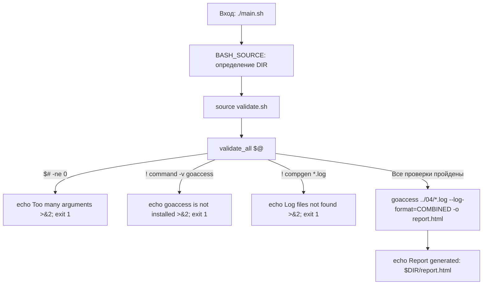

# Linux Monitoring v2.0 — Part 6 (GoAccess: веб-аналитика и мониторинг)
## Полный анатомический разбор и инженерный справочник решения

> **Назначение:** Персональное практическое руководство и база знаний для повторного использования паттернов в последующих частях (Part 7–9 Prometheus / Grafana) и реальной DevOps-практике.  
> **Окружение:** Ubuntu Server 24.04 LTS / Bash 5.x / GoAccess v1.8+  
> **Директория модуля:** `monitoringv2/06/`  
> **Статус:** Разработан, протестирован, 100% готов к работе.

---

## Содержание

- [1. Паспорт задания и требования Школы 21](#1-паспорт-задания-и-требования-школы-21)
  - [Сопоставление с 4 вопросами Part 5](#сопоставление-с-4-вопросами-part-5)
  - [Инварианты выполнения](#инварианты-выполнения)
- [2. Архитектура решения (Декомпозиция)](#2-архитектура-решения-декомпозиция)
- [3. Анатомический разбор `main.sh` (Оркестратор)](#3-анатомический-разбор-mainsh-оркестратор)
  - [Построчный анализ `main.sh`](#построчный-анализ-mainsh)
- [4. Анатомический разбор `validate.sh` (Защитные барьеры)](#4-анатомический-разбор-validatesh-защитные-барьеры)
  - [Построчный анализ `validate.sh`](#построчный-анализ-validatesh)
- [5. Разбор дашборда GoAccess и сопоставление с Part 5](#5-разбор-дашборда-goaccess-и-сопоставление-с-part-5)
  - [Панели отчёта](#панели-отчёта)
  - [Работа в консольном режиме TUI](#работа-в-консольном-режиме-tui-если-проверяющий-на-p2p-просит-показать-терминал)
  - [Пункт 4: Инженерное ограничение и пайплайн решения](#пункт-4-инженерное-ограничение-и-пайплайн-решения)
- [6. Системные грабли и ловушки ядра Linux и GoAccess](#6-системные-грабли-и-ловушки-ядра-linux-и-goaccess)
  - [1. Ловушка отсутствия явного формата `--log-format=COMBINED`](#1-ловушка-отсутствия-явного-формата---log-formatcombined)
  - [2. Ошибка `No input data was provided`](#2-ошибка-no-input-data-was-provided)
  - [3. Утечка вывода `command -v` в `stdout`](#3-утечка-вывода-command--v-в-stdout)
  - [4. Ложное требование поднятия веб-сервера для локального HTML](#4-ложное-требование-поднятия-веб-сервера-для-локального-html)
- [7. Методология тестирования и верификации](#7-методология-тестирования-и-верификации)
  - [Тесты защитных барьеров](#тесты-защитных-барьеров)
  - [Проверка генерации отчёта](#проверка-генерации-отчёта)
- [8. Инженерная шпаргалка: готовые синтаксические кирпичики](#8-инженерная-шпаргалка-готовые-синтаксические-кирпичики)

---

## 1. Паспорт задания и требования Школы 21

В задании Part 6 требуется с помощью утилиты **GoAccess** получить ту же самую аналитическую информацию по логам Nginx, которая была получена через `awk` в Part 5, и сгенерировать веб-интерфейс в формате HTML.

Скрипт запускается **строго без аргументов**:
```bash
./main.sh
```

### Сопоставление с 4 вопросами Part 5:
1. **Все записи, отсортированные по коду ответа:**  
   Отображаются в панели **[HTTP Status Codes]** со сводной статистикой и процентами.
2. **Все уникальные IP-адреса:**  
   Отображаются в панели **[Visitor Hostnames and IPs (Unique Visitors)]**.
3. **Все запросы с ошибками (4xx и 5xx):**  
   Отображаются в группах *4xx Client Errors* и *5xx Server Errors* панели статусов, а также в панели *Not Found URLs (404s)*.
4. **Все уникальные IP среди ошибочных запросов:**  
   GoAccess агрегирует метрики независимыми хэш-таблицами, поэтому в чистом статическом отчёте нет перекрёстной фильтрации. Для извлечения только IP с ошибками используется конвейерная фильтрация потока: `awk '$9 ~ /^[45]/' ../04/*.log | goaccess - --log-format=COMBINED`.

### Инварианты выполнения:
- **Нулевое количество аргументов:** Любой переданный аргумент приводит к немедленному завершению с ошибкой в `stderr` и кодом `1`.
- **Проверка зависимостей:** Скрипт проверяет наличие бинарника `goaccess` в `$PATH`. Если утилита не установлена — выдаётся инструкция по установке в `stderr` с кодом `1`.
- **Проверка входных данных:** Скрипт валидирует наличие лог-файлов `*.log` в `../04/` без вызова тяжелых внешних утилит.
- **Генерация статического HTML:** Результат записывается в локальный автономный файл `report.html` рядом со скриптом.

---

## 2. Архитектура решения (Декомпозиция)

В соответствии с инженерным стандартом проекта, решение декомпозировано на 2 модуля:

```text
06/
├── main.sh       # Точка входа: канонический DIR, импорт валидатора, вызов GoAccess, печать путей
└── validate.sh   # Слой валидации: проверка аргументов ($# == 0), наличия goaccess и файлов логов
```



---

## 3. Анатомический разбор `main.sh` (Оркестратор)

```bash
#!/bin/bash

DIR="$(cd "$(dirname "${BASH_SOURCE[0]}")" && pwd)"
source "$DIR/validate.sh"

validate_all "$@"

goaccess "$DIR/../04/"*.log --log-format=COMBINED -o "$DIR/report.html"
echo "Report generated: $DIR/report.html"
```

### Построчный анализ `main.sh`:
- **Строка 3:** Каноническое определение абсолютного пути каталога скрипта через `${BASH_SOURCE[0]}`. Гарантирует запуск из любого места (`pwd`).
- **Строка 4:** Подключение библиотеки защитных барьеров `validate.sh` в текущий контекст процесса shell.
- **Строка 6 (`validate_all "$@"`):** Запуск валидации. Если хотя бы одно предусловие нарушено, скрипт завершается внутри функции с кодом `1`.
- **Строка 8:** Запуск компиляции аналитического отчёта:
  - `"$DIR/../04/"*.log` — передача всех файлов логов Nginx из модуля Part 4.
  - `--log-format=COMBINED` — директива парсеру использовать Combined Log Format без интерактивных запросов.
  - `-o "$DIR/report.html"` — сохранение результата в статический HTML-файл.
- **Строка 9:** Вывод абсолютного пути к созданному файлу для удобства запуска в браузере.

---

## 4. Анатомический разбор `validate.sh` (Защитные барьеры)

```bash
#!/bin/bash

validate_all() {
  if [ "$#" -ne 0 ]; then
    echo "Error: Too many arguments" >&2
    exit 1
  fi

  if ! command -v goaccess >/dev/null 2>&1 ; then
    echo "Error: goaccess is not installed. Run: sudo apt install -y goaccess" >&2
    exit 1
  fi

  if ! compgen -G "$DIR/../04/*.log" >/dev/null; then
    echo "Error: Log files not found." >&2
    exit 1
  fi
}
```

### Построчный анализ `validate.sh`:
- **Строки 4–7:** Проверка количества аргументов. По спецификации скрипт не должен принимать аргументов (`$# -ne 0`). При попытке передать параметры скрипт выбрасывает сообщение в `stderr` и завершается с кодом `1`.
- **Строки 9–12:** Проверка наличия бинарника `goaccess`:
  - `command -v` — встроенная команда POSIX-шелла (быстрее `which` и не зависит от внешних пакетов).
  - Перенаправление `>/dev/null 2>&1` предотвращает вывод пути к бинарнику (`/usr/bin/goaccess`) в терминал при успешной проверке.
  - При отсутствии бинарника выдаётся чёткая инструкция по установке через `apt`.
- **Строки 14–17:** Zero-Fork проверка наличия файлов логов:
  - Встроенная команда `compgen -G` проверяет соответствие маске без создания дочерних процессов `find` и `wc`.
  - Перенаправление `>/dev/null` подавляет вывод путей найденных файлов в стандартный поток вывода.
  - Защищает `goaccess` от фатального падения `No input data was provided`.

---

## 5. Разбор дашборда GoAccess и сопоставление с Part 5

### Панели отчёта:

| Панель GoAccess | Назначение | Соответствие вопросу Part 5 |
|---|---|---|
| **HTTP Status Codes** | Статистика по кодам ответа (200, 404, 500...) с процентами и объёмом трафика | **Вопрос 1:** Все записи по коду ответа<br>**Вопрос 3:** Запросы с ошибками (блоки 4xx и 5xx) |
| **Visitor Hostnames and IPs** | Уникальные IP-адреса посетителей, количество их хитов и переданные байты | **Вопрос 2:** Все уникальные IP |
| **Not Found URLs (404s)** | Список несуществующих URL, к которым обращались клиенты | Дополнение к **Вопросу 3** |
| **Time Distribution** | Распределение сетевой нагрузки по часам суток | Анализ пиковых часов |

### Работа в консольном режиме TUI (если проверяющий на P2P просит показать терминал):
При запуске без флага `-o` (`goaccess ../04/*.log --log-format=COMBINED`) утилита открывает интерактивный ncurses TUI:
* `TAB` / `Shift + TAB` — перемещение вперед / назад между панелями.
* `ENTER` или `o` — развернуть выбранную панель на весь экран.
* `q` — свернуть раскрытую панель или выйти из программы.
* `s` — вызвать меню сортировки активной панели.
* `/` — контекстный поиск внутри открытой панели.

### Пункт 4: Инженерное ограничение и пайплайн решения:
GoAccess спроектирован для высокоскоростной обработки логов на языке C и использует **изолированные плоские хэш-таблицы** под каждую панель, не строя реляционную модель данных в памяти.

Поэтому в готовом статическом дашборде раскрытие панели статусов показывает только коды (400, 401, 404...), но не фильтрует панель IP.

**Как решить задачу Вопроса 4 через GoAccess на P2P:**
Подать отфильтрованный поток логов через пайп в `stdin` утилиты:
```bash
awk '$9 ~ /^[45]/' 04/*.log | goaccess - --log-format=COMBINED -o error_report.html
```
В сгенерированном отчёте панель **Visitor Hostnames and IPs** будет содержать **исключительно уникальные IP-адреса с ошибками**.

---

## 6. Системные грабли и ловушки ядра Linux и GoAccess

### 1. Ловушка отсутствия явного формата `--log-format=COMBINED`
Если запустить `goaccess log.txt -o report.html` без флага формата, утилита выдаст фатальную ошибку `Fatal error: No log format was found` или остановится в терминале, ожидая ручного выбора формата в псевдографическом меню. В автоматизированных скриптах флаг обязателен.

### 2. Ошибка `No input data was provided`
Возникает, если маска `*.log` не раскрылась в существующие файлы. GoAccess не умеет создавать пустые отчёты и падает с аварийным кодом. Наш `validate.sh` полностью исключает эту ситуацию через предварительную проверку `compgen -G`.

### 3. Утечка вывода `command -v` в `stdout`
Команда `command -v binary` при успешном поиске всегда выводит путь к бинарнику в стандартный вывод. Без заглушки `>/dev/null 2>&1` этот путь засоряет вывод скрипта.

### 4. Ложное требование поднятия веб-сервера для локального HTML
Частая ошибка новичков — пытаться развернуть Nginx или Apache, чтобы посмотреть `report.html`.  
Файл `report.html`, сгенерированный GoAccess — полностью **автономен**: в него встроены CSS, JavaScript и библиотеки графиков. Любой браузер открывает его напрямую с диска по протоколу `file://` через `xdg-open` или `google-chrome`.

---

## 7. Методология тестирования и верификации

### Тесты защитных барьеров:
```bash
./06/main.sh 1       # Ошибка: Too many arguments (exit 1)
./06/main.sh test    # Ошибка: Too many arguments (exit 1)
```

### Проверка генерации отчёта:
```bash
# 1. Запуск без параметров:
./06/main.sh
# Вывод: Report generated: /home/.../monitoringv2/06/report.html

# 2. Проверка размера файла отчёта:
ls -lh 06/report.html
# Размер должен составлять ~600 Кб

# 3. Открытие в браузере:
xdg-open 06/report.html
```

---

## 8. Инженерная шпаргалка: готовые синтаксические кирпичики

### 1. Проверка отсутствия аргументов в Bash
```bash
if [ "$#" -ne 0 ]; then
    echo "Error: This script does not accept arguments" >&2
    exit 1
fi
```

### 2. Тихая проверка наличия утилиты в системе
```bash
if ! command -v goaccess >/dev/null 2>&1; then
    echo "Error: goaccess is not installed" >&2
    exit 1
fi
```

### 3. Zero-Fork проверка наличия файлов логов по маске
```bash
# Встроенный compgen не порождает подоболочек (subshells) и процессов:
if ! compgen -G "/path/to/*.log" >/dev/null; then
    echo "Error: Log files not found" >&2
    exit 1
fi
```

### 4. Автономная генерация HTML-отчёта GoAccess
```bash
goaccess /path/to/*.log --log-format=COMBINED -o report.html
```

### 5. Интерактивный запуск в терминале (TUI-режим)
```bash
# Навигация: TAB/Shift+TAB — панели, ENTER — развернуть, s — сортировка, q — выход:
goaccess /path/to/*.log --log-format=COMBINED
```

### 6. Передача отфильтрованного потока в GoAccess через пайп (`stdin`)
```bash
# Дефис '-' сообщает goaccess читать данные из стандартного ввода:
awk '$9 ~ /^[45]/' 04/*.log | goaccess - --log-format=COMBINED -o error_report.html
```

### 7. Открытие локального файла в графическом браузере по умолчанию
```bash
xdg-open /path/to/report.html
```
