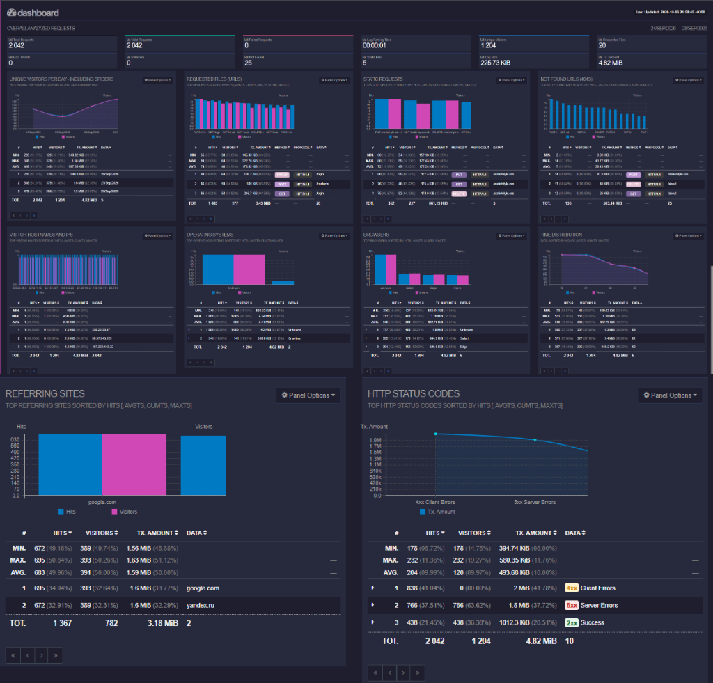
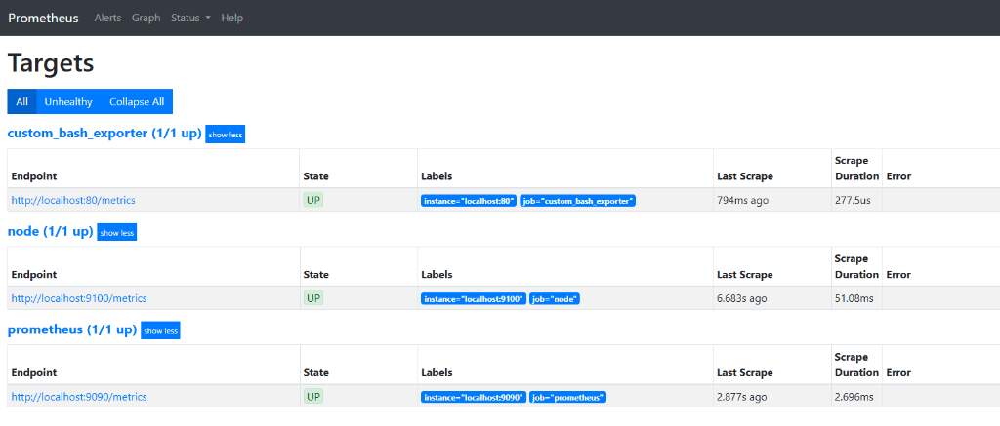
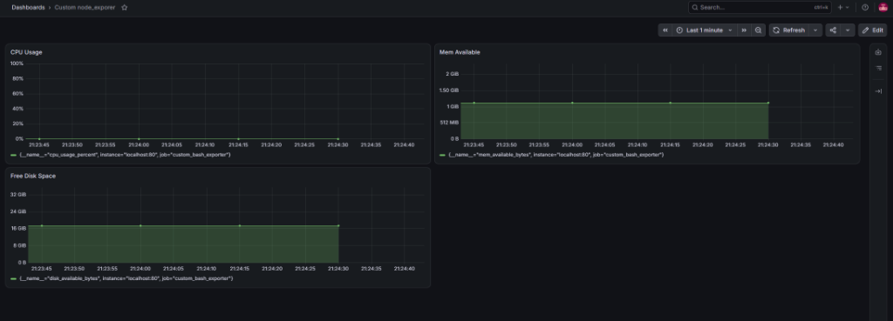

# 🛠️ Bash DevOps Toolkit

<p align="center">
  <a href="#"></a>
  <a href="#"></a>
  <a href="#"></a>
  <a href="#"></a>
  <a href="#"></a>
</p>

Модульный набор инструментов и скриптов системного администрирования Linux на чистом Bash.

Проект решает практические задачи эксплуатации инфраструктуры: параметрическая генерация и стресс-тестирование файловых систем, безопасная очистка дискового пространства, эмуляция и потоковый анализ веб-трафика Nginx, а также автоматизация мониторинга и сборки метрик под Prometheus и Grafana.

* **Автор:** Vladislav ([@BeerLover47](https://github.com/BeerLover47))

---

## 🏗️ Архитектура и модули

Каждая утилита полностью автономна, снабжена собственной документацией и изолированным модулем валидации аргументов (паттерн Guard Clauses).

```
.
├── fs-generator/             # Параметрический генератор каталогов и файлов
├── fs-stress-fill/           # Заполнение диска до порога свободного места (1 Гб)
├── fs-cleaner/               # 3 режима безопасной очистки файловой системы
├── nginx-log-generator/      # Генератор веб-логов Nginx в Combined Log Format
├── nginx-log-analyzer/       # Потоковый парсер и анализатор логов на AWK
├── goaccess-visualizer/      # Визуализация логов и генерация отчётов GoAccess
├── infra-monitoring/         # Оркестрация стека Prometheus + Node Exporter + Grafana
├── infra-benchmarking/       # Нагрузочное тестирование (stress, iperf3, дашборды)
└── custom-metrics-exporter/  # Нативный Bash-экспортер метрик (OpenMetrics + Nginx)
```

---

## 📋 Каталог инструментов

### 1. Storage & File System Operations
| Модуль | Описание | Стек | Документация |
|---|---|---|:---:|
| **`fs-generator`** | Создание структур папок и файлов по маске с логированием | `fallocate`, `df`, ERE | [README](./fs-generator/README.md) |
| **`fs-stress-fill`** | Стресс-тестирование диска до остатка свободного места $\le$ 1 Гб | `$RANDOM`, bench | [README](./fs-stress-fill/README.md) |
| **`fs-cleaner`** | Очистка созданных файлов: по логу, дате/времени или маске | `find`, Process Sub | [README](./fs-cleaner/README.md) |

### 2. Web Logs & Stream Analytics Pipeline
| Модуль | Описание | Стек | Документация |
|---|---|---|:---:|
| **`nginx-log-generator`** | Генератор синтетических логов веб-сервера за 5 дней | Bash, Unix Epoch | [README](./nginx-log-generator/README.md) |
| **`nginx-log-analyzer`** | Высокоскоростной потоковый фильтр логов в 4 режимах | `awk`, `sort`, Stream | [README](./nginx-log-analyzer/README.md) |
| **`goaccess-visualizer`** | Интерактивный TUI-анализ и генерация HTML-отчёта | `goaccess`, Web TUI | [README](./goaccess-visualizer/README.md) |

### 3. Infrastructure Observability & Telemetry
| Модуль | Описание | Стек | Документация |
|---|---|---|:---:|
| **`infra-monitoring`** | Развертывание стека Prometheus + Grafana, 4 базовые метрики | Prometheus, Grafana | [README](./infra-monitoring/README.md) |
| **`infra-benchmarking`** | Стресс-тесты CPU/RAM (`stress`), сети (`iperf3`) и дашборд 13978 | `stress`, `iperf3`, PromQL | [README](./infra-benchmarking/README.md) |
| **`custom-metrics-exporter`** | Легковесный Bash-демон метрик (CPU, RAM, диск) под Nginx | `/proc`, OpenMetrics | [README](./custom-metrics-exporter/README.md) |

---

## 📸 Дашборды и телеметрия

### 📊 1. Потоковая веб-аналитика логов Nginx (GoAccess)
<p align="center">
  
</p>

### 📈 2. Нагрузочное тестирование и системные метрики (Grafana + Node Exporter)
<p align="center">
  
</p>

### 📡 3. Кастомный Bash-экспортер и статус скрейпинга (Prometheus + Grafana)
<p align="center">
  
</p>
<p align="center">
  
</p>

---

## ⚡ Инженерные стандарты реализации

1. **Guard Clauses (Защитные барьеры):**  
   Каждая точка входа (`main.sh`) отделена от проверок аргументов (`validate.sh`). Невалидные входные данные отсекаются до вызова рабочих функций с информативным выводом в `stderr` (`>&2`) и ненулевым кодом выхода (`exit 1`).
2. **Безопасная работа с диском:**  
   Вместо тяжелого `dd` выделение файлов происходит через системный вызов `fallocate(2)` с мягким фоллбэком на `truncate`. Критические системные каталоги защищены от случайного удаления.
3. **Потоковая обработка без оверхеда:**  
   Парсинг логов реализован на `awk` с ассоциативными массивами (хэш-таблицами) в памяти, что гарантирует сложность $O(N)$ и исключает промежуточный I/O на диске.
4. **Атомарность записи метрик:**  
   Экспортер метрик пишет данные во временный файл и производит замену через атомарную операцию `mv -f` (`rename(2)`), защищая веб-сервер от чтения неполного файла.

---

## 🚀 Требования и запуск

* **Окружение:** Linux (Ubuntu 22.04 / 24.04 LTS или WSL2).
* **Оболочка:** GNU Bash 5.0+.
* **Опциональные системные пакеты:**
  ```bash
  sudo apt update && sudo apt install -y fallocate findutils gawk goaccess stress iperf3 nginx
  ```
