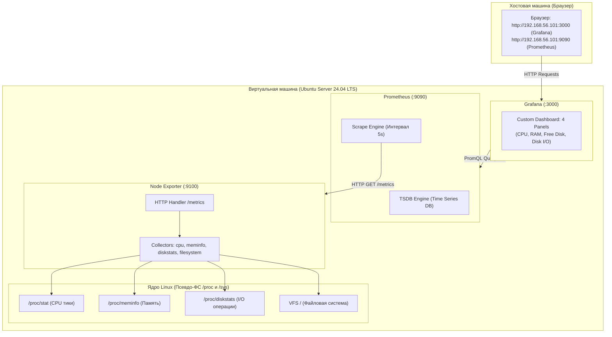
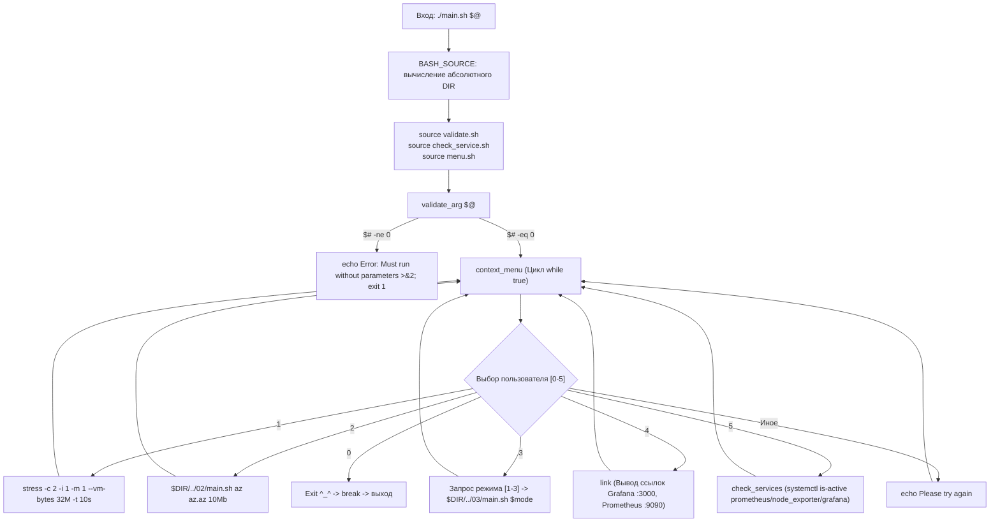

# Linux Monitoring v2.0 — Part 7 (Prometheus и Grafana: мониторинг системных ресурсов)
## Полный анатомический разбор и инженерный справочник решения

> **Назначение:** Персональное практическое руководство и база знаний по архитектуре мониторинга, устройству демонов ядра Linux, PromQL и автоматизации нагрузочных тестов.  
> **Окружение:** Ubuntu Server 24.04 LTS / Bash 5.x / Prometheus v2.x / Node Exporter v1.x / Grafana v10+  
> **Директория модуля:** `monitoringv2/07/`  
> **Статус:** Разработан, протестирован на боевой ВМ, 100% готов к работе.

---

## Содержание

- [1. Паспорт задания и требования Школы 21](#1-паспорт-задания-и-требования-школы-21)
  - [Формулировка задачи](#формулировка-задачи)
  - [Инварианты выполнения](#инварианты-выполнения)
- [2. Архитектура стека мониторинга и сетевая модель](#2-архитектура-стека-мониторинга-и-сетевая-модель)
  - [2.1. Pull-модель сбора метрик против Push](#21-pull-модель-сбора-метрик-против-push)
  - [2.2. Node Exporter: как ядро Linux отдаёт метрики](#22-node-exporter-как-ядро-linux-отдаёт-метрики)
  - [2.3. Prometheus TSDB: модель данных временных рядов](#23-prometheus-tsdb-модель-данных-временных-рядов)
  - [2.4. Сетевая топология VirtualBox (Host-Only + NAT)](#24-сетевая-топология-virtualbox-host-only--nat)
- [3. Архитектура решения и декомпозиция Bash-модулей](#3-архитектура-решения-и-декомпозиция-bash-модулей)
  - [3.1. Оркестратор `07/main.sh`](#31-оркестратор-07mainsh)
  - [3.2. Защитный барьер `07/validate.sh`](#32-защитный-барьер-07validatesh)
  - [3.3. Модуль проверки сервисов `07/check_service.sh`](#33-модуль-проверки-сервисов-07check_servicesh)
  - [3.4. Интерактивное меню `07/menu.sh`](#34-интерактивное-меню-07menush)
- [4. Математика PromQL и 4 ключевые панели дашборда](#4-математика-promql-и-4-ключевые-панели-дашборда)
  - [4.1. Панель CPU: почему `irate` и вычитание `idle`](#41-панель-cpu-почему-irate-и-вычитание-idle)
  - [4.2. Панель RAM: MemAvailable против ловушки MemFree](#42-панель-ram-memavailable-против-ловушки-memfree)
  - [4.3. Панель Free Disk: фильтрация корневой ФС](#43-панель-free-disk-фильтрация-корневой-фс)
  - [4.4. Панель Disk I/O: замер скорости чтения и записи](#44-панель-disk-io-замер-скорости-чтения-и-записи)
- [5. Пошаговая настройка инфраструктуры и сервисов (SRE Runbook)](#5-пошаговая-настройка-инфраструктуры-и-сервисов-sre-runbook)
  - [5.1. Установка и запуск демонов на Ubuntu Server](#51-установка-и-запуск-демонов-на-ubuntu-server)
  - [5.2. Конфигурация Prometheus (`prometheus.yml`)](#52-конфигурация-prometheus-prometheusyml)
  - [5.3. Подключение Prometheus к Grafana и импорт дашборда](#53-подключение-prometheus-к-grafana-и-импорт-дашборда)
- [6. Нагрузочные тесты и физика процессов ОС](#6-нагрузочные-тесты-и-физика-процессов-ос)
  - [6.1. Стресс-тест CPU и памяти через `stress`](#61-стресс-тест-cpu-и-памяти-через-stress)
  - [6.2. Дисковый стресс через Part 2 (`02/main.sh`)](#62-дисковый-стресс-через-part-2-02mainsh)
  - [6.3. Очистка диска через Part 3 (`03/main.sh`)](#63-очистка-диска-через-part-3-03mainsh)
- [7. Экспорт и структура дашборда `dashboard.json`](#7-экспорт-и-структура-дашборда-dashboardjson)
- [8. Системные грабли и ловушки ядра Linux](#8-системные-грабли-и-ловушки-ядра-linux)
- [9. SRE Playbook: Диагностика сокетов, демонов и портов](#9-sre-playbook-диагностика-сокетов-демонов-и-портов)
- [10. Инженерная шпаргалка: готовые синтаксические кирпичики](#10-инженерная-шпаргалка-готовые-синтаксические-кирпичики)
- [11. Методология верификации и тестирования скриптов](#11-методология-верификации-и-тестирования-скриптов)

---

## 1. Паспорт задания и требования Школы 21

### Формулировка задачи:
В задании Part 7 необходимо:
1. Установить и настроить стек мониторинга:
   * **Prometheus** (порт `9090`) — сервер сбора и хранения временных рядов.
   * **Node Exporter** (порт `9100`) — экспортер системных метрик Linux.
   * **Grafana** (порт `3000`) — веб-интерфейс визуализации.
2. Создать в Grafana кастомный дашборд с 4 обязательными панелями:
   * ЦПУ (загрузка процессора в %).
   * Доступная оперативная память.
   * Свободное место на диске.
   * Количество операций ввода-вывода (Disk I/O).
3. Провести нагрузочные тесты и зафиксировать поведение графиков:
   * Нагрузка на диск с помощью скрипта **Part 2** (`02/main.sh`).
   * Нагрузка на CPU/RAM с помощью утилиты **stress**.
4. Экспортировать конфигурацию дашборда в файл `07/dashboard.json`.
5. Написать скрипт запуска `07/main.sh`, обеспечивающий запуск тестов и контроль состояния системы.

### Инварианты выполнения:
* **Запуск без аргументов:** `./main.sh` вызывается строго без параметров (`$# == 0`). При передаче аргументов — сообщение в `stderr` и `exit 1`.
* **Модульность:** Разделение логики на `main.sh`, `validate.sh`, `check_service.sh`, `menu.sh`.
* **Автономность:** Скрипт корректно находит пути к модулям Part 2 и Part 3 относительно собственного расположения через `BASH_SOURCE`.

---

## 2. Архитектура стека мониторинга и сетевая модель



### 2.1. Pull-модель сбора метрик против Push
В отличие от push-систем (Zabbix Agent, Telegraf, StatsD), где агенты сами шлют данные в сервер:
* **Prometheus работает по Pull-модели:** Сервер Prometheus сам периодически опрашивает (scrape) список зарегистрированных эндпоинтов по протоколу HTTP (по умолчанию путь `/metrics`).
* **Преимущества Pull-модели в архитектуре:**
  1. *Централизованный контроль частоты сбора:* Сервер сам решает, когда и с каким интервалом опрашивать цели (`scrape_interval: 5s`).
  2. *Мгновенный мониторинг доступности:* Если агент упал или недоступен по сети, Prometheus сразу фиксирует `up == 0`.
  3. *Защита от DDoS сервера метриками:* Агенты не могут завалить сервер лавиной пакетов при авариях.
  4. *Упрощение агента:* Экспортер — это простой легковесный HTTP-сервер, не знающий, кто его опрашивает.

### 2.2. Node Exporter: как ядро Linux отдаёт метрики
Node Exporter не использует тяжелые системные вызовы. Он периодически читает виртуальные псевдо-файловые системы ядра:
* `/proc/stat` $\to$ счетчики тиков процессорного времени (`user`, `system`, `idle`, `iowait`).
* `/proc/meminfo` $\to$ точные срезы памяти ядра (`MemTotal`, `MemFree`, `MemAvailable`, `Buffers`, `Cached`).
* `/proc/diskstats` $\to$ счетчики секторов чтения/записи и миллисекунды I/O.
* `/proc/net/dev` $\to$ байты и пакеты сетевых интерфейсов.

Все эти счетчики Node Exporter форматирует в текстовый стандарт OpenMetrics/Prometheus:
```text
# HELP node_cpu_seconds_total Seconds the CPUs spent in each mode.
# TYPE node_cpu_seconds_total counter
node_cpu_seconds_total{cpu="0",mode="idle"} 12458.12
node_cpu_seconds_total{cpu="0",mode="user"} 845.34
```

### 2.3. Prometheus TSDB: модель данных временных рядов
Каждая запись в базе данных Prometheus представляет собой кортеж:
$$\text{Временной ряд} = (\text{Имя метрики}, \{\text{Лейблы}\}, \text{Timestamp}, \text{Значение Float64})$$

Типы метрик:
1. **Counter (Счетчик):** Монотонно возрастающее значение (например, количество переданных байт, секунды работы CPU). Может только расти или сбрасываться в 0 при перезагрузке ОС. К счетчикам применяются функции `rate()` и `irate()`.
2. **Gauge (Калибр):** Значение, которое может произвольно увеличиваться и уменьшаться (свободная память, температура, процент заполнения диска).

### 2.4. Сетевая топология VirtualBox (Host-Only + NAT)
Для изоляции и стабильного доступа на ВМ настроены два сетевых адаптера:
1. **NAT (Адаптер 1):** Обеспечивает доступ ВМ в интернет (для `apt update && apt install`). На нем настроен Port Forwarding:
   * Порт хоста `3000` $\to$ Порт гостя `3000` (Grafana)
   * Порт хоста `9090` $\to$ Порт гостя `9090` (Prometheus)
2. **Host-Only Adapter (`vboxnet0`, Адаптер 2):** Выделяет статический IP в изолированной локальной подсети хоста (`192.168.56.101`). Браузер хоста обращается напрямую по этому IP без трансляции портов.

---

## 3. Архитектура решения и декомпозиция Bash-модулей

Структура каталога `07/`:
```text
07/
├── main.sh          # Точка входа: сборка контекста, валидация и вызов меню
├── validate.sh      # Guard Clause: проверка аргументов командной строки
├── check_service.sh # Проверка статусов демонов systemd с цветовой индикацией
├── menu.sh          # Интерактивное TUI-меню управления стресс-тестами
└── dashboard.json   # Экспортированная спецификация дашборда Grafana
```



---

### 3.1. Оркестратор `07/main.sh`

```bash
#!/bin/bash

DIR="$(cd "$(dirname "${BASH_SOURCE[0]}")" && pwd)"
source "$DIR/validate.sh"
source "$DIR/check_service.sh"
source "$DIR/menu.sh"

validate_arg "$@"
context_menu
```

#### Построчный анализ:
* **Строка 3: `DIR="$(cd "$(dirname "${BASH_SOURCE[0]}")" && pwd)"`**  
  Канонический Bash-паттерн вычисления абсолютного пути к директории скрипта. Гарантирует корректность работы при запуске из любого рабочего каталога.
* **Строки 4–6: `source "$DIR/..."`**  
  Подключение функциональных модулей в текущий контекст оболочки.
* **Строка 8: `validate_arg "$@"`**  
  Первоочередная валидация аргументов.
* **Строка 9: `context_menu`**  
  Передача управления интерактивному циклу меню.

---

### 3.2. Защитный барьер `07/validate.sh`

```bash
#!/bin/bash

validate_arg() {
  if [ "$#" -ne 0 ]; then
    echo "Error: The script must be run without parameters." >&2
    echo "Usage: $0" >&2
    exit 1
  fi
}
```

#### Построчный анализ:
* **`[ "$#" -ne 0 ]`** — проверка переменной `$#` (число аргументов).
* **`>&2`** — перенаправление диагностических сообщений в поток ошибок (дескриптор 2).
* **`exit 1`** — ненулевой код возврата при нарушении условий запуска.

---

### 3.3. Модуль проверки сервисов `07/check_service.sh`

```bash
#!/bin/bash

GREEN='\033[0;32m'
RED='\033[0;31m'
RESET='\033[0m'

check_status() {
    local status="$1"
    if [ "$status" = "active" ]; then
      echo -e "${GREEN}[ACTIVE]${RESET}"
    else
      echo -e "${RED}[INACTIVE]${RESET}"
    fi
}

check_services() {
    local prometheus=$(systemctl is-active prometheus 2>/dev/null)
    local node_exporter=$(systemctl is-active prometheus-node-exporter 2>/dev/null)
    local grafana=$(systemctl is-active grafana-server 2>/dev/null)
    local prometheus_status=$(check_status "$prometheus")
    local node_exporter_status=$(check_status "$node_exporter")
    local grafana_status=$(check_status "$grafana")

    echo "----- Check Services Status -----"
    echo -e "Prometheus status: $prometheus_status"
    echo -e "Node Exporter status: $node_exporter_status"
    echo -e "Grafana status: $grafana_status"
}
```

#### Построчный анализ:
* **Строки 3–5: ANSI-эскейп последовательности цветов**  
  `\033[0;32m` (зеленый), `\033[0;31m` (красный), `\033[0m` (сброс). Позволяет мгновенно считывать статус сервисов в терминале.
* **Строки 17–19: `systemctl is-active <unit> 2>/dev/null`**  
  Штатная команда systemd для проверки состояния демона. Возвращает строку `active`, `inactive` или `failed`. Подавление ошибок `2>/dev/null` защищает экран от шума, если сервис ещё не установлен.
* **`local` переменные:**  
  Изоляция переменных внутри функций, предотвращающая загрязнение глобального окружения скрипта.

---

### 3.4. Интерактивное меню `07/menu.sh`

```bash
#!/bin/bash

context_menu() {
    while true; do
      echo ""
      echo "===== Test management menu ====="
      echo "1) Run stress-test CPU / RAM (stress)"
      echo "2) Run test disk (Part 2)"
      echo "3) Clear disk after disk test"
      echo "4) Get link for utilities"
      echo "5) Check services status"
      echo "0) Exit ^_^"

      read -rp "Choose action [0-5]: " choice
      case "$choice" in
        1)
        echo "Run stress"
        stress -c 2 -i 1 -m 1 --vm-bytes 32M -t 10s
        ;;
        2)
        echo "Run test disk"
        "$DIR/../02/main.sh" az az.az 10Mb
        ;;
        3)
        echo ""
        echo "----- Choose cleaning method -----"
        echo "1) By Log File"
        echo "2) By date and time"
        echo "3) By mask name"
        read -rp "Cleaning mode [1-3]: " clean_mode
        "$DIR/../03/main.sh" "$clean_mode"
        ;;
        4)
        link
        ;;
        5)
        echo ""
        check_services
        ;;
        0)
        echo ""
        echo "Exit"
        break
        ;;
        *)
        echo ""
        echo -e "${RED}Please try again.${RESET}"
        ;;
      esac
    done       
}

link() {
    local IP="192.168.56.101"
    echo ""
    echo "----- Web UI Links -----"
    echo -e "http://${IP}:3000 ${GREEN}Grafana${RESET}"
    echo -e "http://${IP}:9090 ${GREEN}Prometheus${RESET}"
}
```

---

## 4. Математика PromQL и 4 ключевые панели дашборда

Каждая панель в `dashboard.json` опирается на строгую формулу языка **PromQL** (Prometheus Query Language).

---

### 4.1. Панель CPU: почему `irate` и вычитание `idle`

#### PromQL запрос:
```promql
100 - (avg by (instance) (irate(node_cpu_seconds_total{mode="idle"}[1m])) * 100)
```

#### Математический смысл:
1. `node_cpu_seconds_total` — счетчик секунд, проведенных ядром в различных состояниях (`user`, `system`, `idle`, `iowait`, `steal` и т.д.).
2. `{mode="idle"}` — фильтрует только время простоя (когда процессор ничем не занят).
3. `irate(...[1m])` — вычисляет **мгновенную производную** (instant rate) по двум последним точкам в окне 1 минута:
   $$\text{irate} = \frac{\Delta \text{idle\_seconds}}{\Delta t}$$
   Результат — доля времени простоя от 0.0 до 1.0.
4. `avg by (instance) (...)` — усредняет показатели по всем ядрам процессора (если ядер $\ge 2$).
5. `* 100` — переводит долю в проценты (от 0% до 100%).
6. `100 - (...)` — инвертирует формулу:
   $$\text{Загрузка CPU (\%)} = 100\% - \text{Простой CPU (\%)}$$

> **Разница между `rate()` и `irate()`:**  
> * `rate()` считает среднюю скорость по всему окну времени (сглаживает кратковременные пики).
> * `irate()` считает скорость между двумя последними измерениями (идеально для фиксации резких секундных всплесков от утилиты `stress`).

---

### 4.2. Панель RAM: MemAvailable против ловушки MemFree

#### PromQL запрос (в процентах):
```promql
(1 - (node_memory_MemAvailable_bytes / node_memory_MemTotal_bytes)) * 100
```
*Или в абсолютных байтах:*
```promql
node_memory_MemAvailable_bytes
```

#### Системная физика Linux:
* **Ловушка `MemFree`:** В Linux неиспользуемая память — потерянная память. Ядро активно использует свободную оперативную память под дисковый кэш (Page Cache) и буферы (Buffers). Если ориентироваться на `MemFree`, покажется, что свободной памяти почти нет (100–200 Мб), хотя система ничем не нагружена.
* **`MemAvailable` (введена в ядре Linux 3.14):** Оценка ядра, сколько памяти можно выделить процессам **без ухода в SWAP**. Она учитывает `MemFree` плюс ту часть кэшей, которую ядро может мгновенно сбросить при необходимости.
* **Формула:**  
  $$\text{Использовано RAM (\%)} = \left(1 - \frac{\text{MemAvailable}}{\text{MemTotal}}\right) \times 100$$

---

### 4.3. Панель Free Disk: фильтрация корневой ФС

#### PromQL запрос:
```promql
node_filesystem_avail_bytes{mountpoint="/"}
```

#### Разбор:
* `node_filesystem_avail_bytes` — число байт, доступных непривилегированным пользователям.
* `{mountpoint="/"}` — критически важный фильтр! В Linux смонтировано множество псевдо-ФС (`/dev`, `/sys`, `/run`, `tmpfs`). Без этого фильтра график покажет сумму или массив всех точек монтирования, включая временные каталоги в оперативной памяти.

---

### 4.4. Панель Disk I/O: замер скорости чтения и записи

#### PromQL запросы (две кривые на одном графике):
* **Скорость чтения:**
  ```promql
  rate(node_disk_read_bytes_total[1m])
  ```
* **Скорость записи:**
  ```promql
  rate(node_disk_written_bytes_total[1m])
  ```

#### Разбор:
* Метрики `node_disk_read_bytes_total` и `node_disk_written_bytes_total` берутся ядром из `/proc/diskstats`.
* Это монотонно растущие счетчики байтов, прошедших через блочные устройства.
* Функция `rate(...[1m])` берет разность байт за последнюю минуту и делит на 60 секунд. Результат — **Байт/сек (Bps)**, который Grafana автоматически масштабирует в `KiB/s` или `MiB/s`.

---

## 5. Пошаговая настройка инфраструктуры и сервисов (SRE Runbook)

### 5.1. Установка и запуск демонов на Ubuntu Server

```bash
# 1. Установка Node Exporter
sudo apt update && sudo apt install -y prometheus-node-exporter
sudo systemctl enable --now prometheus-node-exporter

# 2. Установка Prometheus
sudo apt install -y prometheus

# 3. Установка Grafana
sudo apt install -y apt-transport-https software-properties-common wget
sudo mkdir -p /etc/apt/keyrings/
wget -q -O - https://apt.grafana.com/gpg.key | gpg --dearmor | sudo tee /etc/apt/keyrings/grafana.gpg > /dev/null
echo "deb [signed-by=/etc/apt/keyrings/grafana.gpg] https://apt.grafana.com stable main" | sudo tee /etc/apt/sources.list.d/grafana.list
sudo apt update && sudo apt install -y grafana
sudo systemctl enable --now grafana-server
```

### 5.2. Конфигурация Prometheus (`/etc/prometheus/prometheus.yml`)

Файл конфигурации задает частоту опроса и список эндпоинтов:
```yaml
global:
  scrape_interval: 5s       # Опрос метрик каждые 5 секунд (для фиксации быстрых всплесков)
  evaluation_interval: 5s

scrape_configs:
  - job_name: 'node_exporter'
    static_configs:
      - targets: ['localhost:9100']
```

Перезапуск для применения настроек:
```bash
sudo systemctl restart prometheus
```

### 5.3. Подключение Prometheus к Grafana и импорт дашборда

1. Открыть браузер хоста: `http://192.168.56.101:3000` (логин: `admin`, пароль: `admin`).
2. Перейти в **Connections** $\to$ **Data sources** $\to$ **Add data source** $\to$ выбрать **Prometheus**.
3. В поле **Prometheus server URL** указать: `http://localhost:9090`. Нажать **Save & test**.
4. Для импорта готового дашборда:
   * Перейти в **Dashboards** $\to$ нажать **New** $\to$ **Import**.
   * Скопировать содержимое `07/dashboard.json` или загрузить файл.
   * Нажать **Import**.

---

## 6. Нагрузочные тесты и физика процессов ОС

При запуске тестов из меню `07/menu.sh` на дашборде Grafana наблюдаются характерные отклики метрик:

| Тест | Панель CPU | Панель RAM | Панель Free Disk | Панель Disk I/O |
| :--- | :--- | :--- | :--- | :--- |
| **1) `stress`** | Всплеск до **100%** на 10 сек | Кратковременное падение MemAvailable на 32 Мб | Стабильна | Незначительные всплески (`sync`) |
| **2) `Part 2`** | Небольшой рост (5–15%) | Падение MemAvailable (рост Page Cache) | **Резкое падение** (на сотни Мб / Гб) | **Огромный всплеск записи** (Disk Write $\ge 50$ MiB/s) |
| **3) `Part 3`** | Рост на этапе сканирования `find` | Возврат памяти | **Резкий скачок вверх** (возврат свободного места) | Всплеск операций чтения метаданных |

### 6.1. Стресс-тест CPU и памяти через `stress`
```bash
stress -c 2 -i 1 -m 1 --vm-bytes 32M -t 10s
```
* `-c 2`: порождает 2 процесса, непрерывно вычисляющих квадратный корень (`sqrt()`) в бесконечном цикле. Загружает 2 процессорных ядра на 100%.
* `-m 1 --vm-bytes 32M`: процесс выделяет через `malloc()` 32 Мб памяти, заполняет её нулями и освобождает в цикле.
* `-t 10s`: ровно через 10 секунд процесс завершается сигналом таймера.

### 6.2. Дисковый стресс через Part 2 (`02/main.sh`)
* Аллоцирует файлы заданного размера (`10Mb`) в случайных каталогах ОС.
* Вызывает массовые системные вызовы `write()` / `fallocate()`.
* На графике Disk I/O виден непрерывный поток записи, а на графике Free Disk линия плавно уходит вниз вплоть до достижения лимита остановки ($\le 1$ Гб).

### 6.3. Очистка диска через Part 3 (`03/main.sh`)
* Находит созданные файлы и папки и удаляет их через `rm -rf`.
* Файловая система ext4 освобождает индексные дескрипторы (inodes) и блоки данных.
* На графике Free Disk линия мгновенно поднимается обратно к исходному уровню.

---

## 7. Экспорт и структура дашборда `dashboard.json`

Файл `07/dashboard.json` содержит полную декларативную JSON-модель дашборда Grafana:

### Ключевые секции JSON-модели:
1. `"panels": [...]` — массив объектов панелей.
2. `"gridPos": { "h": 8, "w": 12, "x": 0, "y": 0 }` — геометрия панели в 24-колоночной сетке Grafana (высота, ширина, координаты X/Y).
3. `"targets": [{ "expr": "...", "legendFormat": "..." }]` — PromQL запросы к Prometheus.
4. `"fieldConfig": { "defaults": { "unit": "bytes" } }` — настройки единиц измерения (Grafana автоматически переводит байты в KiB, MiB, GiB).
5. `"refresh": "5s"` — частота автообновления дашборда.

---

## 8. Системные грабли и ловушки ядра Linux

### 1. Ловушка `MemFree` вместо `MemAvailable`
* **Симптом:** Grafana показывает, что сервер «забит под 95% памяти», хотя запущен только Prometheus.
* **Причина:** Использование `node_memory_MemFree_bytes`. Ядро кэширует чтение с диска в оперативную память.
* **Решение:** Использовать `node_memory_MemAvailable_bytes`.

### 2. Ловушка окна усреднения PromQL: `rate(...[5s])` vs `rate(...[1m])`
* **Симптом:** График Disk I/O исчезает или выглядит как разрозненные точки.
* **Причина:** Окно времени в квадратных скобках должно содержать минимум **4 периода сбора метрик** (`scrape_interval`). Если сбор идет раз в 15 секунд, окно `[5s]` не захватит ни одной точки данных.
* **Решение:** Использовать окно минимум `[1m]`.

### 3. Ловушка запуска из чужой директории
* **Симптом:** При запуске `07/main.sh` из корня или домашней папки скрипт не находит `../02/main.sh`.
* **Причина:** Использование жестких относительных путей `../02/main.sh` без привязки к `BASH_SOURCE`.
* **Решение:** Вычислять базовую директорию через `DIR="$(cd "$(dirname "${BASH_SOURCE[0]}")" && pwd)"` и вызывать `"$DIR/../02/main.sh"`.

### 4. Ловушка прав systemd сервисов
* **Симптом:** Prometheus или Grafana не стартуют после перезагрузки.
* **Причина:** Сервисы не добавлены в автозагрузку.
* **Решение:** `sudo systemctl enable prometheus prometheus-node-exporter grafana-server`.

---

## 9. SRE Playbook: Диагностика сокетов, демонов и портов

При сбоях в работе стека мониторинга используются быстрые консольные команды:

### 1. Проверка прослушиваемых сокетов (Listening Ports):
```bash
# Проверка сокетов Prometheus (9090), Grafana (3000) и Node Exporter (9100):
ss -tulpn | grep -E '3000|9090|9100'
```
*Ожидаемый вывод:*
```text
tcp   LISTEN 0      4096         0.0.0.0:3000       0.0.0.0:*    users:(("grafana-server",pid=...,fd=...))
tcp   LISTEN 0      4096       127.0.0.1:9090       0.0.0.0:*    users:(("prometheus",pid=...,fd=...))
tcp   LISTEN 0      4096       127.0.0.1:9100       0.0.0.0:*    users:(("prometheus-node",pid=...,fd=...))
```

### 2. Проверка отдачи сырых метрик ядра Node Exporter:
```bash
curl -s http://localhost:9100/metrics | head -n 25
```

### 3. Проверка здоровья Prometheus:
```bash
curl -s http://localhost:9090/-/healthy
# Ответ: Prometheus Server is Healthy.
```

### 4. Анализ системных логов systemd при сбоях старта:
```bash
sudo journalctl -u prometheus.service -n 50 --no-pager
sudo journalctl -u grafana-server.service -n 50 --no-pager
```

---

## 10. Инженерная шпаргалка: готовые синтаксические кирпичики

```bash
# Вычисление абсолютного каталога скрипта:
DIR="$(cd "$(dirname "${BASH_SOURCE[0]}")" && pwd)"

# Подключение внешнего модуля:
source "$DIR/validate.sh"

# Защитный барьер от аргументов:
if [ "$#" -ne 0 ]; then
  echo "Error: Must be run without parameters." >&2
  exit 1
fi

# Проверка активности демона systemd:
systemctl is-active prometheus 2>/dev/null

# Вывод цветного статуса:
GREEN='\033[0;32m'
RESET='\033[0m'
echo -e "${GREEN}[ACTIVE]${RESET}"

# Интерактивное чтение ввода пользователя:
read -rp "Choose action [0-5]: " choice

# Передача параметров в дочерний модуль:
"$DIR/../03/main.sh" "$clean_mode"
```

---

## 11. Методология верификации и тестирования скриптов

| Тестовый сценарий | Входные данные | Ожидаемый результат | Код возврата |
| :--- | :--- | :--- | :---: |
| **Тест аргументов** | `./main.sh arg1` | Сообщение об ошибке в `stderr`, остановка | `1` |
| **Тест лишних ключей** | `./main.sh -v` | Сообщение об ошибке в `stderr`, остановка | `1` |
| **Тест меню: пункт 4** | Выбор `4` | Вывод кликабельных ссылок Grafana и Prometheus | `0` |
| **Тест меню: пункт 5** | Выбор `5` | Вывод статуса `[ACTIVE]` для всех трёх сервисов | `0` |
| **Тест меню: пункт 1** | Выбор `1` | Запуск `stress` на 10 сек, всплеск CPU на дашборде | `0` |
| **Тест меню: пункт 2** | Выбор `2` | Запуск `02/main.sh`, падение Free Disk, всплеск I/O | `0` |
| **Тест меню: пункт 3** | Выбор `3` + выбор `1` | Очистка по логу через `03/main.sh`, возврат диска | `0` |
| **Тест меню: пункт 0** | Выбор `0` | Завершение скрипта | `0` |
