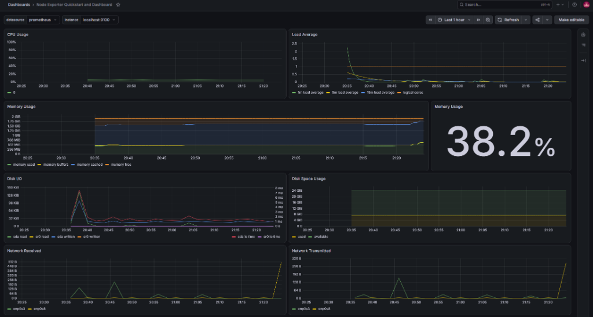

# 🏎️ Infrastructure Benchmarking & Production Dashboards (`infra-benchmarking`)

Комплекс нагрузочного тестирования сетевой и дисковой подсистем, процессора и оперативной памяти с визуализацией в расширенном дашборде Grafana.

---

## 🚀 Использование

```bash
./main.sh
```

Открывает меню управления тестами производительности:

```text
===== Test menu =====
1) Run test iperf3
2) Run stress-test CPU/RAM
3) Run storage stress test (fs-stress-fill)
4) Clear disk after storage test
5) Get link for utilities
0) Exit ^_^
```

### Тестирование сети через `iperf3`:
Пункт `1` запускает тест пропускной способности сети на 30 секунд в 4 параллельных потока:
```bash
iperf3 -c <target_ip> -p 5201 -t 30 -P 4
```
*(Для проверки внутри одного хоста можно предварительно запустить `iperf3 -s` в соседнем терминале).*

---

## ⚙️ Под капотом

* **Production Dashboard (`13978_rev2.json`):**  
  В каталог включен популярный промышленный дашборд *Node Exporter Full (ID 13978 / 1860)* с детализацией по IOPS диска, свитчам контекста процессора, системным прерываниям и сокетам TCP/UDP.

<p align="center">
  
</p>

* **Нагрузка на выносливость:**  
  * `stress` нагружает вычислительные ядра (`-c 1`) и выделяет виртуальную память в кольцевой буфер (`--vm-bytes 32M`), вызывая всплеск на графиках нагрузки CPU и потребления RAM.
  * Тест `fs-stress-fill` генерирует интенсивную дисковую активность (IOPS), что наглядно видно на панелях утилизации диска (Disk I/O time & read/write bandwidth).

