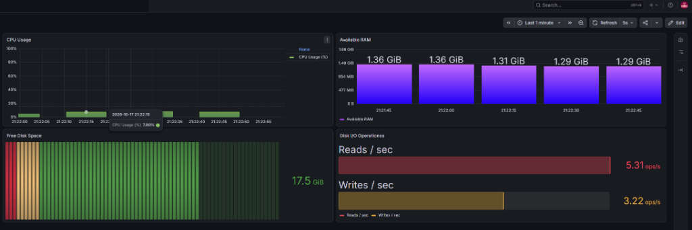

# 📈 Infrastructure Monitoring Stack (`infra-monitoring`)

Автоматизированное развёртывание, проверка и управление стеком мониторинга инфраструктуры на базе **Prometheus**, **Node Exporter** и **Grafana**.

---

## 🚀 Использование

```bash
./main.sh
```

После запуска скрипт проверяет статус системных служб и открывает интерактивное меню управления:

```text
===== Test management menu =====
1) Run stress-test CPU / RAM (stress)
2) Run storage stress test (fs-stress-fill)
3) Clear disk after storage test
4) Get link for utilities
5) Check services status
0) Exit ^_^
```

### Веб-интерфейсы:
* **Grafana:** `http://localhost:3000` (дефолтный логин/пароль: `admin` / `admin`).
* **Prometheus:** `http://localhost:9090` (сбор метрик со скрейп-интервалом 5с).
* **Node Exporter:** `http://localhost:9100/metrics` (системные метрики хоста).

---

## ⚙️ Под капотом

* **Архитектура сбора телеметрии:**  
  Node Exporter опрашивает структуры ядра Linux (`/proc`, `/sys`) и отдаёт метрики по HTTP. Prometheus периодически опрашивает (pull model) экспортер и сохраняет временные ряды (TSDB). Grafana визуализирует данные.
* **Кастомный дашборд (`dashboard.json`):**  
  В репозитории подготовлен готовый JSON-дашборд с 4 ключевыми физическими метриками сервера:
  1. **CPU Usage (%):** `100 - (avg by (instance) (rate(node_cpu_seconds_total{mode="idle"}[1m])) * 100)`
  2. **Available Memory (MB):** `node_memory_MemAvailable_bytes / 1024 / 1024`
  3. **Disk Free Space (GB):** `node_filesystem_free_bytes{mountpoint="/"} / 1024 / 1024 / 1024`
  4. **Network I/O (KB/s):** `rate(node_network_receive_bytes_total[1m]) / 1024`

<p align="center">
  
</p>

* **Интерактивные сценарии нагрузки:**  
  Прямо из консольного меню можно запустить `stress` на CPU и память или вызвать `fs-stress-fill`, чтобы в реальном времени наблюдать скачки графиков в Grafana.

